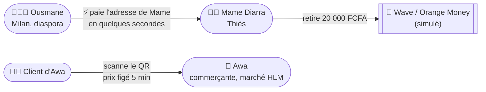
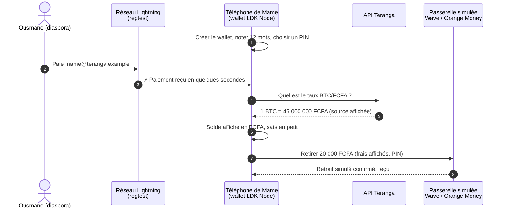
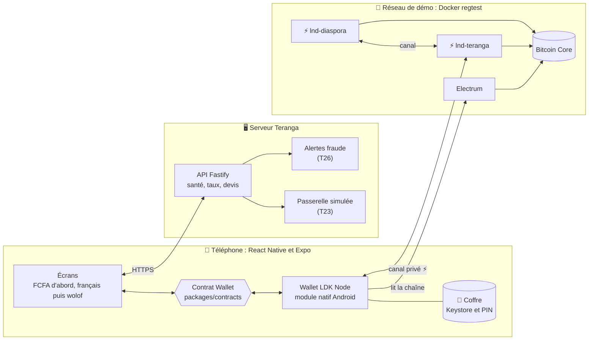
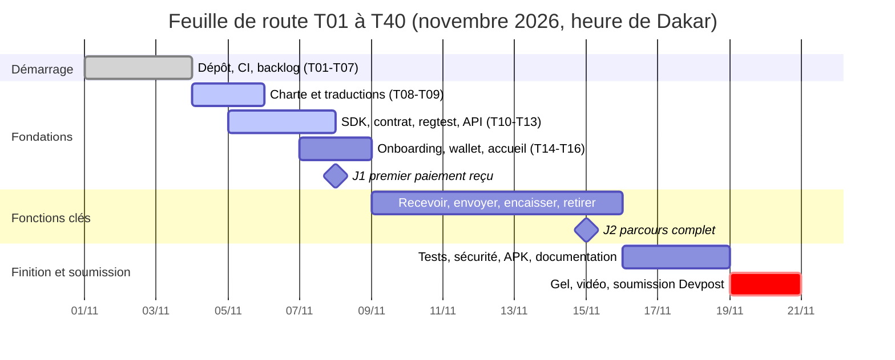
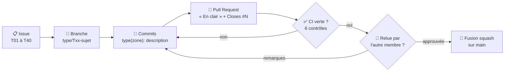

<p align="center">
  
</p>

<p align="center">
  <picture>
    <source media="(prefers-color-scheme: dark)" srcset="assets/brand/logos/logo-inverse.svg">
    
  </picture>
</p>

<p align="center">
  <strong>Portefeuille Bitcoin Lightning pour le Sénégal.</strong><br>
  Recevoir l'argent de la diaspora, payer et encaisser par QR, tout en <strong>FCFA d'abord</strong>.<br>
  Projet du hackathon <em>Dakar Bitcoin Trust</em>, novembre 2026.
</p>

<p align="center">
  <a href="#-le-projet-en-une-image">Le projet</a> ·
  <a href="#-parcours-de-démonstration">Démo</a> ·
  <a href="#️-architecture">Architecture</a> ·
  <a href="#-avancement">Avancement</a> ·
  <a href="#-démarrer">Démarrer</a> ·
  <a href="#️-organisation-du-dépôt">Dépôt</a> ·
  <a href="#-travailler-ensemble">Équipe</a>
</p>

> [!IMPORTANT]
> **Prototype de démonstration.** Tous les paiements passent par **regtest**, un réseau Bitcoin privé sans aucune valeur réelle. Les retraits Wave et Orange Money sont **simulés**. Les personnes et numéros des exemples sont fictifs.

---

## 🧭 Le projet en une image

Ousmane travaille à Milan et envoie de l'argent à sa mère, Mame Diarra, à Thiès. Aujourd'hui, il passe par un opérateur, avec des frais et un taux de change peu lisibles. Avec Teranga Pay, il paie directement l'adresse Lightning de Mame : l'argent arrive en quelques secondes, Mame voit le montant en FCFA et peut le retirer vers Wave ou Orange Money.



| Qui                   | Aujourd'hui                                          | Avec Teranga Pay                                                      |
| --------------------- | ---------------------------------------------------- | --------------------------------------------------------------------- |
| **Mame** reçoit       | Passage par un opérateur, frais et taux peu lisibles | Paiement direct sur son adresse Lightning, montant affiché en FCFA    |
| **Awa** encaisse      | Espèces ou transfert mobile money                    | QR en FCFA, prix figé cinq minutes, confirmation en quelques secondes |
| **Mame** veut du cash | Agent, frais de retrait                              | Choisit Wave ou Orange Money et voit les frais avant de confirmer     |

**Principe de confiance :** les clés du portefeuille restent **dans le téléphone**. Le serveur Teranga aide (taux, adresse Lightning, alertes), mais il **ne peut pas dépenser l'argent**. Si le serveur tombe, les paiements Lightning continuent.

## 🎬 Parcours de démonstration



Jalons du plan : **8 novembre**, premier paiement reçu en regtest ; **15 novembre**, parcours complet (recevoir, payer un marchand, retirer) ; **19 novembre à midi**, gel du code ; **20 novembre au matin**, soumission.

## 🏗️ Architecture



| Brique         | Technologie                                     | Rôle                                                     | État                                                                                                                      |
| -------------- | ----------------------------------------------- | -------------------------------------------------------- | ------------------------------------------------------------------------------------------------------------------------- |
| Application    | Expo 57, React Native, TypeScript               | Écrans, navigation, traductions, identité visuelle       | [apps/mobile](apps/mobile/README.md)                                                                                      |
| Identité       | SVG, tokens, polices libres                     | Direction « Le courant commun », marine et citron        | [assets/brand](assets/brand/README.md)                                                                                    |
| Wallet         | LDK Node 0.7 dans un module Expo Kotlin         | Clés, canaux, factures et paiements, dans le téléphone   | T15 en cours ; choix en revue ([#50](https://github.com/PapaAmad/teranga-pay/pull/50))                                    |
| Contrat        | TypeScript                                      | Interface commune écrans ↔ wallet, faux wallet de test   | en revue ([#53](https://github.com/PapaAmad/teranga-pay/pull/53))                                                         |
| API            | Node 24, Fastify 5                              | Santé, validation, limite de débit, taux BTC/FCFA, devis | en revue ([#48](https://github.com/PapaAmad/teranga-pay/pull/48), [#52](https://github.com/PapaAmad/teranga-pay/pull/52)) |
| Réseau de démo | Docker : Bitcoin Core 29.5, LND 0.21.6, electrs | Vrais paiements Lightning avec de la fausse monnaie      | en revue ([#49](https://github.com/PapaAmad/teranga-pay/pull/49))                                                         |

La [vue d'architecture détaillée](docs/architecture/vue-ensemble.md) décrit les frontières du système, le modèle de confiance et les règles sur les montants.

<details>
<summary><strong>📖 Petit lexique</strong></summary>

| Mot                  | En clair                                                                                            |
| -------------------- | --------------------------------------------------------------------------------------------------- |
| **Nœud**             | Un programme qui participe au réseau et garde sa copie des comptes.                                 |
| **Bitcoin Core**     | Le nœud officiel de Bitcoin : il tient le grand livre de toutes les transactions.                   |
| **Lightning**        | Une couche au-dessus de Bitcoin pour des paiements instantanés et presque gratuits.                 |
| **Canal**            | Un « compte commun » entre deux nœuds Lightning, ouvert une fois puis utilisé des milliers de fois. |
| **Electrum**         | Un guichet qui renseigne le téléphone sur la chaîne, sans qu'il télécharge tout le grand livre.     |
| **Regtest**          | Un réseau Bitcoin privé où l'on crée des blocs à la demande, avec de l'argent sans valeur.          |
| **sats**             | La plus petite unité du bitcoin : 1 BTC = 100 000 000 sats.                                         |
| **Facture (BOLT11)** | Une demande de paiement Lightning, souvent affichée en QR.                                          |

</details>

## 📊 Avancement



| Tâche   | Sujet                                     | Responsable | État                                                                                                                           |
| ------- | ----------------------------------------- | ----------- | ------------------------------------------------------------------------------------------------------------------------------ |
| T01–T06 | Dépôt, modèles, backlog, application Expo | PAN         | ✅ sur `main` ([#36](https://github.com/PapaAmad/teranga-pay/pull/36), [#37](https://github.com/PapaAmad/teranga-pay/pull/37)) |
| T07     | CI, hooks et contrôles du dépôt           | PAN         | 🔎 approuvée, à fusionner ([#38](https://github.com/PapaAmad/teranga-pay/pull/38))                                             |
| T08     | Identité visuelle et composants           | PAN         | 🔎 en revue ([#47](https://github.com/PapaAmad/teranga-pay/pull/47))                                                           |
| T10     | Choix du SDK Lightning : LDK Node         | Salam       | 🔎 en revue ([#50](https://github.com/PapaAmad/teranga-pay/pull/50)), essais natifs en cours                                   |
| T11     | Contrat écrans ↔ wallet et faux wallet    | Les deux    | 🔎 en revue ([#53](https://github.com/PapaAmad/teranga-pay/pull/53))                                                           |
| T12     | Réseau regtest Docker et seed de démo     | Salam       | 🔎 en revue ([#49](https://github.com/PapaAmad/teranga-pay/pull/49))                                                           |
| T13     | Squelette de l'API                        | Salam       | 🔎 en revue ([#48](https://github.com/PapaAmad/teranga-pay/pull/48))                                                           |
| T15     | Wallet LDK Node dans le téléphone         | Salam       | 🛠️ en cours                                                                                                                    |
| T17     | Taux BTC/FCFA et devis figés cinq minutes | Salam       | 🔎 en revue ([#52](https://github.com/PapaAmad/teranga-pay/pull/52))                                                           |

Ce tableau est daté du 7 novembre 2026. La liste complète, avec dates et responsables, est dans la [feuille de route](docs/planning/roadmap.md) ; le [tableau GitHub Projects](https://github.com/users/PapaAmad/projects/3) suit l'état de chaque issue.

## 🚀 Démarrer

**Prérequis :** Node.js 24 (fixé dans `.nvmrc`), npm 12 et Git. Pour le réseau de démo : Docker Desktop. Pour le wallet natif : JDK 17 et le SDK Android.

```sh
npm ci              # installe tout le monorepo
npm run mobile      # application Expo (Expo Go ou émulateur Android)
```

Le [guide de démarrage](docs/guides/demarrage.md) détaille l'installation pas à pas.

<details>
<summary><strong>🧪 Réseau Lightning de démonstration (après fusion de la #49)</strong></summary>

```sh
npm run regtest:up      # Bitcoin Core, Electrum et deux nœuds LND
npm run regtest:seed    # fonds de test, canal diaspora → teranga, paiement de vérification
npm run regtest:down    # arrête en gardant les données
npm run regtest:reset   # efface tout
```

Rien n'a de valeur : c'est un réseau privé. Détails dans le README `infrastructure` de la [#49](https://github.com/PapaAmad/teranga-pay/pull/49).

</details>

<details>
<summary><strong>🖥️ API Teranga (après fusion des #48 et #52)</strong></summary>

```sh
npm run api                                   # http://127.0.0.1:3000
curl http://127.0.0.1:3000/health             # {"status":"ok","service":"teranga-api"}
curl http://127.0.0.1:3000/v1/rate            # taux BTC/FCFA et sa source
```

</details>

<details>
<summary><strong>✅ Vérifier avant une PR</strong></summary>

```sh
npm run format:check
npm run lint
npm run typecheck
npm test -- --ci
npm run test:tooling
npm run repo:check
```

La CI GitHub reprend ces contrôles, vérifie le titre de la PR et cherche les secrets avec Gitleaks. Les résultats détaillés et leurs limites sont consignés dans le [rapport de validation](docs/guides/validation-du-socle.md).

</details>

## 🗂️ Organisation du dépôt

```text
teranga-pay/
├── apps/mobile/          📱 application Expo : écrans, navigation, traductions, composants
├── packages/contracts/   🤝 contrat commun écrans ↔ wallet (T11)
├── services/             🖥️ API Teranga, passerelle simulée et alertes
├── infrastructure/       🧪 réseau regtest Docker et seed de démonstration (T12)
├── assets/brand/         🎨 logos, icônes, polices, charte et motion
├── docs/                 📚 sources PDF, architecture, décisions, guides, planning
├── scripts/              🔧 contrôles du dépôt, outils GitHub et de marque
├── tests/e2e/            🧭 parcours mobiles Maestro (T30)
└── .github/              ⚙️ CI, modèles d'issue et de PR (voir GUIDE.md)
```

| Dossier                                               | Rôle                                            | Responsable              |
| ----------------------------------------------------- | ----------------------------------------------- | ------------------------ |
| [`apps/mobile/`](apps/mobile/README.md)               | Application, interface et intégration du wallet | PAN ; Salam (wallet)     |
| [`packages/contracts/`](packages/contracts/README.md) | Types et fonctions partagés                     | Les deux                 |
| [`services/`](services/README.md)                     | API, passerelle simulée, alertes                | Salam ; PAN (passerelle) |
| [`infrastructure/`](infrastructure/README.md)         | Bitcoin Core, Electrum et LND en regtest        | Salam                    |
| [`assets/`](assets/README.md)                         | Identité visuelle puis visuels de soumission    | PAN                      |
| [`docs/`](docs/README.md)                             | Conception, décisions, guides et suivi          | Les deux                 |
| [`scripts/`](scripts/README.md)                       | Vérifications et préparation GitHub             | PAN                      |
| [`tests/`](tests/README.md)                           | Parcours de bout en bout                        | PAN                      |
| [`.github/`](.github/GUIDE.md)                        | CI, modèles, propriétaires                      | PAN                      |

Chaque dossier maintenu a son propre README. Le dossier `.github` utilise `GUIDE.md` pour laisser GitHub afficher ce README à l'accueil.

## 🤝 Travailler ensemble



| Personne                                                                             | S'occupe de                                            |
| ------------------------------------------------------------------------------------ | ------------------------------------------------------ |
| **PAN**, Papa Amadou Niang ([@PapaAmad](https://github.com/PapaAmad))                | Dépôt, application, design, passerelle simulée         |
| **Salam**, Alioune Abdou Salam Kane ([@AliouneKane](https://github.com/AliouneKane)) | Lightning, wallet, API, sécurité, documentation finale |

Règles complètes : [CONTRIBUTING.md](CONTRIBUTING.md) et [AGENTS.md](AGENTS.md), partagées par Codex et Claude Code. Les choix techniques sont expliqués dans les [notes de décision](docs/decisions/README.md).

## 🔐 Sécurité et limites

- **Clés dans le téléphone :** la phrase de récupération reste dans le coffre sécurisé du téléphone ; le serveur ne la voit jamais (T15).
- **Aucune donnée personnelle dans les journaux** de l'API : ni adresse IP, ni numéro, ni contenu de requête (T13).
- **Aucun secret dans le dépôt :** fichiers `.env` ignorés, exemples neutres, Gitleaks dans la CI.
- **Limites assumées du prototype :** regtest uniquement, retraits simulés, aucun APK signé pour l'instant (T35), essais sur un vrai téléphone encore à faire.

Signaler une faille : voir [SECURITY.md](SECURITY.md).

---

<p align="center">
  <sub>Le dépôt <a href="https://github.com/PapaAmad/teranga-pay">PapaAmad/teranga-pay</a> est privé (<a href="docs/decisions/0002-visibilite-privee.md">décision 0002</a>). Code sous licence <a href="LICENSE">MIT</a>.<br>
  Fait à Dakar avec ⚡ par PAN et Salam.</sub>
</p>
