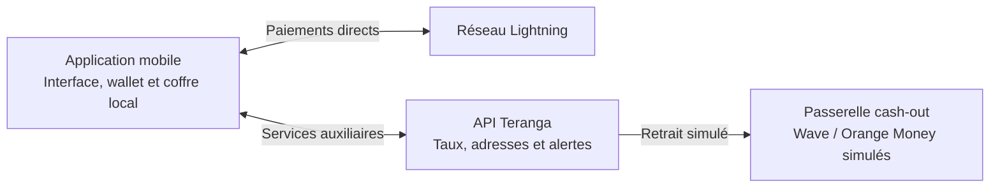

# Teranga Pay

Application mobile Bitcoin/Lightning pour recevoir, payer et encaisser avec des montants affichés d'abord en FCFA. Projet de Salam (**Alioune Abdou Salam Kane**, [@AliouneKane](https://github.com/AliouneKane)) et PAN (**Papa Amadou Niang**, [@PapaAmad](https://github.com/PapaAmad)), pour le hackathon Dakar Bitcoin Trust.

Le dépôt [PapaAmad/teranga-pay](https://github.com/PapaAmad/teranga-pay) est **privé**, conformément au choix de PAN du 2 novembre 2026. Le tableau GitHub Projects doit également rester privé. Le fichier de licence MIT est conservé ; l'accès GitHub reste limité aux personnes autorisées. Cette décision remplace la visibilité publique initialement prévue dans les PDF ; voir la [décision 0002](docs/decisions/0002-visibilite-privee.md).

Ce dépôt contient le **socle de travail jusqu'à T07** : application Expo navigable, outils communs, documentation, modèles GitHub, backlog et CI. Les fonctions de portefeuille, de paiement et de retrait seront réalisées dans les tâches suivantes. La démonstration visera regtest ; les retraits Wave et Orange Money seront simulés.

## Démarrer

Prérequis : **Node.js 24** (version fixée dans `.nvmrc`), **npm 12**, Git, puis Expo Go compatible SDK57 sur Android ou un émulateur Android. Le simulateur iOS nécessite macOS.

```sh
npm ci
npm run mobile
```

Scanner le QR Expo avec le téléphone sur le même réseau, ou lancer `npm run mobile:android`. L'application propose un accueil de préparation et une page de présentation. Aucun compte, secret ou serveur n'est nécessaire pour ce socle.

Expo et React Native utilisent les versions du template officiel SDK57, compatibles avec Expo Go à l'initialisation. Les dépendances résolues sont verrouillées dans `package-lock.json`. Voir les [instructions officielles Expo](https://docs.expo.dev/get-started/create-a-project/) et le [guide local](docs/guides/demarrage.md).

## Organisation

| Dossier                                               | Rôle                                                          | Responsable                        |
| ----------------------------------------------------- | ------------------------------------------------------------- | ---------------------------------- |
| [`apps/mobile/`](apps/mobile/README.md)               | Application Expo et navigation TypeScript                     | PAN ; Salam pour la logique wallet |
| [`services/`](services/README.md)                     | Emplacements pour l'API, la passerelle simulée et les alertes | Salam ; PAN pour `bridge-sim`      |
| [`packages/contracts/`](packages/contracts/README.md) | Emplacement des types et contrats communs à définir en T11    | Les deux                           |
| [`infrastructure/`](infrastructure/README.md)         | Préparation du réseau regtest et du jeu de démonstration T12  | Salam                              |
| [`tests/e2e/`](tests/e2e/README.md)                   | Futurs parcours mobiles Maestro T30                           | PAN                                |
| [`assets/`](assets/README.md)                         | Charte et visuels de soumission à produire                    | PAN                                |
| [`docs/`](docs/README.md)                             | Sources PDF, architecture, décisions, guides et suivi         | Les deux                           |
| [`.github/`](.github/GUIDE.md)                        | CI, modèles, propriétaires, labels et règles préparées        | PAN                                |
| [`scripts/`](scripts/README.md)                       | Vérifications du dépôt et préparation GitHub                  | PAN                                |
| [`.husky/`](.husky/README.md)                         | Vérifications avant commit                                    | PAN                                |

Chaque dossier maintenu contient un petit README. Le dossier réservé `.github` utilise [GUIDE.md](.github/GUIDE.md) pour laisser GitHub afficher ce README du projet à l'accueil. Les emplacements des futurs services contiennent uniquement leur documentation : ils ne démarrent aucun service. npm n'enregistre comme workspace que les dossiers possédant un `package.json`.

## Architecture cible



Ce schéma présente la cible après T07. Seuls les écrans de préparation et leur navigation sont disponibles aujourd'hui. Les clés doivent rester dans le coffre sécurisé du téléphone ; le choix du SDK Lightning appartient à T10. La [vue détaillée](docs/architecture/vue-ensemble.md) décrit les frontières du système et le futur réseau regtest.

Les schémas sont écrits en [Mermaid](https://docs.github.com/en/get-started/writing-on-github/working-with-advanced-formatting/creating-diagrams) dans le Markdown et rendus directement par GitHub. Ils restent modifiables comme le reste de la documentation.

## Vérifier le socle

```sh
npm run format:check
npm run lint
npm run typecheck
npm test -- --ci
npm run test:tooling
npm run repo:check
```

La CI reprend les contrôles de format, lint, types, tests, titre de PR et secrets. Husky et lint-staged vérifient les fichiers indexés ; commitlint contrôle les messages. Le ruleset de `main` prévu dans les fichiers n'est pas actif : GitHub refuse cette fonction pour ce dépôt privé avec l'offre actuelle. L'analyse native des secrets et la protection au push ne sont pas activées ; le contrôle Gitleaks de la CI est distinct. La règle d'équipe reste une PR verte et relue par l'autre membre.

L'installation par lockfile, les contrôles de code, les tests locaux et l'export Android ont été vérifiés. Les hooks ont contrôlé les fichiers indexés lors du premier commit. Après le déverrouillage du compte par le support GitHub, la [CI distante sur `main`](https://github.com/PapaAmad/teranga-pay/actions/runs/41490101961) est verte, y compris les tests et Gitleaks. Avant les correctifs de revue, les six contrôles ont aussi réussi [sur la PR #38](https://github.com/PapaAmad/teranga-pay/actions/runs/41497845298), avec vérification réelle de son titre. L'audit npm signale encore des alertes transitives dans l'outillage, dont deux élevées ; les résultats et les limites sont consignés dans le [rapport de validation](docs/guides/validation-du-socle.md).

La preuve CI citée pour la PR #38 couvre précisément le commit `e0124c184052d5529dc306f184bc764ef7ac0f8b`, avant les correctifs de revue. Elle ne valide pas les commits suivants. Pour la version courante, consulter les [contrôles de la PR #38](https://github.com/PapaAmad/teranga-pay/pull/38/checks) et vérifier leur SHA.

## Travail d'équipe et GitHub

Une tâche = une issue = une branche = une PR. Les commits et titres suivent `type(zone): description`, avec 72 caractères au maximum. La PR contient une explication « En clair », les vérifications et la référence à l'issue. Voir [CONTRIBUTING.md](CONTRIBUTING.md).

Le socle est livré sur `main` par la [PR #36](https://github.com/PapaAmad/teranga-pay/pull/36). PAN a autorisé cette première fusion squash comme [exception d’initialisation](docs/decisions/0003-initialisation-main.md), malgré le refus de démarrage de la CI distante et sans inventer une approbation de Salam. Les règles de relecture restent applicables aux tâches suivantes ; Salam dispose d'un accès en écriture au dépôt et au [Project privé #3](https://github.com/users/PapaAmad/projects/3). Le tableau contient 35 cartes : T06 et T07 en revue, les 33 autres à faire. Le champ natif `Status` porte les quatre états français ; les colonnes du [tableau](https://github.com/users/PapaAmad/projects/3/views/2) sont regroupées par ce champ, ce qui a été vérifié par l’API.

Squash seul, suppression des branches fusionnées, permissions Actions en lecture, Dependabot, 16 labels et 35 issues avec leurs affectations ont été vérifiés. Consulter le [relevé GitHub vérifié](docs/planning/publication-github.md) et le [suivi T01 à T07](docs/planning/suivi-t01-t07.md) pour les preuves et les points ouverts.

Le [guide du dépôt distant](docs/guides/depot-distant.md) est la procédure de référence pour publier et configurer ce dépôt privé. Les [scripts GitHub](scripts/github/README.md) préparent les réglages et le backlog ; leurs fichiers seuls ne prouvent pas qu'une opération distante a abouti.

Codex et Claude Code partagent [AGENTS.md](AGENTS.md) via [CLAUDE.md](CLAUDE.md). Les choix techniques sont consignés dans [docs/decisions](docs/decisions/README.md).

## Suite du projet

T08 et T09 apportent la charte et les traductions. T10 valide le SDK Lightning ; T11 fixe le contrat entre les écrans et la logique. Le réseau de démonstration arrive en T12, l'API en T13 et les premiers parcours wallet en T14 à T16. Consulter la [roadmap](docs/planning/roadmap.md) et la [vue d'architecture](docs/architecture/vue-ensemble.md).

Les jalons du plan sont le 8 novembre 2026 pour le premier paiement de test, le 15 pour le parcours complet, le 19 à midi pour le gel du code et le 20 au matin pour la soumission. L'heure officielle de clôture reste à vérifier par l'équipe.

Les clés du wallet doivent rester dans le coffre sécurisé du téléphone. Le SDK et les compromis éventuels ne sont pas encore décidés ; le repli LND côté serveur devra expliquer la garde des clés. Voir [SECURITY.md](SECURITY.md). Le socle n'a pas encore été validé sur un téléphone physique et aucun APK signé n'est fourni à ce stade.

Licence [MIT](LICENSE).
