<p align="center">
  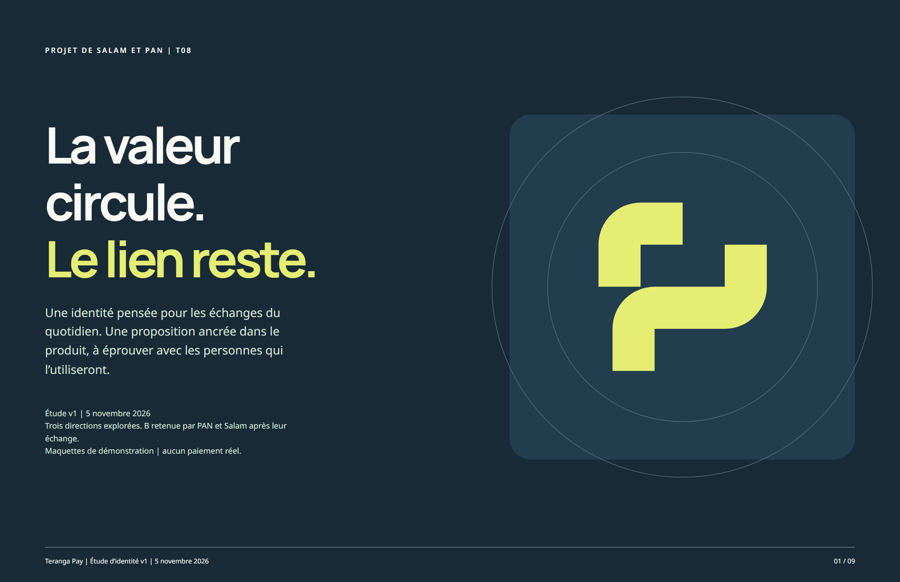
</p>

<h1 align="center">Teranga Pay</h1>

<p align="center">
  <b>Recevoir, payer et encaisser en Bitcoin Lightning, avec des montants affichés d'abord en FCFA.</b><br>
  Projet de Salam (<a href="https://github.com/AliouneKane">@AliouneKane</a>) et PAN (<a href="https://github.com/PapaAmad">@PapaAmad</a>) pour le hackathon Dakar Bitcoin Trust.
</p>

> **Démonstration uniquement.** Les écrans, le wallet natif, l’API et la passerelle simulée sont raccordés ([#120](https://github.com/PapaAmad/teranga-pay/issues/120)). Le réseau est regtest (bitcoins de test sans valeur) ; les retraits Wave et Orange Money sont **simulés**.

## 📲 Essayer l'application (jurys)

<p align="center">
  <a href="https://github.com/PapaAmad/teranga-pay/releases/download/v0.9.0-demo/teranga-pay-v0.9.0-demo.apk"><b>⬇️ Télécharger l'APK Android de démonstration</b></a>
  <br>
  <sub>Android 7 ou plus récent, téléphone 64 bits (ARM64). Toutes les versions : <a href="https://github.com/PapaAmad/teranga-pay/releases">page des Releases</a>.</sub>
</p>

### Installer (2 minutes)

1. Sur un téléphone Android, ouvrir le lien ci-dessus et télécharger le fichier `.apk` (environ 50 Mo).
2. Ouvrir le fichier téléchargé. Si Android le demande, autoriser l'installation depuis le navigateur : c'est normal pour une application hors Play Store.
3. Ouvrir **Teranga Pay**.

### Parcours conseillé (5 minutes)

Tout est **fictif** : un bandeau jaune « Aperçu fictif | aucun paiement réel » le rappelle sur chaque écran. Pour le code, inventez 6 chiffres (par exemple `482615`).

| Étape                     | Où toucher                                                                                                                                  | Ce que vous voyez                                                     |
| ------------------------- | ------------------------------------------------------------------------------------------------------------------------------------------- | --------------------------------------------------------------------- |
| 1. Créer un portefeuille  | **Essayer le parcours fictif**, puis **Créer mon portefeuille**                                                                             | Choix de la langue, code à 6 chiffres saisi deux fois                 |
| 2. Sauvegarder            | **Créer et voir mes mots**, puis **J'ai noté mes douze mots**                                                                               | 12 mots d'exemple, puis un petit test : retrouver 3 mots de la liste  |
| 3. Ouvrir l'accueil       | **Quitter l'aperçu**, **Découvrir le projet**, puis **Essayer l'accueil fictif**                                                            | Solde affiché d'abord en FCFA (45 000 FCFA), puis en sats             |
| 4. Recevoir               | **Recevoir**                                                                                                                                | QR code et adresse Lightning de type e-mail                           |
| 5. Envoyer                | **Envoyer**, **Utiliser la demande fictive**, **Confirmer le destinataire**, saisir le code sous le récapitulatif, puis **Simuler l'envoi** | Montant, frais maximum et total en FCFA, puis « Simulation terminée » |
| 6. Encaisser (commerçant) | **Encaisser**, saisir un prix (ex. 2500), **Continuer**, **Afficher le QR**, puis **Simuler le règlement**                                  | QR à faire scanner au client, prix figé 5 minutes, reçu de la vente   |
| 7. Retirer en cash        | **Retirer en cash**, choisir **Wave** ou **Orange Money**, un montant, **Voir les frais**, puis **Confirmer le retrait simulé**             | Frais affichés avant d'accepter, retrait **simulé** terminé           |
| 8. Historique             | **Tout voir**                                                                                                                               | Opérations passées et leurs reçus                                     |

**Astuce :** sous chaque écran, la rubrique « Atelier | situations fictives » montre les cas difficiles en un toucher : hors connexion, paiement échoué ou en attente, solde insuffisant, alerte avant un envoi inhabituel…

> **Ce que montre cet APK.** Il fonctionne sans serveur : chaque écran affiche « Aperçu fictif | aucun paiement réel », et aucun argent ne circule. Le vrai wallet Lightning a besoin du réseau regtest de l'équipe, qui n'est pas exposé sur Internet ; ses paiements réels sur émulateur sont décrits dans le [guide de démonstration Lightning](docs/guides/demo-lightning.md). La somme de contrôle SHA-256 accompagne l'APK sur la page de la Release.

## L'application en images

|                                         Bienvenue                                          |                                                Accueil                                                |                                                 Recevoir                                                  |                                        Envoyer                                        |
| :----------------------------------------------------------------------------------------: | :---------------------------------------------------------------------------------------------------: | :-------------------------------------------------------------------------------------------------------: | :-----------------------------------------------------------------------------------: |
| 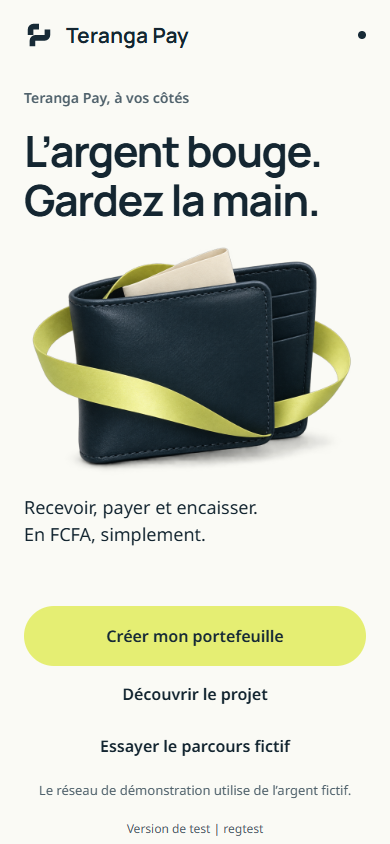 | 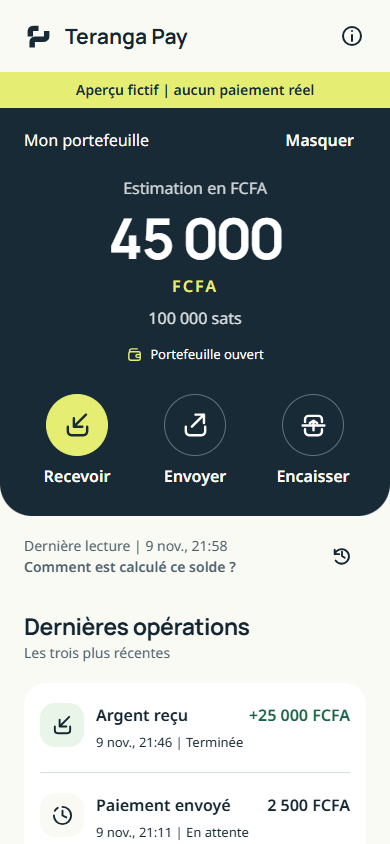 | 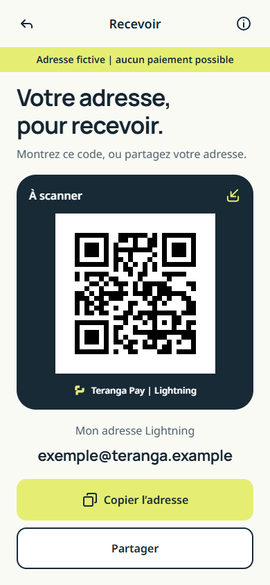 | 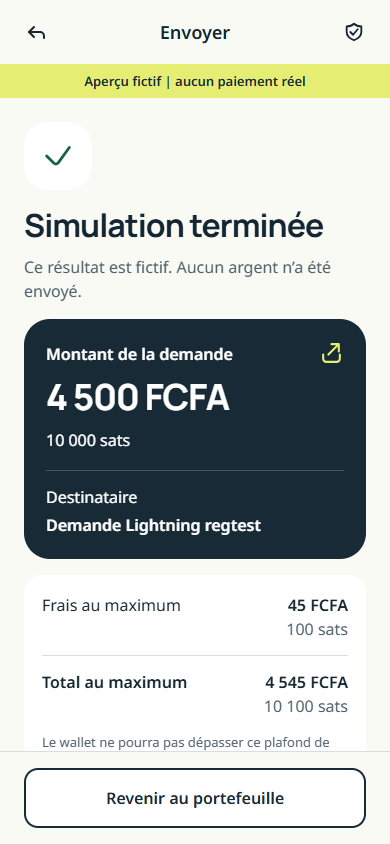 |
|                              Langue et sauvegarde des 12 mots                              |                                  Solde en FCFA, actions principales                                   |                                       QR code et adresse Lightning                                        |                       Scanner, vérifier, confirmer avec le code                       |

|                                      Encaisser                                       |                                   Historique et reçus                                   |                                           Alerte avant envoi                                            |                                             Retirer en cash                                              |
| :----------------------------------------------------------------------------------: | :-------------------------------------------------------------------------------------: | :-----------------------------------------------------------------------------------------------------: | :------------------------------------------------------------------------------------------------------: |
| 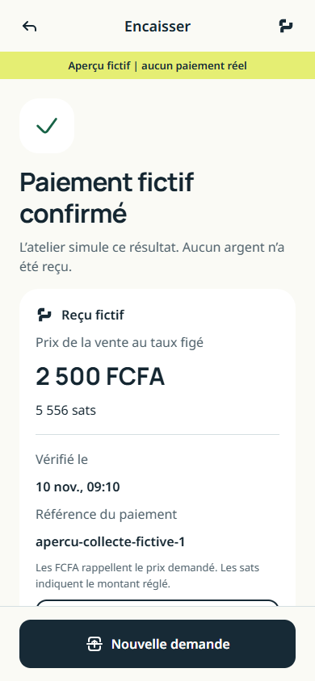 | 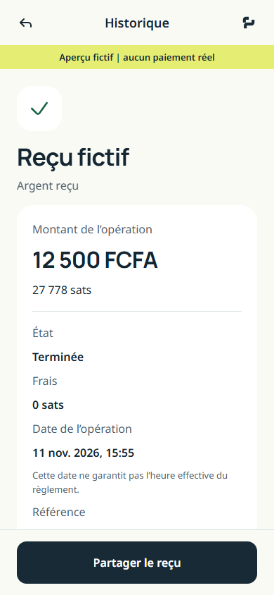 | 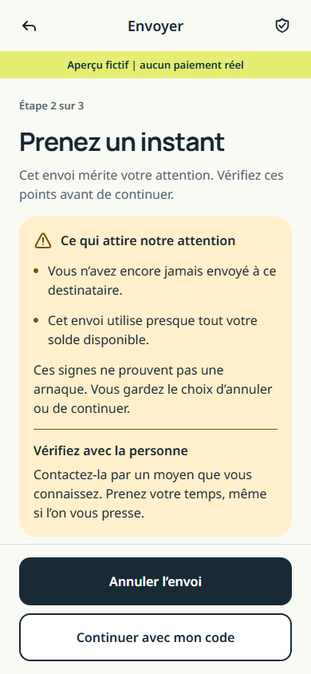 | 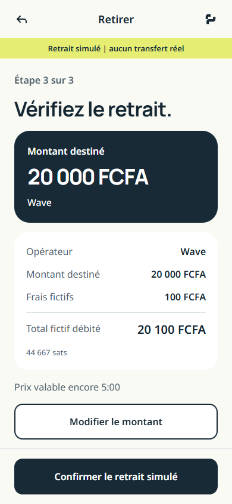 |
|                             Prix en FCFA figé 5 minutes                              |                               Opérations, filtres, reçus                                |                                 Signes inhabituels expliqués simplement                                 |                                    Vers Wave ou Orange Money (simulé)                                    |

Les captures présentent les ateliers fictifs validés visuellement par PAN. Elles ne prouvent pas un paiement natif. Toutes les captures, état par état, sont dans les [galeries de validation](docs/design/README.md).

## L'idée en 30 secondes

Ousmane vit à Milan. Il veut envoyer 25 000 FCFA à sa sœur Mame Diarra, à Dakar. Un transfert classique coûte cher et prend du temps. Le parcours cible de Teranga Pay :

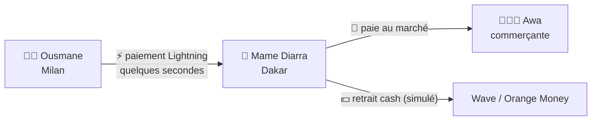

1. **Recevoir** : Mame Diarra montre un QR code ou donne son adresse `mame@teranga.example`.
2. **Voir en FCFA** : l'application convertit les « sats » (la plus petite unité du bitcoin) en FCFA, au taux affiché avec sa source.
3. **Payer ou encaisser** : elle paie Awa en scannant un QR. Awa peut aussi créer une demande au prix fixé en FCFA.
4. **Retirer** : elle convertit vers Wave ou Orange Money (simulé pour la démo).

**L’architecture vise des clés gardées dans le téléphone.** Le module natif et les contrats sont présents ; le [raccordement natif #120](https://github.com/PapaAmad/teranga-pay/issues/120) des écrans et les essais de sauvegarde restent à confirmer. Le serveur ne reçoit pas les clés du wallet.

## Comment le projet est construit

Le schéma décrit l’architecture visée. Les composants sont présents ; les flèches entre les écrans, le wallet et l’API nécessitent encore la composition suivie dans #120.

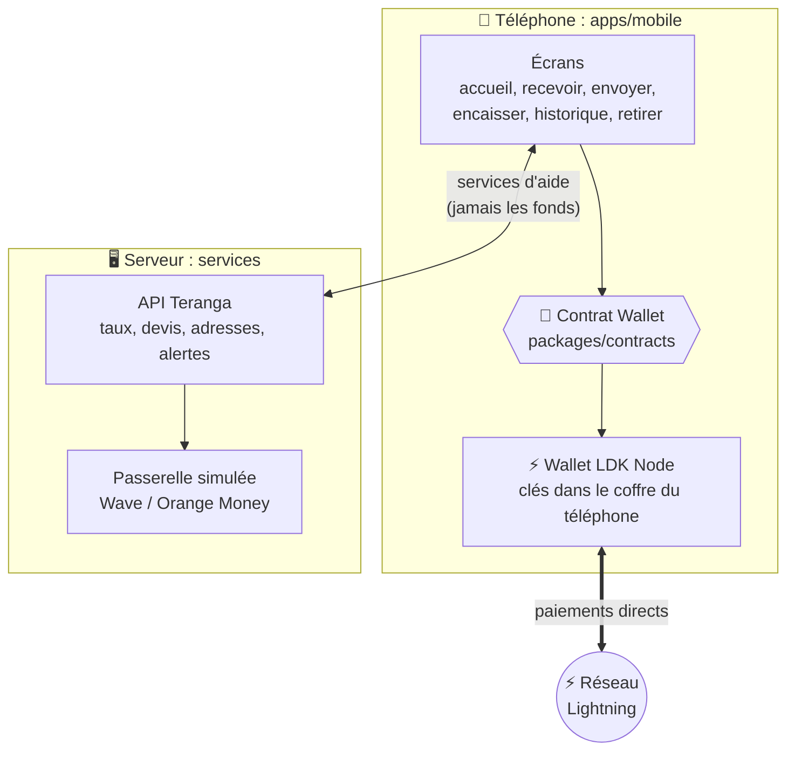

| Dossier                                                  | Ce qu'on y trouve                                                                   | Responsable                  |
| -------------------------------------------------------- | ----------------------------------------------------------------------------------- | ---------------------------- |
| 📱 [`apps/mobile/`](apps/mobile/README.md)               | L'application Android (React Native + Expo) : écrans et wallet                      | PAN (écrans), Salam (wallet) |
| 🤝 [`packages/contracts/`](packages/contracts/README.md) | Le « contrat » entre les écrans et le wallet, plus un faux wallet pour les tests    | Les deux                     |
| 🖥️ [`services/`](services/README.md)                     | L'API (taux, devis, adresse Lightning, alertes) et la passerelle de retrait simulée | Salam, PAN                   |
| 🧪 [`infrastructure/`](infrastructure/README.md)         | Le réseau Bitcoin et Lightning de test, lancé avec Docker                           | Salam                        |
| 🎨 [`assets/`](assets/README.md)                         | Logo, icônes, couleurs, polices, illustrations                                      | PAN                          |
| 📚 [`docs/`](docs/README.md)                             | Architecture, décisions, guides, design, planning                                   | Les deux                     |
| ✅ [`tests/`](tests/README.md)                           | Parcours de bout en bout sur Android (Maestro)                                      | PAN                          |
| 🛠️ [`scripts/`](scripts/README.md)                       | Vérifications du dépôt, préparation GitHub, release de l'APK                        | PAN, Salam                   |
| ⚙️ [`.github/`](.github/GUIDE.md)                        | CI, modèles d'issues et de PR                                                       | PAN                          |

Chaque dossier a son propre README, qui explique à quoi il sert et comment il fonctionne.

## Démarrer

Il faut **Node.js 24** (voir `.nvmrc`), **npm**, Git, et un téléphone Android ou un émulateur.

```sh
npm ci            # installe les dépendances
npm run mobile    # ouvre les écrans ; le module wallet exige un build Android natif
npm run api       # dans un autre terminal : l'API sur http://127.0.0.1:3000
```

Le réseau Lightning local peut être préparé séparément avec Docker. Le démarrer ne raccorde pas automatiquement les écrans :

```sh
npm run regtest:up     # démarre Bitcoin et deux nœuds Lightning
npm run regtest:seed   # fonds de test, canal et paiement de vérification
```

Le [guide de la démonstration Lightning](docs/guides/demo-lightning.md) rapporte l’essai WalletLab de Salam du 11 novembre ; il ne constitue pas une nouvelle validation de l’arbre consolidé. Pour débuter sur le projet, lire le [guide de démarrage](docs/guides/demarrage.md).

## Petit lexique

| Mot                   | En clair                                                                                           |
| --------------------- | -------------------------------------------------------------------------------------------------- |
| **Lightning**         | Un réseau construit au-dessus de Bitcoin pour des paiements instantanés et presque gratuits.       |
| **sat**               | La plus petite unité du bitcoin : 1 BTC = 100 000 000 sats.                                        |
| **Facture**           | Une demande de paiement d'un montant précis, souvent montrée en QR code.                           |
| **Adresse Lightning** | Une adresse lisible comme `mame@teranga.example`, qui remplace la facture.                         |
| **Canal**             | Un « tuyau » de paiement entre deux nœuds Lightning.                                               |
| **Nœud**              | Un programme qui envoie et reçoit des paiements Lightning. Ici, il tourne dans le téléphone.       |
| **regtest**           | Un réseau Bitcoin privé de test : les blocs sont créés à la demande et l'argent n'a pas de valeur. |
| **Non custodial**     | Personne d'autre que l'utilisateur ne détient ses fonds ni ses clés.                               |

## Vérifier le code

```sh
npm run format:check && npm run lint && npm run typecheck
npm test -- --ci
npm run test:tooling
npm run repo:check
```

La CI GitHub relance les contrôles de qualité et la recherche de secrets. Le workflow T29 de paiement regtest et le workflow Maestro sont présents et distincts : leur résultat doit être vérifié sur le SHA concerné. Les fixtures Maestro ne prouvent pas un paiement Lightning ni le raccordement natif des écrans.

## Travailler à deux

La [décision 0023](docs/decisions/0023-consolidation-des-bases.md) consigne l’autorisation de PAN du 17 novembre et les suivis qui restent ouverts.

Une tâche = une issue = une branche = une PR, relue par l'autre membre, avec une CI verte avant la fusion. Les messages suivent `type(zone): description`. Tout est dans [CONTRIBUTING.md](CONTRIBUTING.md) et [AGENTS.md](AGENTS.md). Les choix techniques sont expliqués dans les [décisions](docs/decisions/README.md), et le suivi des tâches T01 à T40 dans la [roadmap](docs/planning/roadmap.md).

**Sécurité** : voir [SECURITY.md](SECURITY.md). Le dépôt est privé ([décision 0002](docs/decisions/0002-visibilite-privee.md)). Licence [MIT](LICENSE).
