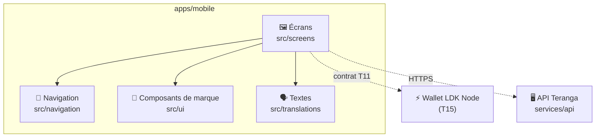

# 📱 Applications

`mobile/` contient l'application React Native et Expo de Teranga Pay, initialisée en T06 et portée par PAN. Salam y branche la logique du wallet.

Depuis la racine : `npm run mobile` ou `npm run mobile:android`. Le détail est dans le [README de l'application](mobile/README.md).

L'application est séparée des services pour que chacun avance sans déplacer le travail de l'autre. Aucune application web n'est prévue.
