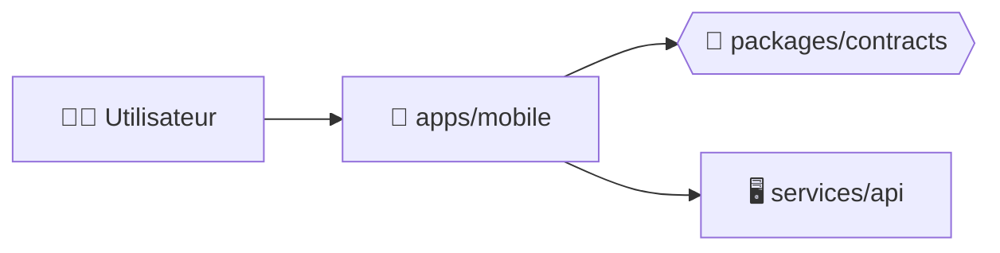

# 📦 Applications

Les applications que l'utilisateur installe. Il n'y en a qu'une pour l'instant.

| Dossier                       | Ce que c'est                                                                         |
| ----------------------------- | ------------------------------------------------------------------------------------ |
| [📱 mobile](mobile/README.md) | L'application Android Teranga Pay (React Native + Expo) : écrans et wallet Lightning |

Le code partagé entre l'application et le serveur vit dans [`packages`](../packages/README.md). Le serveur vit dans [`services`](../services/README.md).
