# 📱 Application mobile

> L’application Android de Teranga Pay prépare les parcours de réception, d’envoi et d’encaissement, avec les montants en FCFA d’abord. Les bases sont consolidées ; le [raccordement natif #120](https://github.com/PapaAmad/teranga-pay/issues/120) des ports UI au wallet et à l’API reste ouvert.

Projet de Salam et PAN. PAN porte les écrans. Salam porte le wallet (le « porte-monnaie » qui garde les clés et fait les paiements).

<p align="center">
  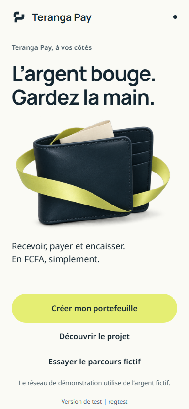
  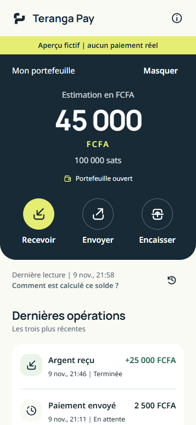
  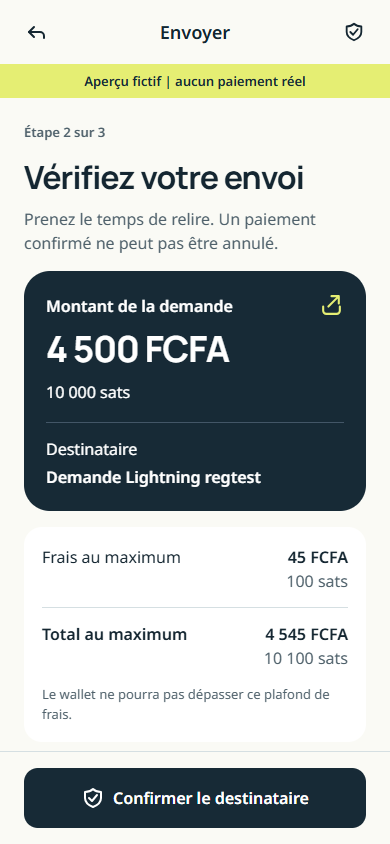
  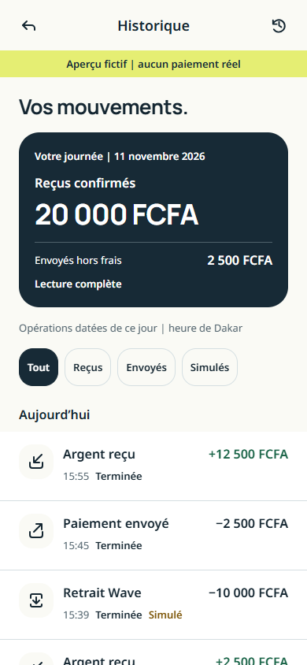
</p>

## Les écrans, un par un

| Écran                          | À quoi il sert                                                                           |                                     Aperçu                                      | Code                                           |
| ------------------------------ | ---------------------------------------------------------------------------------------- | :-----------------------------------------------------------------------------: | ---------------------------------------------- |
| **Bienvenue** (T14)            | Choisir sa langue, créer son code à 6 chiffres, noter et vérifier ses 12 mots de secours |      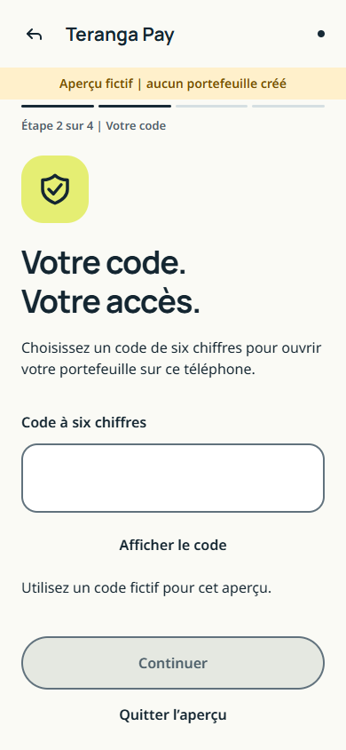       | [`src/onboarding`](src/onboarding/README.md)   |
| **Accueil** (T16)              | Voir son solde en FCFA (et en sats), ses dernières opérations, et les 3 actions          |   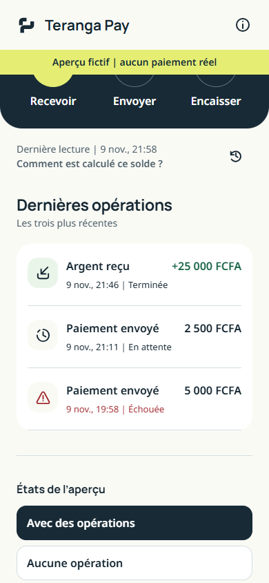    | [`src/home`](src/home/README.md)               |
| **Recevoir** (T18)             | Montrer un QR code ou son adresse Lightning, la copier, la partager                      |    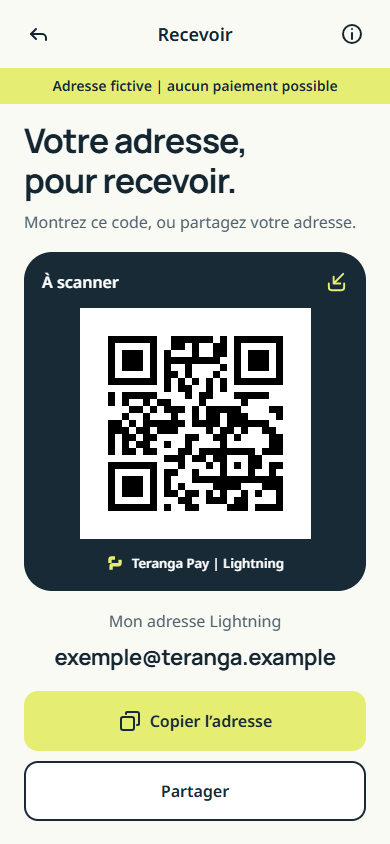     | [`src/receive`](src/receive/README.md)         |
| **Envoyer** (T20)              | Scanner ou coller une demande, vérifier le montant et les frais, confirmer avec son code |     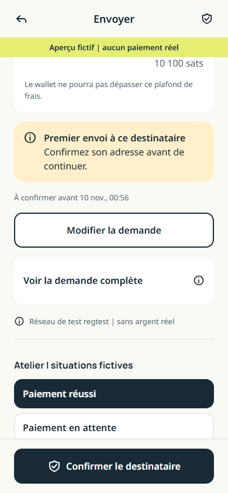     | [`src/send`](src/send/README.md)               |
| **Encaisser** (T22)            | Pour un commerçant : saisir un prix en FCFA, afficher le QR, voir la vente payée         |  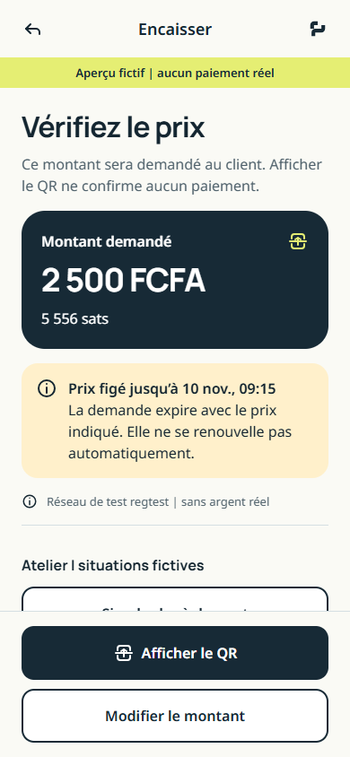   | [`src/collect`](src/collect/README.md)         |
| **Historique** (T24)           | Toutes les opérations, filtres, reçus à partager, total du jour                          |      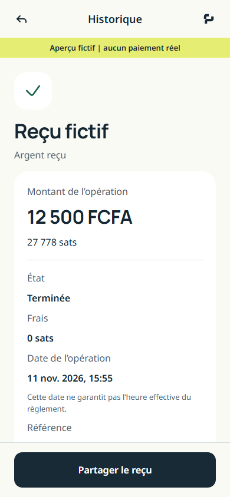       | [`src/history`](src/history/README.md)         |
| **Retirer en cash** (T25)      | Convertir vers Wave ou Orange Money (**simulé**)                                         |   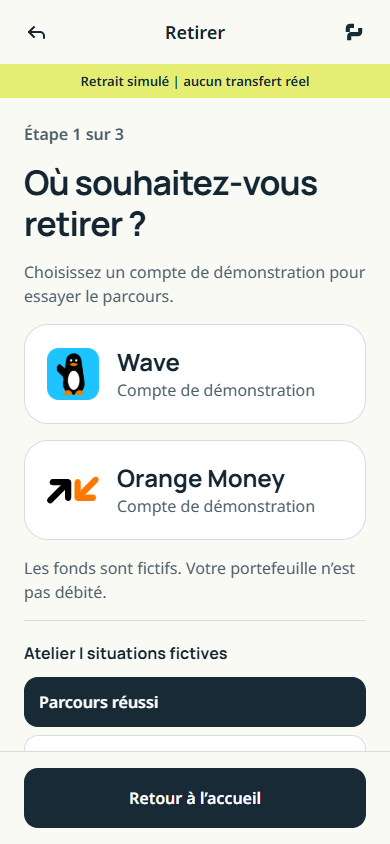    | [`src/withdraw`](src/withdraw/README.md)       |
| **Alerte** (T27)               | Avant un envoi inhabituel, expliquer simplement pourquoi être prudent                    |     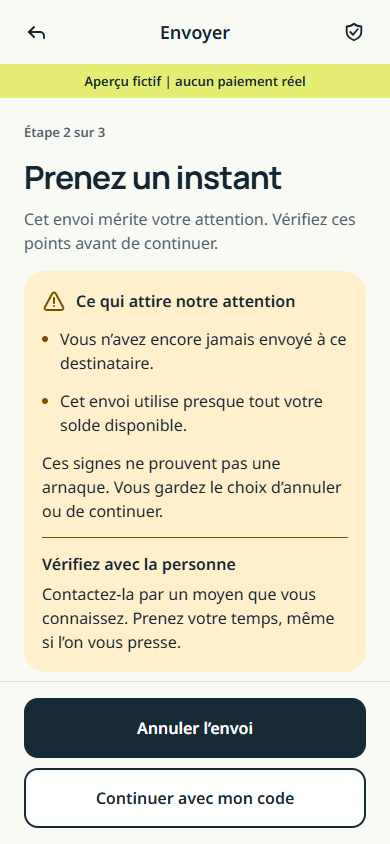      | [`src/risk`](src/risk/README.md)               |
| **Attentes et reprises** (T28) | Réseau lent, coupure, réponse en retard : toujours dire ce qui se passe                  | 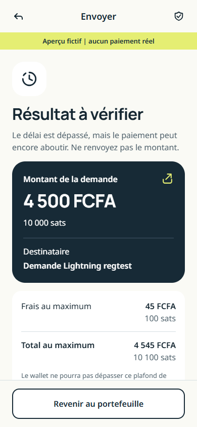 | [`src/reliability`](src/reliability/README.md) |

Chaque écran a une galerie complète de captures (tous les états, petits écrans compris) dans [`docs/design`](../../docs/design/README.md).

## Comment c'est organisé

Les écrans ne parlent jamais directement au réseau Lightning. Ils passent par un **contrat** commun : une liste de fonctions (`balance`, `receive`, `send`…) avec des réponses toujours prévues. Les contrats communs et les ports propres à chaque écran préparent cet échange. Les ateliers utilisent des fournisseurs fictifs ; les adaptateurs et leur composition avec le wallet natif restent suivis dans le [raccordement natif #120](https://github.com/PapaAmad/teranga-pay/issues/120). Le schéma décrit cette architecture visée.

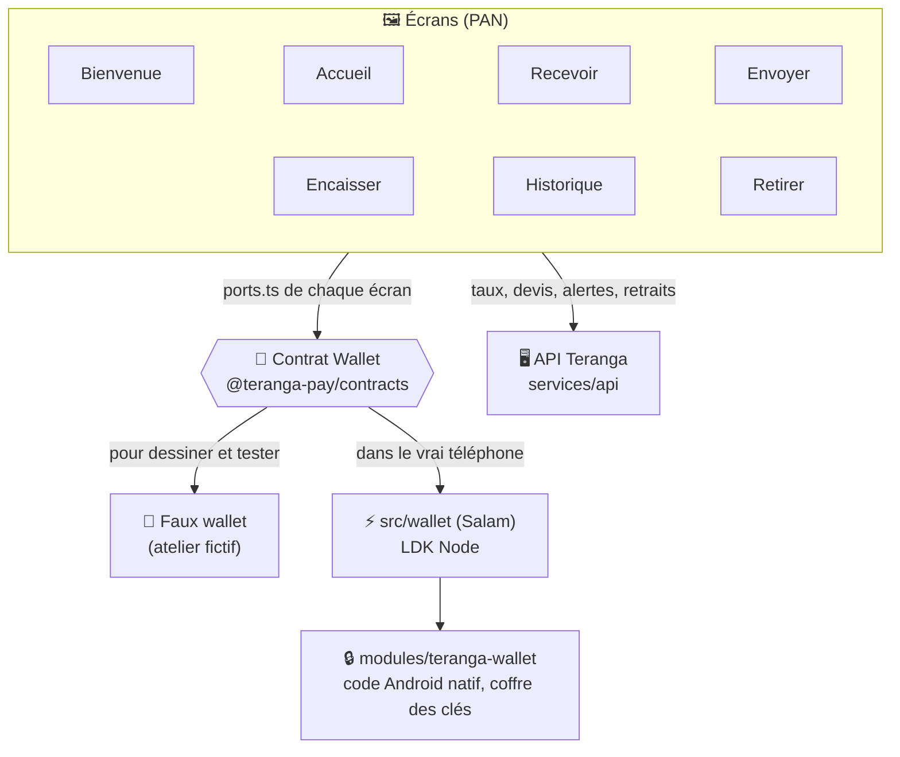

Chaque écran suit le même découpage :

| Fichier         | Rôle                                                                         |
| --------------- | ---------------------------------------------------------------------------- |
| `XxxScreen.tsx` | Ce qu'on voit : mise en page, textes, boutons                                |
| `controller.ts` | La logique de l'écran : étapes, attentes, erreurs, sans affichage            |
| `ports.ts`      | La « prise » vers l'extérieur (wallet, API) : ce dont l'écran a besoin       |
| `preview.ts`    | Les données fictives de l'**atelier**, pour essayer l'écran sans vrai argent |

## Ce qu'il y a dans `src/`

| Dossier                                                                                          | Contenu                                                                  |
| ------------------------------------------------------------------------------------------------ | ------------------------------------------------------------------------ |
| [`ui`](src/ui/README.md)                                                                         | Boutons, cartes, champs, icônes, couleurs et polices de la charte        |
| [`translations`](src/translations/README.md)                                                     | Tous les textes de l'application (français ; wolof en préparation)       |
| [`navigation`](src/navigation/README.md)                                                         | Le passage d'un écran à l'autre                                          |
| [`screens`](src/screens/README.md)                                                               | Écrans simples : « À propos », galerie de la charte                      |
| `wallet`                                                                                         | Le wallet LDK Node, le journal du téléphone, l'adresse Lightning (Salam) |
| `onboarding`, `home`, `receive`, `send`, `collect`, `history`, `withdraw`, `risk`, `reliability` | Les écrans du tableau plus haut                                          |

## Essayer l'application

Depuis la racine du dépôt :

```sh
npm ci
npm run mobile                      # puis scanner le QR avec Expo Go (SDK 58)
npm run mobile:web -- --port 8092   # ou dans le navigateur : http://localhost:8092
```

- L’entrée normale annonce les fournisseurs absents et s’arrête avant une création native non raccordée. Les ateliers fictifs sont accessibles par des actions explicites en développement ; leur bandeau indique « Aperçu fictif | aucun paiement réel ».
- Le module wallet a besoin d’un build de développement Android et du réseau de test. Le [guide Lightning](../../docs/guides/demo-lightning.md) décrit l’essai WalletLab historique de Salam ; il ne prouve pas que les écrans métier sont raccordés.
- Le Web sert à regarder les écrans. Il ne prouve ni les protections Android (captures bloquées pendant les 12 mots), ni le clavier, ni un vrai paiement.

## Vérifier

```sh
npm run typecheck --workspace @teranga-pay/mobile
npm test --workspace @teranga-pay/mobile -- --ci
```

Les parcours Maestro sur fixtures explicites sont décrits dans [`tests/e2e`](../../tests/e2e/README.md) et le [guide Maestro](../../docs/guides/tests-maestro.md).

## Versions

Expo SDK 58, React 19.3, React Native 0.88, navigation React Navigation 7, textes avec i18next. Caméra (`expo-camera`) sans micro, QR avec `qrcode-generator`.

## Pour aller plus loin

| Tâche          | Recherche et choix                                                                 | Suivi et preuves                          |
| -------------- | ---------------------------------------------------------------------------------- | ----------------------------------------- |
| T14 Bienvenue  | [décision 0012](../../docs/decisions/0012-onboarding-protection-et-integration.md) | [suivi](../../docs/planning/suivi-t14.md) |
| T16 Accueil    | [décision 0013](../../docs/decisions/0013-accueil-lecture-wallet.md)               | [suivi](../../docs/planning/suivi-t16.md) |
| T18 Recevoir   | [décision 0014](../../docs/decisions/0014-recevoir-adresse-et-qr.md)               | [suivi](../../docs/planning/suivi-t18.md) |
| T20 Envoyer    | [décision 0015](../../docs/decisions/0015-envoyer-confirmation-et-session.md)      | [suivi](../../docs/planning/suivi-t20.md) |
| T22 Encaisser  | [décision 0016](../../docs/decisions/0016-encaisser-demande-et-recu.md)            | [suivi](../../docs/planning/suivi-t22.md) |
| T24 Historique | [décision 0018](../../docs/decisions/0018-historique-et-totaux.md)                 | [suivi](../../docs/planning/suivi-t24.md) |
| T25 Retirer    | [décision 0019](../../docs/decisions/0019-retrait-simule-et-reprise.md)            | [suivi](../../docs/planning/suivi-t25.md) |
| T27 Alerte     | [décision 0020](../../docs/decisions/0020-alerte-et-consentement.md)               | [suivi](../../docs/planning/suivi-t27.md) |
| T28 Attentes   | [décision 0021](../../docs/decisions/0021-attentes-et-reprises.md)                 | [suivi](../../docs/planning/suivi-t28.md) |
| T30 Maestro    | [décision 0022](../../docs/decisions/0022-maestro-et-preuve-native.md)             | [suivi](../../docs/planning/suivi-t30.md) |
