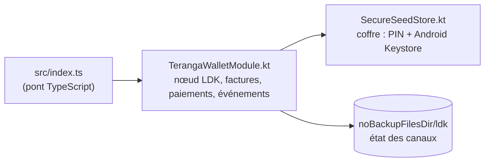

# 🤖 Code Android du module wallet

Le code Kotlin qui fait tourner le nœud Lightning **LDK Node** dans le téléphone et garde la phrase de récupération dans un coffre chiffré.

| Fichier | Rôle |
| --- | --- |
| `build.gradle` | Dépendances Android, dont LDK Node 0.7.0 |
| `consumer-rules.pro` | Règles R8 de l'APK release : garde JNA et LDK Node, lus par réflexion |
| `src/main/java/expo/modules/terangawallet/TerangaWalletModule.kt` | Création, déverrouillage, solde, factures, paiements, événements |
| `src/main/java/expo/modules/terangawallet/SecureSeedStore.kt` | Chiffrement de la phrase (AES-256-GCM, PIN + Keystore), blocage après 5 PIN faux |
| `src/main/java/expo/modules/terangawallet/IntegrationCipher.kt` | Enveloppe AES-GCM liée au coffre et à l'usage, vérifiable sur JVM |
| `src/main/java/expo/modules/terangawallet/SecureIntegrationStore.kt` | Secrets et import DEV chiffrés, atomiques et exclus des sauvegardes |

Le chemin `src/main/java/expo/modules/terangawallet` est imposé par Android et Expo (un dossier par partie du nom du paquet). Voir le [README du module](../README.md).
