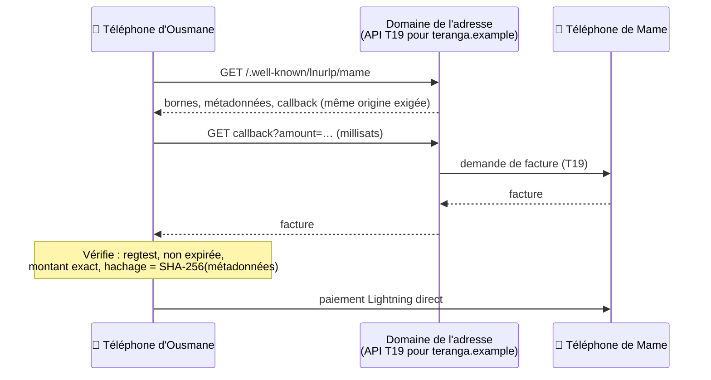

# Logique wallet (T15)

- `ldkWallet.ts` : `createLdkWallet(native, settings)` implémente le contrat `Wallet` de `@teranga-pay/contracts` au-dessus du module natif [teranga-wallet](../../modules/teranga-wallet/README.md) (LDK Node). Les erreurs du natif deviennent des codes du contrat ; aucune exception n'atteint les écrans.
- `useSecureScreen.ts` : `useSecureScreen(nativeWallet, phraseVisible)` bloque les captures d'écran tant que la phrase secrète est affichée, puis les rétablit. À utiliser dans l'onboarding (T14) sur chaque écran qui montre ou demande la phrase.
- `journal.ts` : petit journal JSON gardé par le natif dans `noBackupFilesDir` (écriture atomique). Il retient ce que LDK Node ne garde pas : la valeur FCFA de chaque paiement au moment où il a lieu et les factures créées (`paymentId`, prix du devis). Aucun secret. Un fichier illisible repart vide.
- `settings.ts` : réglages du réseau regtest de démonstration (Electrum, pair `lnd-teranga`), lus dans les variables `EXPO_PUBLIC_*`.

Règles appliquées :

- Frais maximum : 1 % du montant, avec un minimum de 10 sats. Ils sont affichés avant la confirmation et transmis comme plafond au routage.
- Le PIN est revérifié à chaque envoi. Seules les factures regtest non expirées sont acceptées.
- Solde disponible = ce qu'un envoi peut vraiment utiliser (limite du prochain envoi sur chaque canal utilisable). Le reste du total Lightning (réserves de canal) est dans `pendingSats`.
- La valeur FCFA d'un paiement est notée une fois, au taux du moment ; pour une facture issue d'un devis, c'est le prix du devis. Un paiement jamais vu par l'application garde `amountXof: null`.
- `receive` renvoie le `paymentId` de la facture ; `lookupInvoice` relit la demande et son règlement après redémarrage. `expiresInSecs` (60 à 3 600 s) borne la facture elle-même.
- Les factures créées mais pas réglées n'apparaissent pas dans l'historique.
- Les événements de réussite et d'échec publient le paiement, puis le solde.
- Un envoi attend la confirmation du nœud pendant 60 s au plus, puis renvoie `PAYMENT_TIMEOUT`.
- Un envoi est refusé avant de partir si montant + frais maximum dépassent la capacité d'envoi des canaux (`INSUFFICIENT_FUNDS`).
- **Jamais deux fois le même envoi** (T21) : tant qu'un envoi vers la même destination et du même montant est en cours, ou d'issue inconnue après un délai dépassé, un nouvel essai renvoie `PAYMENT_PENDING`. Il redevient possible dès que le premier a échoué ; après un succès, un second envoi identique est un nouveau paiement voulu.
- La raison d'échec de LDK devient un code : `PAYMENT_EXPIRED` → `INVOICE_EXPIRED`, erreur inattendue → `UNKNOWN`, tous les autres cas → `NO_ROUTE` (« le paiement n'est pas passé, votre argent n'a pas bougé »).

## Recevoir sur son adresse Lightning (T15 + T19)

`addressInbox.ts` : le téléphone réserve `nom@teranga.example` (`registerAddress`), puis écoute les demandes (`startAddressInbox`). Pour chaque demande, il crée avec son propre nœud une facture au montant exact et portant le hachage des métadonnées (`receiveForDescriptionHash`), puis la renvoie au serveur. L'argent arrive directement dans le téléphone : le serveur ne le touche jamais.

- Demande ignorée si elle est expirée, mal formée, au-dessus de 5 000 000 sats ou déjà traitée.
- Après une coupure, nouvel essai après 1 s, 2 s, 4 s… jusqu'à 30 s. Un jeton refusé (401) arrête l'écoute.
- Le jeton est un secret : l'écran d'essai le garde en mémoire seulement ; l'onboarding (T14) devra le ranger dans le stockage sécurisé.
- L'écoute ne tourne que pendant que l'application est ouverte et le wallet déverrouillé : sinon, le payeur reçoit « destinataire hors ligne ».

## Payer une adresse Lightning (T21)

`lightningAddress.ts` suit LUD-16 et LUD-06 :

- Le domaine de démo (`EXPO_PUBLIC_LNADDRESS_DOMAIN`, par défaut `teranga.example`) est joint par l'API locale (`EXPO_PUBLIC_API_URL`, HTTP autorisé pour lui seul). Tout autre domaine est joint en HTTPS.
- Le `callback` doit avoir la même origine que le serveur interrogé : côté API, `PUBLIC_BASE_URL` doit donc être l'adresse que voit le téléphone (`http://10.0.2.2:3000` pour l'émulateur).
- Erreurs : nom inconnu ou réponse invalide → `DESTINATION_INVALID` ; réponse LNURL `ERROR` (téléphone du destinataire hors ligne…) → `NO_ROUTE` ; coupure ou délai de 20 s → `NETWORK_OFFLINE`. Dans tous ces cas, rien n'est payé.

Tests : `tests/ldkWallet.test.ts`, `tests/lightningAddress.test.ts`, `tests/addressInbox.test.ts` et `tests/useSecureScreen.test.tsx` utilisent un faux module natif et un faux serveur LNURL. Responsable : Salam.

## Journal du téléphone

`journal.ts` garde ce que LDK Node ne conserve pas, dans `noBackupFilesDir`, écrit de façon atomique, sans clé ni phrase :

- la valeur FCFA de chaque paiement au moment où il a lieu ;
- les factures créées (prix du devis, lien facture ↔ règlement) ;
- les envois en cours (protection contre le double paiement après un redémarrage) ;
- la raison de chaque échec : le module natif ne la garde qu'en mémoire.

Un seul journal est partagé par module natif. Les factures expirées depuis plus de 7 jours et jamais réglées en sont retirées à la création d'une nouvelle facture.
