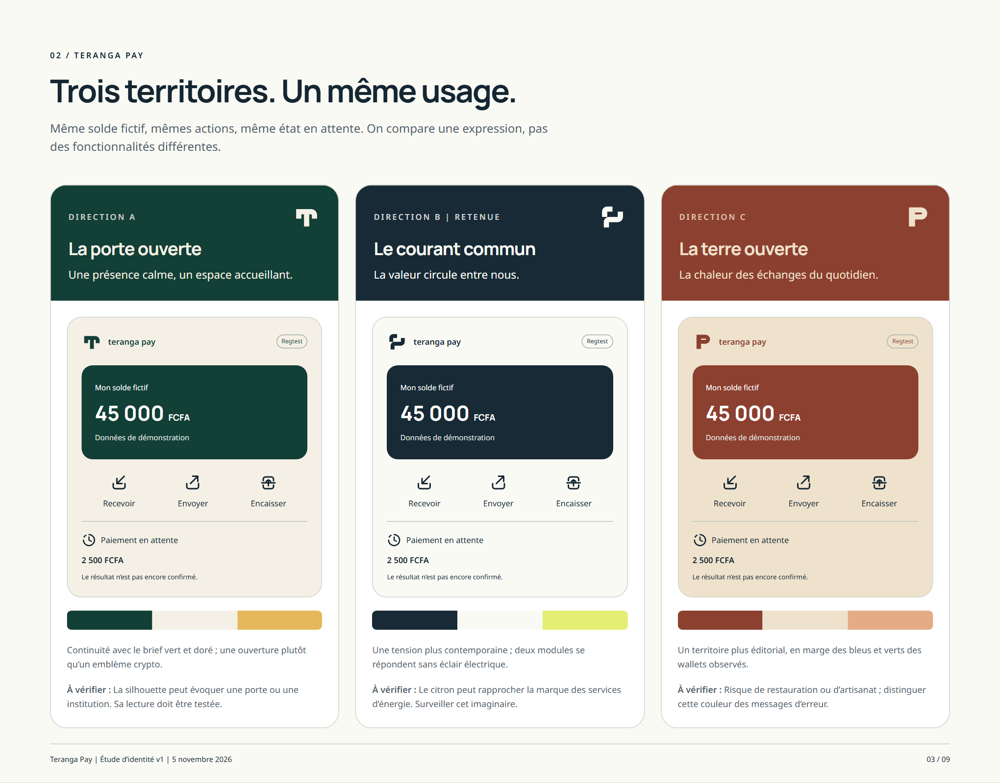

# 🎨 Visuels du projet

PAN porte les ressources visuelles ; Salam relit les livrables.

  

| Dossier                            | Contenu                                              | Tâche    |
| ---------------------------------- | ---------------------------------------------------- | -------- |
| [brand](brand/README.md)           | Logos, icônes, polices, tokens, charte PDF et motion | T08      |
| [submission](submission/README.md) | Captures, couverture et vidéo de soumission          | T37, T39 |

Conserver les sources éditables et les exports utiles, avec leur provenance et leurs droits d'utilisation. Les ressources techniques intégrées à l'application restent près de celle-ci.
