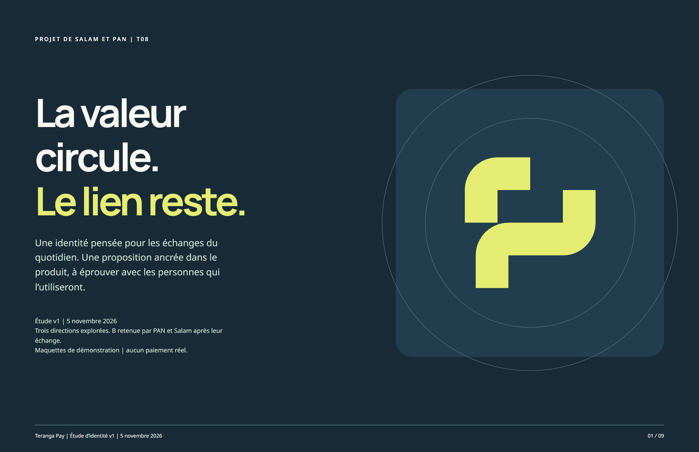
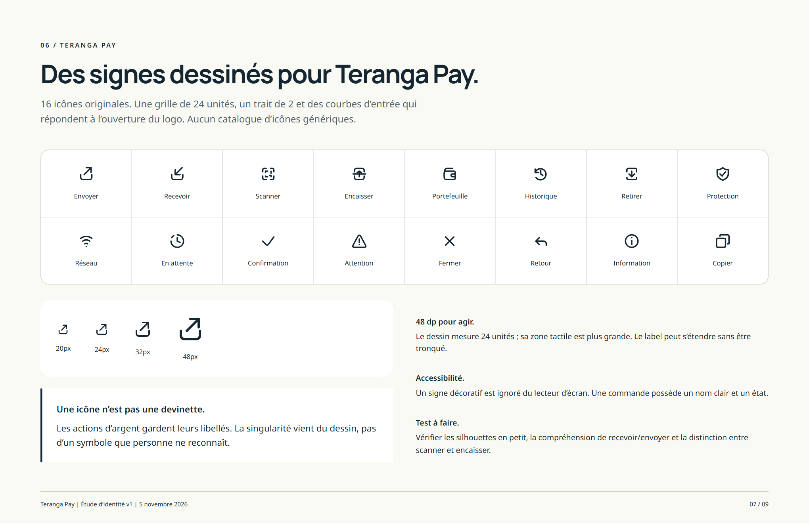
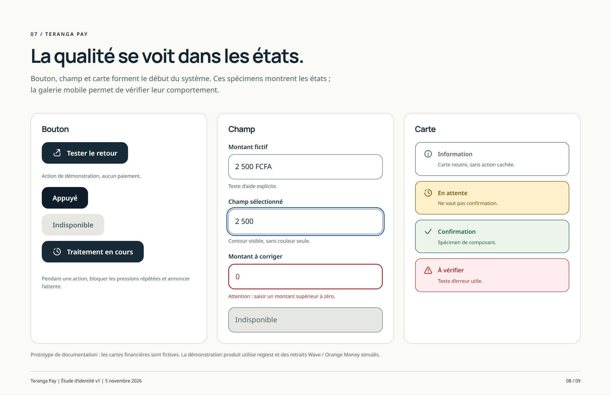
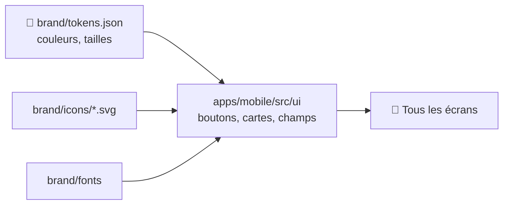

# 🎨 Visuels

> L'identité de Teranga Pay : logo, couleurs, polices, icônes, illustrations, et les logos des opérateurs pour le retrait simulé.

PAN porte les visuels ; Salam relit.

  

|                                    Logo                                     |                                 Icônes                                  |                                      Composants                                      |
| :-------------------------------------------------------------------------: | :---------------------------------------------------------------------: | :----------------------------------------------------------------------------------: |
|  |  |  |

| Dossier                            | Ce qu'il contient                                                                                                                   |
| ---------------------------------- | ----------------------------------------------------------------------------------------------------------------------------------- |
| [brand](brand/README.md)           | L'identité « Le courant commun » : couleurs (`tokens.json`), contraste vérifié, polices, logos, icônes, animations, exports PDF/PNG |
| [operators](operators/README.md)   | Les logos officiels Wave et Orange Money, avec leur provenance (écran Retirer, T25)                                                 |
| [submission](submission/README.md) | Les visuels pour Devpost : captures, couverture, vidéo (T37, T39)                                                                   |

## Comment les visuels arrivent dans l'application

Changer une couleur dans `tokens.json` la change partout dans l'application. Les contrastes sont recalculés par `npm run brand:build` et vérifiés par `npm run test:tooling`.

Toujours garder les sources modifiables, leur provenance et leurs droits d'utilisation.
