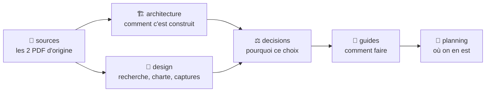
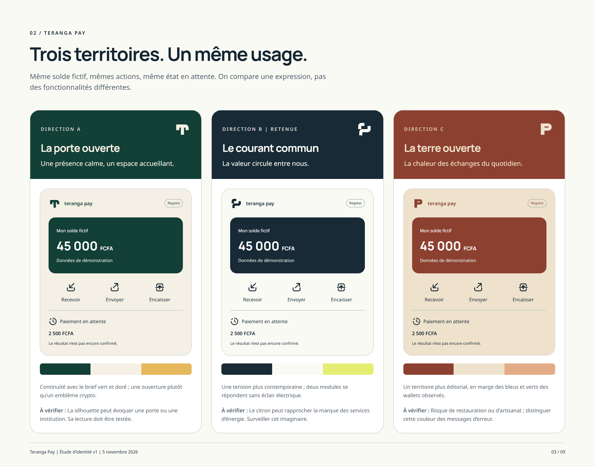

# 📚 Documentation

> Tout ce qu'il faut pour comprendre Teranga Pay : le besoin d'origine, l'architecture, les choix faits, le design, les guides pratiques et le suivi des tâches.

| Dossier                                   | Ce qu'on y trouve                                                   | Par où commencer                               |
| ----------------------------------------- | ------------------------------------------------------------------- | ---------------------------------------------- |
| 📄 [sources](sources/README.md)           | Le document de conception et le plan d'équipe, en PDF               | Le document de conception                      |
| 🏗️ [architecture](architecture/README.md) | Les grandes briques et ce que chacune a le droit de faire           | [Vue d'ensemble](architecture/vue-ensemble.md) |
| ⚖️ [decisions](decisions/README.md)       | Une note courte par choix important (SDK Lightning, API, design…)   | La liste numérotée                             |
| 🎨 [design](design/README.md)             | Recherche, charte graphique, et une galerie de captures par écran   | [Charte](design/charte.md)                     |
| 🧭 [guides](guides/README.md)             | Démarrer, faire la démo Lightning, travailler à deux, tests Maestro | [Démarrage](guides/demarrage.md)               |
| 📅 [planning](planning/README.md)         | La roadmap T01 à T40 et le suivi détaillé de chaque tâche           | [Roadmap](planning/roadmap.md)                 |

  

## Les guides les plus utiles

- [Démarrer sur le projet](guides/demarrage.md) : installer et lancer l'application.
- [Démonstration Lightning de bout en bout](guides/demo-lightning.md) : procédure et essai WalletLab rapportés par Salam le 11 novembre, à distinguer du raccordement UI restant.
- [Tests Maestro](guides/tests-maestro.md) : parcours sur fixtures explicites, sans preuve de paiement regtest natif.
- [Collaboration](guides/collaboration.md) : une tâche = une issue = une branche = une PR.

## Règle d'or

Les PDF décrivent le produit **visé**. Les guides décrivent ce que le dépôt fait **aujourd'hui**. Si un choix change ce que dit un PDF, on l'explique dans une note de [décision](decisions/README.md).
