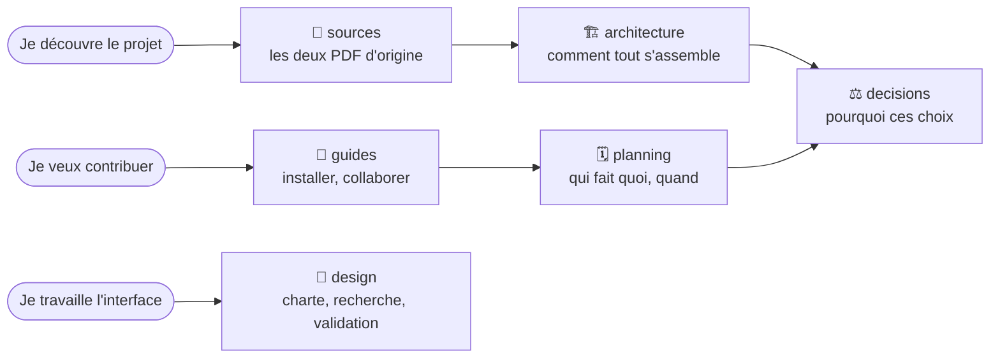

# 📚 Documentation de Teranga Pay

Point d'entrée pour comprendre le produit, démarrer le dépôt et retrouver les décisions de l'équipe. PAN a préparé cette organisation ; Salam porte la documentation technique finale en T36.

| Dossier                                | Contenu                                                    |
| -------------------------------------- | ---------------------------------------------------------- |
| [sources](sources/README.md)           | Les deux PDF d'origine, conservés intégralement            |
| [guides](guides/README.md)             | Installation locale et règles de collaboration             |
| [architecture](architecture/README.md) | Architecture cible, responsabilités et modèle de confiance |
| [decisions](decisions/README.md)       | Notes expliquant les choix structurants                    |
| [planning](planning/README.md)         | Feuille de route T01 à T40 et suivi                        |
| [design](design/README.md)             | Recherche, identité T08, règles et validation              |

Commencer par le [démarrage](guides/demarrage.md), puis la [feuille de route](planning/roadmap.md).

Le dépôt reste privé selon la [décision 0002](decisions/0002-visibilite-privee.md), qui remplace la visibilité publique prévue dans les PDF. Le [relevé GitHub](planning/publication-github.md) distingue les opérations confirmées des travaux en cours.

Les sources décrivent le produit cible ; les guides décrivent ce que le dépôt permet réellement. Si une décision fait évoluer un PDF, l'expliquer dans une note de décision et mettre à jour les documents concernés.
