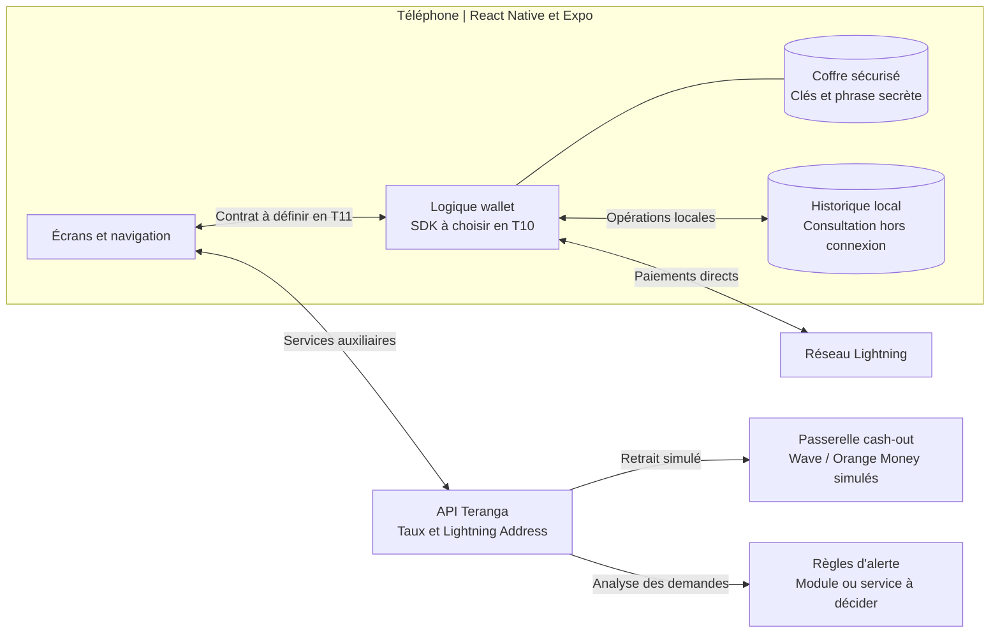
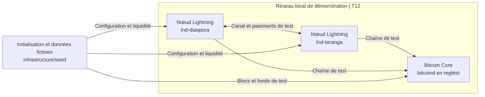

# Vue d'ensemble

Teranga Pay vise un portefeuille Lightning mobile pour le Sénégal : recevoir des remises de la diaspora, encaisser par QR et simuler un retrait vers Wave ou Orange Money. Les montants sont présentés d'abord en FCFA. Le socle T01 à T07 prépare le dépôt, l'application et les outils de collaboration.

## Organisation du code

| Emplacement                           | Rôle prévu                                                            | Responsable                                | Introduction        |
| ------------------------------------- | --------------------------------------------------------------------- | ------------------------------------------ | ------------------- |
| `apps/mobile`                         | Application Expo/React Native en TypeScript, navigation puis parcours | PAN pour l'interface, Salam pour le wallet | T06, puis T14 à T16 |
| `packages/contracts`                  | Types et fonctions communs entre écrans et logique                    | Les deux                                   | T11                 |
| `services/api`                        | Santé, validation, accès contrôlé, taux et Lightning Address          | Salam                                      | T13, T17, T19       |
| `services/bridge-sim`                 | Simulation des retraits Wave/Orange Money                             | PAN                                        | T23                 |
| `services/ai`                         | Règles d'alerte et estimation ; déploiement à décider                 | Salam                                      | T26, T34            |
| `infrastructure/lightning`            | Bitcoin Core regtest et deux nœuds Lightning de démo                  | Salam                                      | T12                 |
| `infrastructure/seed`                 | Initialisation reproductible du réseau et données fictives            | Salam                                      | T12                 |
| `tests/e2e`                           | Parcours nominal mobile                                               | PAN                                        | T30                 |
| `assets/brand` et `assets/submission` | Identité visuelle puis captures et vidéo                              | PAN                                        | T08, T37, T39       |

Seuls les dossiers qui ont un `package.json` sont des packages npm. Les répertoires réservés aux services et aux contrats ne sont pas des applications démarrables.

## Architecture cible

Les blocs ci-dessous représentent la cible du produit. Cette branche comprend le socle API Fastify T13 et les taux/devis T17 ; T23 y propose le module de retrait simulé décrit plus bas. Les parcours mobiles T14 à T22 sont proposés dans une autre pile de branches, conservée dans le checkout principal. La présence de ces travaux ne prouve ni leur fusion ni une intégration native complète.

Les liens du schéma indiquent les responsabilités et les échanges attendus, sans figer le transport ni les signatures. Le contrat T11 relie les écrans à la logique wallet dans l'application. L'API fournit des services auxiliaires ; aucun lien ne lui donne accès au coffre ni le droit de dépenser les fonds du wallet. Le service d'alertes peut rester un module de l'API selon la décision de Salam.

## Environnement de démonstration regtest

Le réseau de test sera introduit en T12 et le paiement d'intégration en T29. Les deux nœuds LND ci-dessous sont des nœuds de démonstration. Leur présence ne choisit pas le SDK mobile et ne garantit pas sa compatibilité regtest.

Ce schéma décrit le réseau local prévu, sans connexion à des fonds réels. La connexion de l'application à l'environnement de démonstration dépendra du choix et des essais T10 ; elle sera documentée après validation. Le repli vers LND côté serveur reste une décision distincte.

## Modifier les schémas

Les diagrammes utilisent des blocs Markdown `mermaid`, sans icônes ni service externe d'images. GitHub les rend dans les README et les autres fichiers Markdown ; dans l'éditeur, utiliser un aperçu compatible Mermaid. La direction `LR` organise les composants de gauche à droite, les rectangles représentent les composants et les cylindres les stockages locaux. Une flèche décrit un échange ; un trait simple relie le wallet à son coffre.

Conserver des libellés courts et mettre à jour le texte avec le schéma lorsque l'architecture change. La [documentation GitHub](https://docs.github.com/en/get-started/writing-on-github/working-with-advanced-formatting/creating-diagrams) explique le rendu et la [syntaxe Mermaid](https://mermaid.js.org/syntax/flowchart.html) détaille les blocs et les liens.

## Clés et modèle de confiance

Dans la cible, le téléphone crée et conserve les clés et la phrase secrète dans son coffre sécurisé. Le serveur ne reçoit pas ces secrets et ne détient pas de droit de dépense sur le wallet de l'utilisateur. L'historique utile hors connexion reste disponible localement ; le serveur n'en conserve que le minimum nécessaire.

Le plan d'équipe prévoit un repli si le SDK mobile échoue au 5 novembre : une démo sur un nœud LND côté serveur. Ce repli n'est pas choisi par ce socle. S'il est retenu en T10, une note devra préciser que les clés de cette démo ne vivent plus dans le téléphone et adapter les promesses du README. Le réseau regtest de T12 est un outil de test ; sa présence ne prouve pas l'architecture non custodiale du produit.

## Montants, retraits et données

- Utiliser des montants entiers et des unités explicites : XOF/FCFA et sats. Les règles d'arrondi et de conversion seront partagées en T11/T17.
- Afficher les frais avant confirmation et fixer le devis marchand pendant cinq minutes en T17/T22.
- T23 introduit les états de retrait, l'idempotence et la réconciliation dans un registre durable pour éviter un double retrait simulé lors d'un réessai.
- Utiliser des comptes et numéros fictifs ; la passerelle du MVP ne représente pas une intégration commerciale Wave ou Orange Money.
- Ne jamais écrire de phrase secrète, de clé, de numéro personnel ou d'identité réelle dans les exemples et les journaux.

Le [module T23](../../services/bridge-sim/README.md) conserve comptes fictifs, devis, réservations, retraits et journal opérateur dans un fichier SQLite ignoré par Git. Ses routes sont montées par l’API existante, avec activation explicite et authentification propres à la simulation. Elles ne peuvent ni lire le coffre du téléphone ni dépenser ses fonds. Les identifiants `wave-demo-001` et `orange-demo-001` remplacent des numéros de téléphone ; les frais fixes de 100 FCFA sont une règle fictive de démonstration.

Une même identité et une même clé retrouvent le retrait existant. Une contrainte supplémentaire empêche de confirmer deux fois un devis sous deux clés. La réservation est enregistrée avant l’attente du simulateur, et son journal garde un effet unique par retrait. En cas de réponse perdue, la réconciliation lit cette référence ; une opération incertaine conserve ses fonds fictifs réservés. Les détails et limites sont dans l’[ADR 0017](../decisions/0017-passerelle-simulee-et-idempotence.md).

## Décisions encore ouvertes

Le choix du SDK Lightning et de ses contraintes natives appartient à T10. Les signatures du wallet et les erreurs échangées avec les écrans appartiennent à T11. Le framework serveur, le stockage et l'organisation effective du service d'alertes seront décidés lors des tâches backend, avec une note lorsqu'un choix est structurant. Le squelette serveur T13 utilise Fastify ; voir la [décision 0007](../decisions/0007-squelette-api.md).

Les notifications, Nostr et un modèle de langue restent optionnels. La disponibilité du serveur ne doit pas conditionner un paiement Lightning direct dans l'architecture cible. La consultation hors connexion et les messages de réseau seront réalisés dans l'application en T28.
