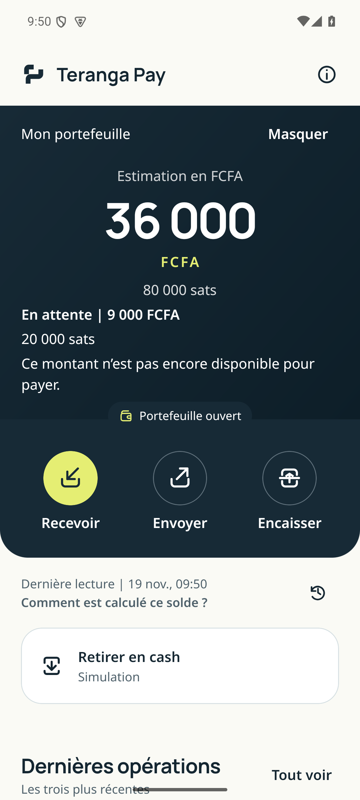
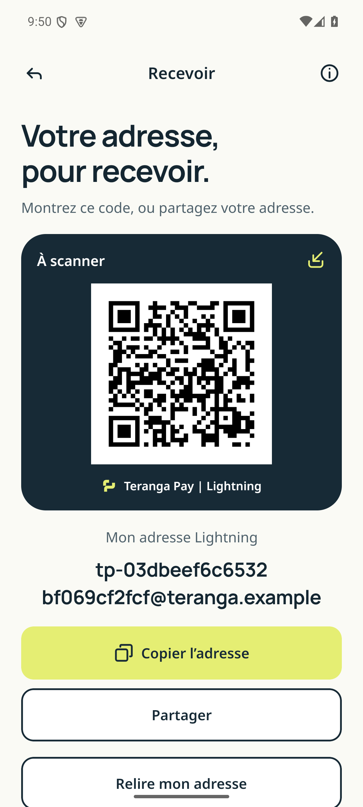
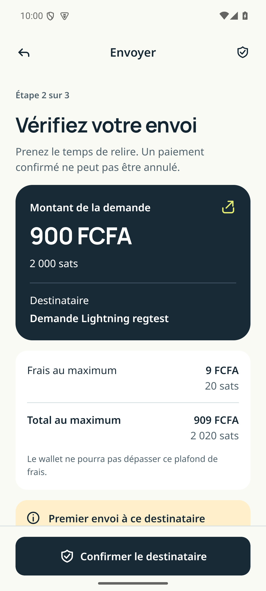
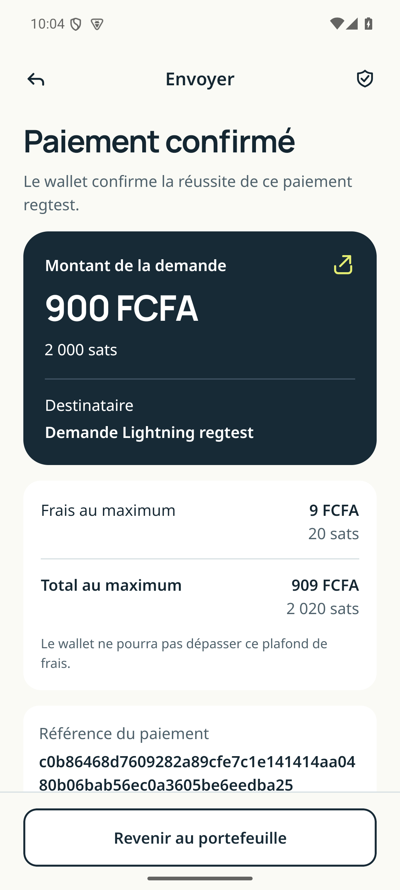
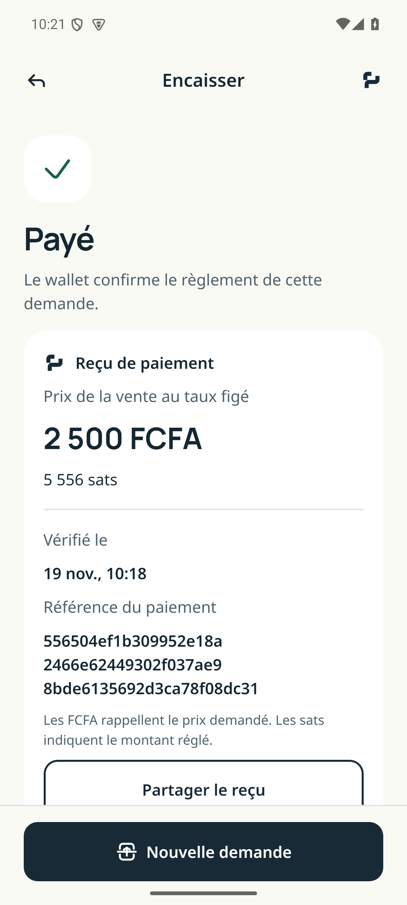
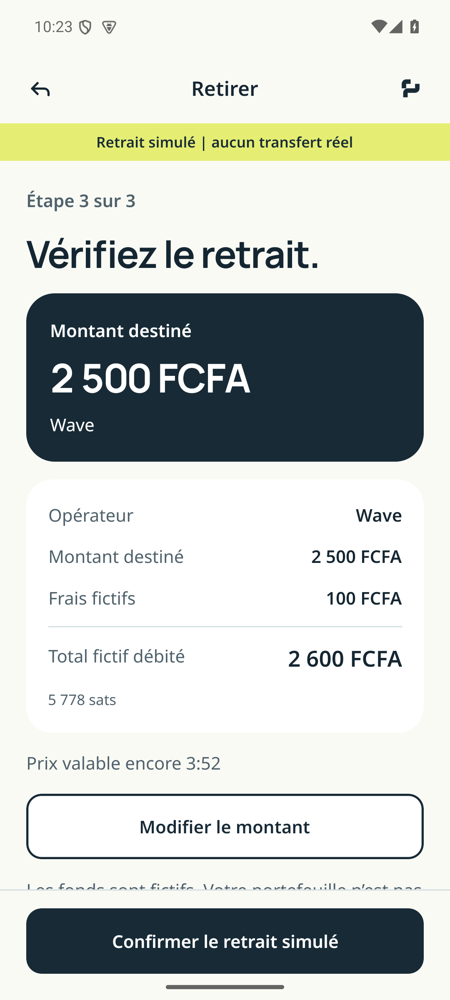
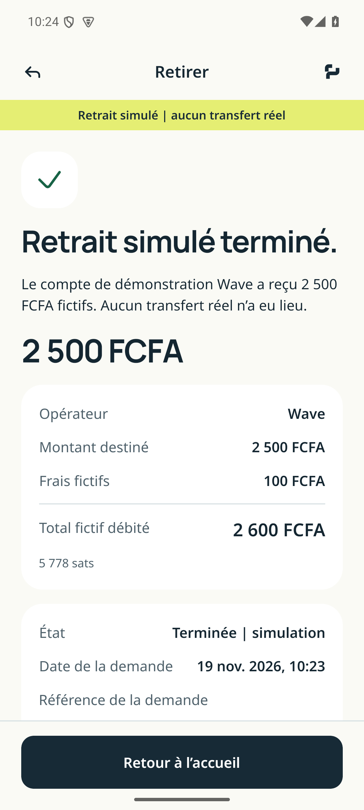

# Validation Android | Raccordement #120

Captures du 19 novembre 2026 sur émulateur Android 35, application normale `pay.teranga.demo`, Expo SDK 58. Salam et PAN portent le raccordement. Aucun atelier ni faux wallet ne compose ces écrans. Bitcoin et Lightning restent en regtest ; Wave reste entièrement simulé.

Les écrans de PIN, les mots de récupération et les jetons ne sont pas capturés.

## Accueil après réception regtest

## Adresse Lightning du wallet Android

## Prix et plafond de frais avant PIN

## Paiement confirmé

## Encaissement marchand confirmé

## Prix du retrait simulé

## Retrait simulé terminé

## Même retrait retrouvé après redémarrage

L'API conserve une seule opération pour ce retrait de 2 500 FCFA. Le redémarrage retrouve sa référence et son résultat sans nouvelle confirmation financière.

## Vérifications

Création et quiz des douze mots, PIN erroné refusé, déverrouillage après arrêt complet, réception LNURL de 100 000 sats de test, envoi avec PIN de 2 000 sats de test confirmé côté destinataire, encaissement de 2 500 FCFA (5 556 sats de test), retrait Wave simulé de 2 500 FCFA avec 100 FCFA de frais fictifs.

Voir le [guide de raccordement](../../guides/raccordement-application.md) pour les commandes et limites. Captures natives ; les anciennes galeries Web et les tests Maestro sur fixtures restent distincts.
