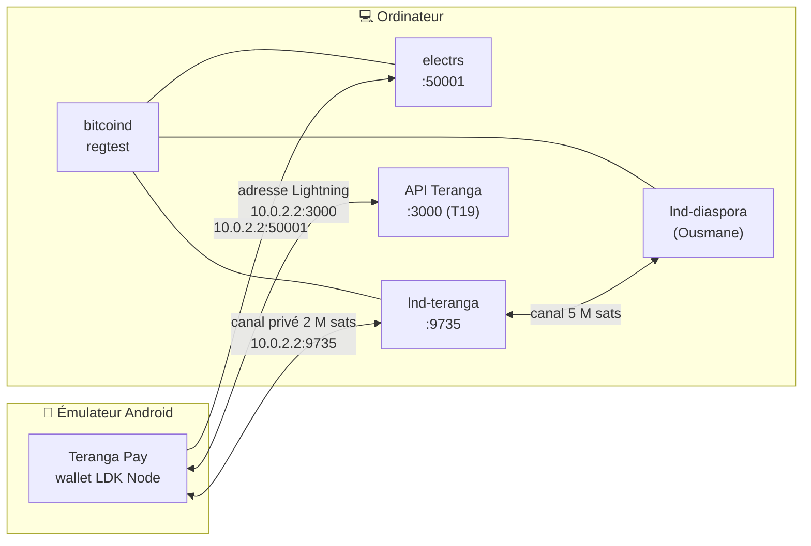

# Démonstration Lightning | Essai historique rapporté

Responsable : Salam (T36) ; PAN relit. Ce guide décrit l’essai WalletLab rapporté par Salam le **11 novembre 2026**, avec un wallet LDK Node dans un émulateur Android et des paiements regtest. Ce récit n’a pas été rejoué sur l’arbre consolidé ; le [raccordement natif #120](https://github.com/PapaAmad/teranga-pay/issues/120) des écrans métier reste ouvert. Source historique : [PR #82, commit 40435c6](https://github.com/PapaAmad/teranga-pay/commit/40435c6955054748f365ed035ef430d7fcba7146).

> **Réseau de test uniquement.** Aucun vrai bitcoin, aucun vrai franc CFA. Les noms (Mame, Ousmane) et les clés sont fictifs.

> **Contexte historique | 11 novembre.** Les bases T12, T19, T15, T21 et le workflow T29 sont désormais présents dans l’arbre consolidé. Leur présence ne constitue pas un nouvel essai du téléphone. Les versions, résultats et métriques ci-dessous appartiennent au récit du 11 novembre ; pour les exigences du build SDK 58 actuel, consulter le [guide Maestro](tests-maestro.md). Aucun APK signé publié n’est déduit de ce guide.



## Prérequis

| Outil          | Version de l’essai rapporté                      | Remarque                             |
| -------------- | ------------------------------------------------ | ------------------------------------ |
| Docker Desktop | 4.x                                              | Doit être ouvert avant de commencer. |
| Node.js et npm | 24.22 et 12.2.1                                  | npm 12 refuse Node 25.               |
| JDK            | 17 (Temurin)                                     | Pour Gradle.                         |
| SDK Android    | plateforme 36, build-tools 36, NDK 27.1.12297006 | Le NDK pèse environ 2,4 Go.          |
| Émulateur      | Android 16 arm64, 3 Go de mémoire                | Nommé `teranga-test` dans ce guide.  |

Place disque à prévoir : **au moins 10 Go libres**. La première compilation télécharge environ 2 Go de dépendances Gradle et produit environ 1 Go de fichiers intermédiaires.

## 1 | Réseau de test | T12

```bash
npm run regtest:up     # bitcoind, electrs, lnd-teranga, lnd-diaspora
npm run regtest:seed   # fonds de test, canal diaspora → teranga, paiement de vérification
```

**Après un redémarrage de Docker**, les deux nœuds ne se reconnectent pas toujours, et LND peut se dire « pas synchronisé ». Dans ce cas :

```bash
# 1 bloc pour réveiller la synchronisation
docker exec teranga-pay-bitcoind-1 bitcoin-cli -regtest -datadir=/home/bitcoin/.bitcoin \
  -rpcwallet=teranga-seed -generate 1
# Reconnecter Ousmane (diaspora) à teranga
npm run regtest:phone -- info   # affiche la clé de teranga
docker exec teranga-pay-lnd-diaspora-1 lncli --network=regtest connect <clé teranga>@lnd-teranga:9735
```

## 2 | API de l'adresse Lightning | T19

L'adresse `nom@teranga.example` passe par l'API. Le `callback` LNURL doit être l'adresse que **voit le téléphone** : `10.0.2.2` depuis l'émulateur.

```bash
PUBLIC_BASE_URL=http://10.0.2.2:3000 npm run api
```

## 3 | Application sur l'émulateur

```bash
cp apps/mobile/.env.example apps/mobile/.env
# Mettre dans EXPO_PUBLIC_TERANGA_PEER_ID la clé affichée par : npm run regtest:phone -- info
cd apps/mobile
npx expo prebuild --platform android --clean
npx expo run:android          # compile, installe et lance Metro
```

Ouvrir ensuite l'écran d'essai, réservé aux versions de développement :

```bash
adb shell am start -a android.intent.action.VIEW -d "terangapay://labo-wallet" pay.teranga.demo
```

## 4 | Scénario de démonstration

| #   | Action                            | Commande ou geste                                                                                        | Résultat historique rapporté du 11 novembre                                                                               |
| --- | --------------------------------- | -------------------------------------------------------------------------------------------------------- | ------------------------------------------------------------------------------------------------------------------------- |
| 1   | Créer le wallet                   | Taper un PIN de 6 chiffres, puis **Créer le wallet**                                                     | État « Prêt » et clé du téléphone affichée. La phrase s'affiche une fois ; une capture d'écran donne une **image noire**. |
| 2   | Ouvrir un canal vers le téléphone | `npm run regtest:phone -- canal <clé du téléphone>`                                                      | « Canal vers le téléphone actif » (2 000 000 sats, privé)                                                                 |
| 3   | Recevoir de Milan                 | **Recevoir 10 000 sats**, puis `npm run regtest:phone -- payer <facture>`                                | « Dernier paiement : Reçu 10000 sats »                                                                                    |
| 4   | Comprendre le solde               | Recevoir 3 fois 10 000 sats                                                                              | **Solde : 10 000 sats** : 30 000 reçus moins une réserve de canal de 20 000 (1 %), qui n'est pas envoyable                |
| 5   | Payer depuis le téléphone         | `lncli addinvoice --amt 2000` sur diaspora, coller la facture, **Payer la facture**                      | Facture réglée côté diaspora, solde 7 998 (2 sats de frais)                                                               |
| 6   | Recevoir sur son adresse          | Nom `mame`, **Activer mon adresse**, puis paiement LNURL de 5 000 sats depuis diaspora (voir ci-dessous) | Facture créée **par le téléphone**, montant et hachage vérifiés, solde 12 998                                             |
| 7   | Payer une adresse                 | Destination `ousmane@teranga.example`, montant 1 500, **Payer la facture**                               | Facture d'Ousmane réglée, solde 11 497                                                                                    |
| 8   | Redémarrer                        | Fermer l'app, la rouvrir, **Déverrouiller** avec le PIN                                                  | Nœud prêt en **5 s**, solde 11 497 retrouvé                                                                               |

**Payer `mame@teranga.example` comme un wallet externe** (étape 6). Ousmane utilise ici `lnd-diaspora`, qui ne connaît pas LNURL : on fait donc les deux requêtes à la main.

```bash
P=$(curl -s localhost:3000/.well-known/lnurlp/mame)
CB=$(echo "$P" | python3 -c "import sys,json;print(json.load(sys.stdin)['callback'].replace('10.0.2.2','127.0.0.1'))")
PR=$(curl -s "$CB?amount=5000000" | python3 -c "import sys,json;print(json.load(sys.stdin)['pr'])")
docker exec teranga-pay-lnd-diaspora-1 lncli --network=regtest decodepayreq "$PR"   # destinataire = téléphone
docker exec teranga-pay-lnd-diaspora-1 lncli --network=regtest payinvoice --force "$PR"
```

## Métriques rapportées | 11 novembre 2026

| Mesure                               | Valeur                | Contexte                                                                  |
| ------------------------------------ | --------------------- | ------------------------------------------------------------------------- |
| Compilation Android complète (debug) | 4 min 21 s            | Mac Apple Silicon, Wi-Fi rapide, dépendances déjà téléchargées en partie  |
| Taille de l'APK de debug             | 68,6 Mo               | Non minifié, arm64 seulement. La taille de release sera mesurée avec T35. |
| Déverrouillage et démarrage du nœud  | 5 s                   | Émulateur Android 16                                                      |
| Paiement réel dans la CI (T29)       | 44 s pour tout le job | Réseau regtest neuf à chaque PR                                           |
| Tests automatiques du wallet         | 68 tests Jest         | Branche de la #76                                                         |

## Limites réelles

- L'application doit être **ouverte et déverrouillée** pour recevoir : le nœud LDK tourne dans l'application.
- Un canal neuf impose une **réserve d'environ 1 %**. Tant que le téléphone a reçu moins que cette réserve, son solde envoyable est 0.
- **Restaurer la phrase** sur une installation neuve rend les fonds on-chain, mais pas l'état des canaux. Ce cas n'est pas encore essayé.
- La **coupure réseau pendant un paiement** est couverte par les tests (pas de double envoi, `PAYMENT_TIMEOUT` avec identifiant), mais pas encore essayée sur l'appareil.
- Aucun essai sur un **vrai téléphone modeste** pour l'instant. Sur le Wi-Fi local, lancer `REGTEST_BIND=0.0.0.0 npm run regtest:up` **pendant la démo seulement**.
- Tout est en **regtest**. Le retrait Wave / Orange Money est **simulé**.
