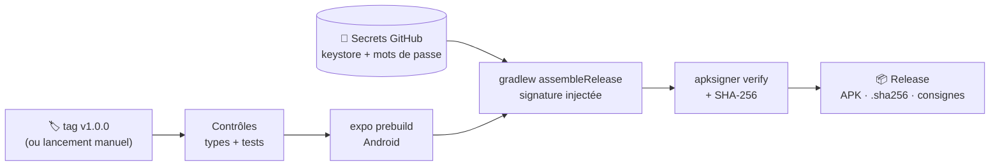

# Release Android | Configuration T35

> **Configuration préparée | Aucun APK publié.** Ce guide décrit un futur lancement autorisé et contrôlé. Aucun build, signature, tag ou Release n’a été exécuté pendant cette consolidation. Les noms des secrets sont déjà présents ; aucune clé n’est recréée et aucune valeur de secret n’est consultée ou modifiée. Le premier essai reste un brouillon sous contrôle humain.

Responsable : Salam ; PAN relit. Le workflow [`release.yml`](../../.github/workflows/release.yml) compile l'APK Android, le signe, calcule sa somme SHA-256 et publie une GitHub Release avec les consignes d'installation.

## Clé existante | Vérification humaine

La clé de signature existante doit être conservée hors Git. Les noms suivants sont déjà présents dans les secrets du dépôt ; cette présence ne valide pas leurs valeurs ni la signature :

| Nom                         | Rôle                      |
| --------------------------- | ------------------------- |
| `ANDROID_KEYSTORE_BASE64`   | Keystore encodé en base64 |
| `ANDROID_KEYSTORE_PASSWORD` | Mot de passe du keystore  |
| `ANDROID_KEY_ALIAS`         | Alias de la clé           |
| `ANDROID_KEY_PASSWORD`      | Mot de passe de la clé    |

Le responsable confirme les valeurs existantes avant tout lancement. Ne pas recréer une clé pour tester ce workflow. Salam et PAN conservent leurs sauvegardes selon leur procédure privée. Un autre certificat empêche une installation par-dessus l’ancien APK ; une réinstallation peut effacer les données locales. La récupération après désinstallation, notamment l’état des canaux, reste à valider dans [T15 #10](https://github.com/PapaAmad/teranga-pay/issues/10). Ce guide ne garantit pas cette restauration.

Sans ces quatre secrets, le workflow s'arrête dès la première étape avec un message qui nomme le secret manquant.

## Réglages publics de l'APK (facultatif)

Les variables `EXPO_PUBLIC_*` sont intégrées en clair dans l'APK : elles ne doivent contenir **aucun secret**. On les définit comme _variables_ (pas secrets) du dépôt :

| Variable                           | Exemple                       | Rôle                                   |
| ---------------------------------- | ----------------------------- | -------------------------------------- |
| `EXPO_PUBLIC_ELECTRUM_URL`         | `tcp://192.168.1.20:50001`    | Electrum du réseau de démo             |
| `EXPO_PUBLIC_TERANGA_PEER_ID`      | clé publique de `lnd-teranga` | Pair Lightning du téléphone            |
| `EXPO_PUBLIC_TERANGA_PEER_ADDRESS` | `192.168.1.20:9735`           | Adresse de ce pair                     |
| `EXPO_PUBLIC_API_URL`              | `http://192.168.1.20:3000`    | API Teranga (adresse Lightning, taux…) |

Sans ces variables, l'APK vise `10.0.2.2`, l'adresse de l'ordinateur vue depuis l'émulateur Android. Sur un vrai téléphone, utiliser l'adresse de l'ordinateur sur le Wi-Fi et lancer `REGTEST_BIND=0.0.0.0 npm run regtest:up` pendant la démo seulement.

## Publication future | Après validation

Les comportements suivants sont préparés par le workflow et ne décrivent aucune exécution déjà effectuée. Les contrôles, la signature et le parcours natif doivent être validés avant de déclencher ces actions.

- **Essai** : _Actions → Release APK → Run workflow_, avec un nom comme `v0.9.0-essai`. Le résultat est une Release **brouillon** (pré-version), visible seulement par l'équipe, qu'on peut supprimer ensuite.
- **Version de soumission (T39)** : `git tag v1.0.0 && git push origin v1.0.0` depuis `main` à jour. La Release est publiée directement.

Le nom doit avoir la forme `vX.Y.Z`, éventuellement suivie d'un suffixe (`v1.0.0-rc.1`).

## Ce que contient la Release

- `teranga-pay-vX.Y.Z.apk` : APK signé.
- `teranga-pay-vX.Y.Z.apk.sha256` : somme de contrôle (`sha256sum -c` l'utilise directement).
- Notes générées par [`release-notes.mjs`](../../scripts/release/release-notes.mjs) :
  - avertissement « regtest, retrait simulé » ;
  - somme SHA-256 et empreinte du certificat de signature ;
  - commandes de vérification sous Linux, macOS et Windows ;
  - étapes d'installation.

## Limites

- Aucun lancement de cette configuration consolidée n’est revendiqué. Les noms des secrets sont présents ; leurs valeurs et le build SDK58 restent à vérifier. Le premier essai autorisé doit être une Release brouillon.
- La proposition T35 initiale estimait la compilation à 15 à 25 minutes ; cette durée reste à mesurer sur la configuration consolidée. Le délai maximal préparé est de 60 minutes.
- L'APK utilise le réseau regtest de l'ordinateur de démo. Il ne fonctionne pas seul.

La configuration utilise Java 21, comme le build SDK58 préparé pour Maestro. Cette cohérence statique ne constitue pas un succès de compilation Android. Le raccordement natif [#120](https://github.com/PapaAmad/teranga-pay/issues/120), la sauvegarde [#10](https://github.com/PapaAmad/teranga-pay/issues/10) et l’APK [#30](https://github.com/PapaAmad/teranga-pay/issues/30) restent ouverts.
