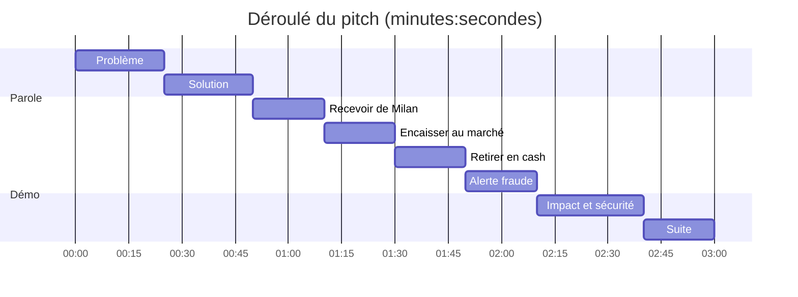

# Script du pitch | 3 minutes

> **Brouillon de travail | Salam et PAN.** Les phrases à prononcer décrivent le résultat visé pour la démonstration. Le raccordement natif #120, la sauvegarde #10, la sécurité #26 et l’APK #30 restent ouverts ; aucun paiement mobile ou APK publié n’est prouvé par ce script. Les chiffres économiques proviennent des documents et restent à vérifier avant publication. Les cases de préparation et de répétition restent à renseigner.

- Tâche : T38. Auteur : Salam ; relecture : PAN.
- Base : section 12 du document de conception (plan de démo), personnages fictifs de `infrastructure/seed/demo-data.json`.
- Durée visée : **3:00**. Partie parlée : environ 400 mots, soit un débit calme d'environ 140 mots par minute, démo comprise.
- Qui fait quoi : **Salam parle**, **PAN manipule** le téléphone (ou l'émulateur projeté). Pour la vidéo (T39), Salam enregistre la voix et PAN la capture.

## 0:00 – 0:25 | Le problème

> Voici Mame Diarra, à Thiès. Son fils Ousmane, chauffeur à Milan, lui envoie de l'argent chaque mois.
>
> Aujourd'hui, cet argent passe par un opérateur : des frais, un taux de change qu'on ne comprend pas, et de l'attente. Depuis l'Europe, un envoi coûte en moyenne entre 2,5 et 3,8 % ; hors zone CFA, cela peut monter jusqu'à 15 %.
>
> En 2024, la diaspora a envoyé plus de 2 200 milliards de FCFA au Sénégal. Chaque point de frais, c'est de l'argent en moins pour les familles.

_Message clé : le problème est réel et proche de nous._

## 0:25 – 0:50 | La solution

> Teranga Pay, c'est un portefeuille Lightning pensé pour le Sénégal. Tout est en FCFA, en français et bientôt en wolof, sur un téléphone simple avec peu de réseau.
>
> Trois actions, pas une de plus : **recevoir**, **payer**, **retirer en cash**. Et surtout : les clés restent dans le téléphone. Teranga Pay ne touche jamais à l'argent.

_Geste : PAN montre l'écran d'accueil avec les trois boutons._

## 0:50 – 2:10 | La démo

**1. Recevoir de Milan (0:50 – 1:10)**

> Ousmane ouvre n'importe quel wallet Lightning et paie l'adresse de sa mère, comme on écrit un e-mail : `mame@teranga.example`.

_Geste : paiement lancé depuis le nœud « diaspora »._

> … Quelques secondes, et c'est arrivé. Mame voit le montant en FCFA, et les frais sont affichés.

**2. Encaisser au marché (1:10 – 1:30)**

> Awa vend des légumes. Elle tape 2 500 FCFA, montre un QR code ; le client scanne et paie. Pas de monnaie à rendre, un reçu, et le total du jour.

**3. Retirer en cash (1:30 – 1:50)**

> Mame a besoin d'espèces. Elle choisit Wave ou Orange Money, voit les frais avant de confirmer, et valide avec son PIN. Ici le retrait est **simulé** : c'est un prototype, aucun vrai transfert n'est fait.

**4. Alerte fraude (1:50 – 2:10)**

> Un faux agent appelle et pousse à tout envoyer, vite, à un nouveau numéro. L'application voit un nouveau destinataire, un montant inhabituel, presque tout le solde : elle avertit et redemande le PIN. Elle ne bloque pas, elle fait réfléchir.

_Message clé : ça marche vraiment._

## 2:10 – 2:40 | Impact et sécurité

> Pour un envoi de 100 000 FCFA depuis la France, notre estimation donne entre 2 350 et 3 650 FCFA d'économie. C'est une estimation, avec sa formule affichée : sur le local, Wave et Orange Money sont déjà bon marché, et nous ne promettons pas le contraire.
>
> Côté sécurité : les clés sont chiffrées dans le téléphone, le serveur ne garde jamais les fonds, et aucun nom ni numéro n'apparaît dans nos journaux.

_Message clé : utile et sûr._

## 2:40 – 3:00 | La suite

> La suite : un pilote avec vingt commerçants d'un même marché, un vrai partenaire agréé pour le cash-out, et un audit de sécurité indépendant avant tout usage réel.
>
> Le code, l'APK et sa somme de contrôle sont sur GitHub. Teranga Pay : l'argent de la famille, sans détour. Merci.

_Message clé : on sait où on va._

## À vérifier avant de jouer

Ne dire une phrase que si la fonction correspondante tourne dans l'APK du jour. Sinon, la retirer du script.

| Phrase du script                     | Tâche qui la rend vraie | Si elle n'est pas prête                       |
| ------------------------------------ | ----------------------- | --------------------------------------------- |
| Paiement vers `mame@teranga.example` | T15, T19, T18           | Payer une facture QR depuis « diaspora »      |
| Solde et frais en FCFA               | T16, T17                | Montrer le solde en sats et le dire           |
| QR marchand, reçu et total du jour   | T22, T24                | Retirer « total du jour »                     |
| Retrait Wave / Orange Money simulé   | T23, T25                | Retirer la partie 3 et rallonger la partie 1  |
| Alerte fraude et PIN redemandé       | T26, T27                | Montrer le score serveur sans l'écran         |
| Estimation d'économies 2 350 – 3 650 | T34                     | Garder seulement la fourchette du document    |
| « bientôt en wolof »                 | T09, T33                | Dire « en wolof » seulement si T33 est livrée |
| APK et somme de contrôle sur GitHub  | T35                     | Dire « le code est sur GitHub »               |

## Plan B

- **Le réseau de la salle tombe** : le réseau regtest et le serveur tournent sur l'ordinateur (`npm run regtest:up`, `npm run api`). Seul le partage d'écran dépend de la salle.
- **Un paiement ne passe pas** : ne pas réessayer en direct plus d'une fois. Lancer la vidéo de secours (T39) au même moment du script.
- **On dépasse le temps** : couper d'abord la partie 3 (retrait), puis la deuxième phrase de « Impact et sécurité ».

## Préparation

- Préparer les comptes avant de monter sur scène : `npm run regtest:seed`, wallets créés, un canal ouvert vers le téléphone.
- Deux téléphones ou deux émulateurs : Mame d'un côté, Awa de l'autre.
- Taille de police maximale et luminosité au maximum pour la projection.
- Les noms et numéros sont fictifs ; ne jamais montrer de vrai numéro, de vraie phrase secrète ni de vrai PIN.

## Répétitions

À remplir après chaque répétition chronométrée. Le critère de T38 (« une répétition confirme trois minutes ») n'est validé qu'avec une ligne réelle ici.

| Date | Qui | Durée mesurée | Ce qui a dépassé | Correction |
| ---- | --- | ------------- | ---------------- | ---------- |
|      |     |               |                  |            |
