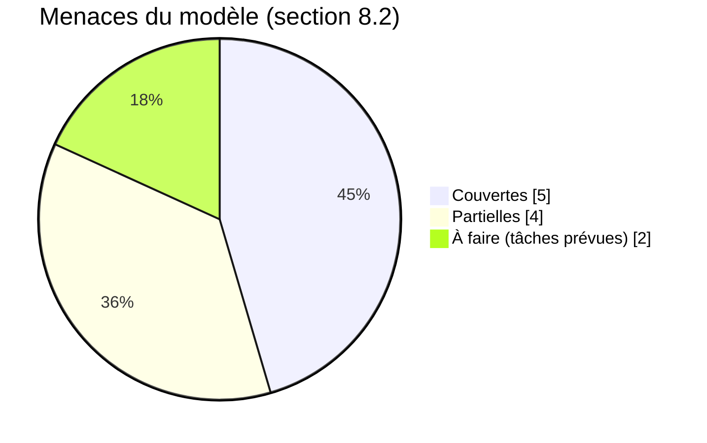

# Revue de sécurité T31 | 7 novembre 2026

> **Archive | Revue du 7 novembre 2026.** Les résultats de recherche de secrets, d’audit des dépendances et de protections décrivent les branches et SHAs cités dans cette revue. Ils ne constituent pas une validation de l’arbre consolidé actuel. Aucun contrôle natif nouveau n’a été exécuté ici ; la sécurité #26, la sauvegarde #10 et le raccordement #120 restent ouverts.

- Auteur : Salam, avec Claude Code ; relecture : PAN.
- Périmètre : `main` et toutes les branches ouvertes au 7 novembre : #47 (T08), #48 (T13), #49 (T12), #52 (T17), #53 (T11), #55 (T09), #56 (T19), #57 (T26), #58 (T29), #59 (T34) et #61 (T15, wallet LDK Node).
- Référence : section 8 du [document de conception](../sources/Teranga_Pay_Document_de_conception.pdf) (actifs, menaces, règles d'or).
- **Limite** : c'est une revue interne faite pendant le hackathon, **pas un audit externe**. Celui-ci reste indispensable avant tout usage avec de vrais fonds.

## En bref

| Résultat                                   | Détail                                                                               |
| ------------------------------------------ | ------------------------------------------------------------------------------------ |
| ✅ Aucun secret dans l'historique Git      | Gitleaks 8.28 sur les 47 commits de toutes les branches : 0 fuite                    |
| ✅ Aucune vulnérabilité dans ce qui tourne | `npm audit --omit=dev` : 0 sur chaque branche (app, API, contrat)                    |
| ⚠️ Outils de développement                 | 27 alertes (2 hautes, 16 moyennes, 9 basses) dans Expo CLI et ESLint ; voir plus bas |
| ✅ Corrigé pendant la revue                | Captures d'écran et sauvegarde Android du wallet (#61, commit `e337e42`)             |
| ⏳ Reste avant la démo                     | Signature de l'APK et somme de contrôle (T35), alerte dans l'appli (T27), etc.       |



## Menaces du document de conception, une par une

| Menace (section 8.2)             | Défense prévue                                                                | État au 7 nov.                                                                                                                                                                                                                                                                                                                    |
| -------------------------------- | ----------------------------------------------------------------------------- | --------------------------------------------------------------------------------------------------------------------------------------------------------------------------------------------------------------------------------------------------------------------------------------------------------------------------------- |
| Vol ou perte du téléphone        | Coffre sécurisé, PIN, verrouillage automatique, limite sans nouveau PIN       | 🟡 **Partiel.** Phrase chiffrée deux fois (PIN PBKDF2 120 000 + Android Keystore, AES-256-GCM), blocage 30 s après 5 PIN faux, PIN redemandé à **chaque** envoi (T15). Manquent : verrouillage automatique après inactivité, biométrie (T14/T28).                                                                                 |
| Fausse appli ou faux site        | Phrase demandée seulement à la récupération ; captures bloquées sur la phrase | ✅ **Couvert côté wallet.** Corrigé pendant la revue : `FLAG_SECURE` tant que la phrase est affichée (`useSecureScreen`). L'onboarding T14 devra utiliser le même crochet.                                                                                                                                                        |
| Appli modifiée                   | APK signé, somme de contrôle publiée                                          | 🔴 **À faire : T35.**                                                                                                                                                                                                                                                                                                             |
| Arnaque par message (faux agent) | Alerte nouveau destinataire / gros montant, confirmation PIN                  | 🟡 **Partiel.** Score serveur explicable (T26, #57) : 6 règles, confirmation à 50 points, aucune donnée personnelle reçue. L'écran d'alerte est T27 (PAN).                                                                                                                                                                        |
| Fuite de données                 | Aucune donnée personnelle dans les journaux                                   | ✅ **Couvert.** Journaux de l'API : méthode, modèle de route, statut et identifiant aléatoire, sans IP, en-têtes, corps ni nom de machine, ce que vérifient des tests (T13). Aucun journal dans le module natif. Personnages fictifs avec le préfixe inexistant `+221 00`. Jeton d'adresse Lightning stocké haché (SHA-256, T19). |
| Entrées malveillantes            | Validation stricte                                                            | ✅ **Couvert.** Schémas JSON stricts sur toutes les routes (champs inconnus refusés, aucune conversion de type dans les corps, tailles bornées). Factures : regtest uniquement, expiration et montant exact vérifiés (T15, T19). Hypothèses d'économies validées champ par champ (T34).                                           |
| Abus de l'API                    | Limite de débit, réponses sans détail interne                                 | ✅ **Couvert.** 60 requêtes par minute et par adresse, routes inconnues comprises et comptées avant la lecture du corps ; `X-Forwarded-For` ignoré ; erreurs sous forme de codes, sans pile (T13). Attente longue de T19 limitée à 10 demandes en attente par utilisateur.                                                        |
| Secrets volés                    | Secrets hors du code, droits minimaux sur le nœud                             | ✅ **Couvert pour la démo.** `.env` ignorés, `.env.example` neutres, Gitleaks dans la CI. Le serveur ne détient **aucune** clé de nœud : l'adresse Lightning relaie la demande au téléphone (décision 0010). Les macaroons LND restent dans les volumes Docker, REST lié à `127.0.0.1`.                                           |
| Bibliothèque compromise          | Bibliothèques reconnues, versions figées, audit                               | 🟡 **Partiel.** Versions npm figées et lockfile, Dependabot actif, LDK Node 0.7.0 figé (décision 0008). Manquent la vérification des dépendances Gradle (`verification-metadata.xml`) et la correction des alertes des outils (voir plus bas).                                                                                    |
| Double retrait / double paiement | Clé d'idempotence, états de transaction                                       | 🟡 **Paiement couvert, retrait à faire.** Le contrat T11 bloque un second envoi de la même facture. T29 prouve à chaque PR, sur un vrai réseau regtest, qu'une facture rejouée est refusée sans débit. Le double retrait simulé est T23 (PAN).                                                                                    |
| Perte de la phrase secrète       | Sauvegarde guidée avec test                                                   | 🔴 **À faire : T14** (onboarding, PAN). Le module natif fournit déjà `restore(words, pin)`.                                                                                                                                                                                                                                       |

## Corrigé pendant la revue (branche T15)

1. **Captures d'écran de la phrase secrète.** Le module natif expose `setScreenSecure`, qui pose `FLAG_SECURE` et bloque captures, enregistrements et aperçus dans les applications récentes. Le crochet `useSecureScreen(nativeWallet, phraseVisible)` le pose et le retire automatiquement. 5 tests Jest.
2. **Sauvegarde Android.** La sauvegarde automatique pouvait copier l'état des canaux LDK dans le cloud. Après une restauration, le téléphone aurait pu publier un **ancien** état de canal : le pair l'aurait puni en gardant tout le canal. Désormais l'état LDK vit dans `noBackupFilesDir` et `app.json` fixe `allowBackup: false`. Seule la phrase secrète permet de restaurer.

## Dépendances

`npm audit` sur le lockfile de chaque branche, au 7 novembre :

- **Paquets livrés** (`--omit=dev`) : 0 vulnérabilité partout.
- **Outils de développement** : 27 alertes, identiques sur toutes les branches.
  - `zod`, via `@expo/cli` (haute) : épuisement de mémoire sur des collections énormes. Il n'est utilisé qu'à la compilation et ne reçoit pas d'entrée externe.
  - `glob` et `minimatch`, via Expo et ESLint (moyennes) : déni de service sur des motifs piégés. Ce sont des outils locaux, ils ne sont pas exposés.
- `npm audit fix` (sans `--force`) supprime les 2 alertes hautes, mais modifie 58 paquets, dont `expo` 57.0.31 → 57.0.32, et provoquerait des conflits avec #47 et #55. **Proposition** : le lancer dans une PR dédiée juste après la fusion de #47 et #55, avec `expo export` et les tests. Les alertes restantes demandent des versions majeures (ESLint 10 → 9 proposé par npm, ce qui est un retour en arrière) : les laisser à Dependabot.

## Écarts et suites proposées

| #   | Constat                                                                                                       | Gravité pour la démo   | Proposition                                                                                                                                |
| --- | ------------------------------------------------------------------------------------------------------------- | ---------------------- | ------------------------------------------------------------------------------------------------------------------------------------------ |
| 1   | `main` n'est pas protégée : les rulesets renvoient 403 sur ce dépôt privé avec l'offre actuelle (SECURITY.md) | Moyenne                | Garder la discipline « PR + relecture + CI verte ». Activer la protection si l'offre ou la visibilité change.                              |
| 2   | APK non signé et sans somme de contrôle                                                                       | Haute avant diffusion  | T35 : signature par une clé hors Git (secret GitHub), SHA-256 publiée avec la Release.                                                     |
| 3   | API en HTTP simple (`PUBLIC_BASE_URL=http://127.0.0.1:3000`), Electrum en TCP sans TLS                        | Faible (regtest local) | Acceptable pour la démo locale. Avant tout réseau public : HTTPS obligatoire (LNURL l'exige) et Electrum en TLS (`ssl://`).                |
| 4   | Pas de verrouillage automatique du wallet après inactivité                                                    | Moyenne                | T28 ou T14 : appeler `lock()` après 2 minutes en arrière-plan.                                                                             |
| 5   | Dépendances Gradle non vérifiées (LDK Node téléchargé depuis Maven Central)                                   | Faible                 | Générer `gradle/verification-metadata.xml` (`--write-verification-metadata sha256`) une fois le build T15 stable.                          |
| 6   | Seed de démo avec le macaroon `admin` de LND                                                                  | Faible (outil local)   | Normal pour préparer le réseau. Aucun service exposé n'utilise un macaroon.                                                                |
| 7   | Compteur d'essais de PIN stocké dans le téléphone                                                             | Faible                 | Connu et documenté (README du module) : il freine un essai manuel, pas un téléphone rooté. La double clé Keystore reste la vraie barrière. |

Aucun de ces écarts ne bloque la démonstration en regtest. Les points 2 et 4 doivent être réglés avant de diffuser l'APK à quelqu'un d'autre que l'équipe.

## Comment refaire les contrôles

```bash
# Secrets dans tout l'historique (copie miroir en lecture seule)
git clone --mirror . /tmp/audit.git
docker run --rm -v /tmp/audit.git:/repo:ro ghcr.io/gitleaks/gitleaks:v8.28.0 \
  git /repo --log-opts="--all" --redact

# Dépendances livrées, puis tout
npm audit --omit=dev
npm audit

# Données personnelles : aucun numéro sénégalais réel ni e-mail dans le code
git grep -nE '\+221 ?(7[05-8])' -- ':!*.pdf'
git grep -nE '[A-Za-z0-9._%+-]+@(gmail|yahoo|hotmail|outlook)\.' -- ':!*.pdf'
```

Résultats au 7 novembre : 0 fuite, 0 vulnérabilité livrée, aucune correspondance pour les deux recherches.
