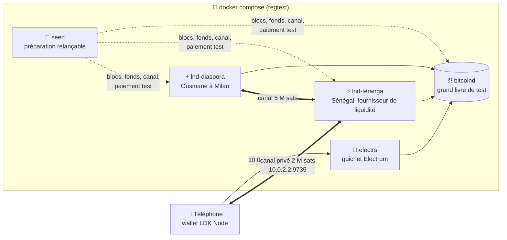
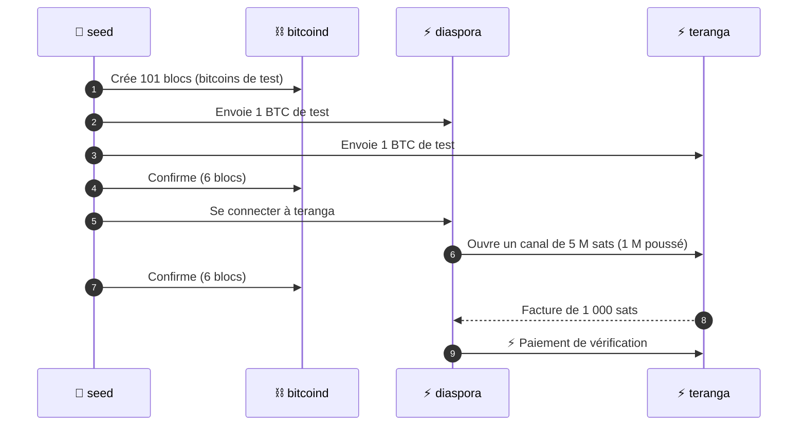

# 🧪 Infrastructure de démonstration

Réseau de test introduit en **T12** par Salam ; PAN relit. Tout fonctionne en **regtest** : un réseau Bitcoin privé où les blocs sont créés à la demande et où aucun fonds n'a de valeur.

- [lightning](lightning/README.md) : Bitcoin Core regtest, un serveur Electrum et deux nœuds LND (`lnd-teranga`, `lnd-diaspora`), décrits dans `lightning/compose.yaml`.
- [seed](seed/README.md) : initialisation reproductible (fonds de test, canal, paiement de vérification) et personnages fictifs.





Le fichier `compose.yaml` à la racine du dépôt inclut ces services. L'API, la passerelle simulée et le service d'alertes s'y ajouteront avec leurs tâches.

```sh
npm run regtest:up      # démarre bitcoind et les deux nœuds, attend qu'ils soient prêts
npm run regtest:seed    # prépare fonds, canal et paiement de vérification (relançable)
npm run regtest:down    # arrête en gardant les données
npm run regtest:reset   # arrête et efface toutes les données du réseau de test
```

Prérequis : Docker Desktop (ou Docker Engine) avec Compose v2.20 ou plus récent. Le premier démarrage télécharge environ 300 Mo d'images.
