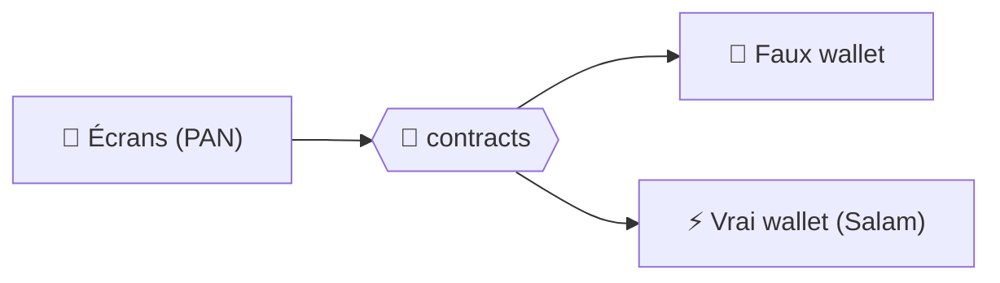

# 🤝 Packages partagés

> Du code utilisé à la fois par l'application et par d'autres parties du projet.

| Dossier                          | Ce que c'est                                                                                                                                                       |
| -------------------------------- | ------------------------------------------------------------------------------------------------------------------------------------------------------------------ |
| [contracts](contracts/README.md) | Le **contrat Wallet** : la liste des fonctions que les écrans peuvent appeler, les erreurs possibles, les conversions FCFA ↔ sats et un faux wallet pour les tests |

Grâce au contrat, PAN a pu construire tous les écrans avec le faux wallet pendant que Salam construisait le vrai. Les deux exposent un contrat commun ; les ports UI nécessitent encore leurs adaptateurs.

PAN et Salam valident ensemble les interfaces communes. Un package devient un workspace après ajout de son manifeste et des vérifications correspondantes. Les interfaces préparent les échanges ; les adaptateurs et leur composition restent suivis dans le [raccordement natif #120](https://github.com/PapaAmad/teranga-pay/issues/120).
