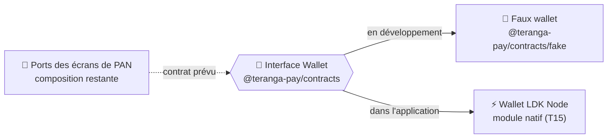
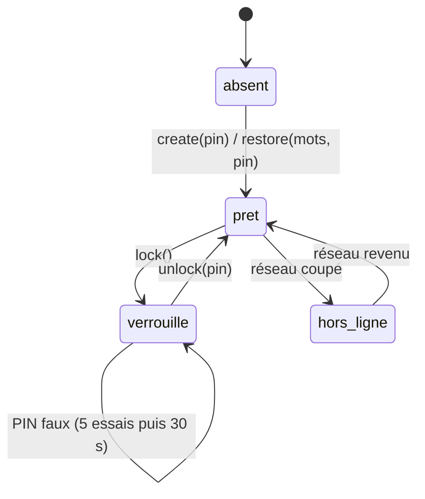
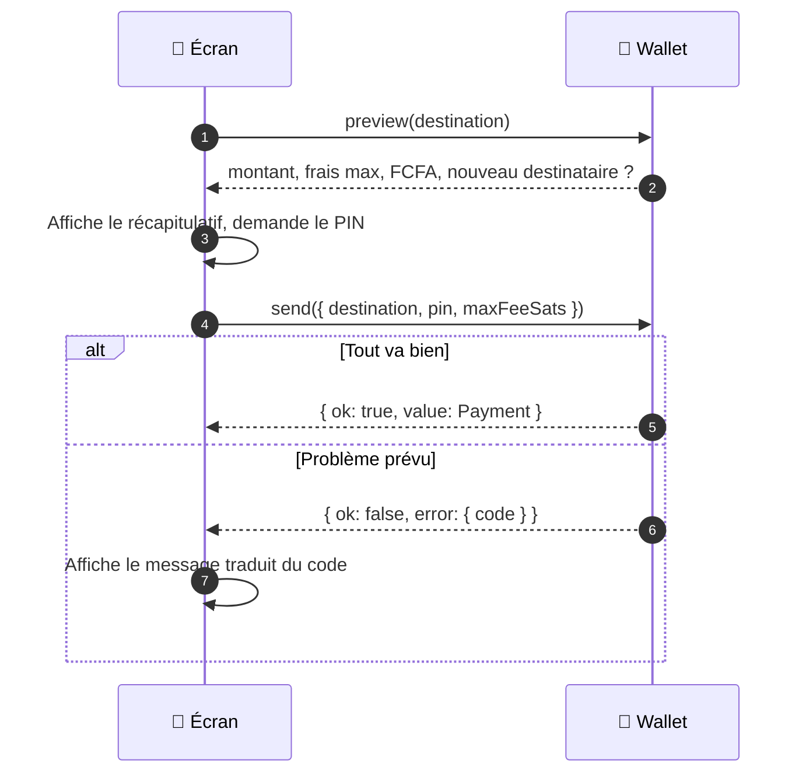

# 🤝 Contrats partagés | T11

Ce package définit le « contrat » entre les écrans de l'application (PAN) et la logique du wallet (Salam). Les ports propres aux écrans décrivent les fonctions attendues de l’interface `Wallet`. Le vrai wallet LDK Node ([décision 0008, PR #50](https://github.com/PapaAmad/teranga-pay/pull/50)) et le faux wallet ci-dessous respectent la même interface, ce qui prépare les adaptateurs dont la composition reste suivie dans le [raccordement natif #120](https://github.com/PapaAmad/teranga-pay/issues/120).

**État : base T11 consolidée sur autorisation de PAN.** C'est une tâche commune : PAN valide les états, les erreurs et les unités pendant la relecture.

### Les états du wallet

### Un envoi, pas à pas

## Exports

`@teranga-pay/contracts` :

- `Wallet` : `state`, `create`, `restore`, `unlock`, `lock`, `balance`, `receive`, `lookupInvoice`, `preview`, `send`, `history` et `subscribe`.
- Types : `WalletState`, `Balance`, `Invoice`, `PaymentPreview`, `Payment`, `WalletEvent`, `RateInfo`, `Result` et `WalletError`.
- `walletErrorCodes` : liste fermée des codes d'erreur. L'application traduit chaque code ; aucun texte n'est fourni ici. `PAYMENT_PENDING` (T21) signale qu'un envoi identique est encore en cours : l'écran doit proposer d'attendre, pas de renvoyer.
- Conversions de montants :
  - `xofToSats` arrondit au sat supérieur, comme l'API T17 ;
  - `satsToXof` arrondit au FCFA inférieur, pour ne jamais afficher un solde trop élevé.
- Aides de saisie : `detectDestination` (facture ou adresse Lightning), `isValidPinFormat` (6 chiffres) et `isValidInvoiceExpiry` (bornes `invoiceExpiryBounds`, de 60 à 3 600 secondes).

`@teranga-pay/contracts/fake` : `createFakeWallet()`, un wallet en mémoire et entièrement fictif. Il sert à construire et tester les écrans (T14, T16, T18, T20, T24) avant l'arrivée du vrai wallet. `simulateIncomingPayment` simule un paiement reçu, `simulateInvoicePaid(paymentId)` le règlement d'une facture précise et `setOnline(false)` simule une coupure de réseau.

## Règles du contrat

- Montants **entiers** avec l'unité dans le nom (`amountSats`, `amountXof`). Le FCFA n'a pas de centimes.
- Les cas prévus (PIN faux, fonds insuffisants, réseau coupé…) **renvoient** `{ ok: false, error: { code } }` sans lever d'exception, ce qui oblige les écrans à les gérer.
- Un montant différent de celui fixé par la facture est refusé (`AMOUNT_INVALID`). À la réception, `amountXof` n'est accepté qu'avec `amountSats`.
- `send` accepte `maxFeeSats`, le maximum affiché par `preview` : au-delà, `FEE_TOO_HIGH`. **Proposition à valider par PAN.**
- Chaque facture porte un `paymentId` : c'est l'`id` du `Payment` qui la réglera. `lookupInvoice(paymentId)` relit la demande et son règlement, même après redémarrage. Un montant égal ou une hausse du solde ne prouvent pas qu'une vente précise est payée (T22).
- `receive({ expiresInSecs })` fixe la vraie durée de validité de la facture, par exemple l'échéance du devis T17 ; hors bornes, `EXPIRY_INVALID`.
- `Payment.amountXof` garde la valeur FCFA du moment du paiement (prix du devis pour une facture) et n'est jamais recalculé au cours actuel ; `null` si aucun taux n'était connu.
- `history({ limit, before })` pagine par identifiant : `before` est l'`id` du dernier paiement de la page précédente.
- Le PIN est revérifié à chaque envoi. Après 5 erreurs, le wallet bloque pendant 30 secondes (`PIN_LOCKED`).
- Une destination jamais payée est signalée par `newRecipient: true` et déclenche l'alerte prévue en T27.
- Dates au format ISO 8601 UTC. Les 12 mots de récupération ne sont renvoyés qu'une fois, à la création.

## Commandes

- `npm test --workspace @teranga-pay/contracts` : tests du contrat et du faux wallet.
- `npm run typecheck --workspace @teranga-pay/contracts`.

Le code est en TypeScript exécuté directement par Node pour les tests et compilé par Metro dans l'application. Les fichiers internes s'importent entre eux par le nom du package (`@teranga-pay/contracts`), ce qui fonctionne à la fois dans Node et dans l'application. Avec `PAYMENT_TIMEOUT` et `PAYMENT_PENDING`, l'erreur porte `paymentId` : l'écran suit ce paiement (événement `paiement`, `history`) au lieu de bloquer ou de renvoyer. `ALREADY_PAID` signifie qu'aucun argent n'est parti cette fois. Le faux wallet simule ce cas avec `simulateSlowNextSend()` puis `simulateSendSettled(id, 'reussi' | 'echoue')`.
