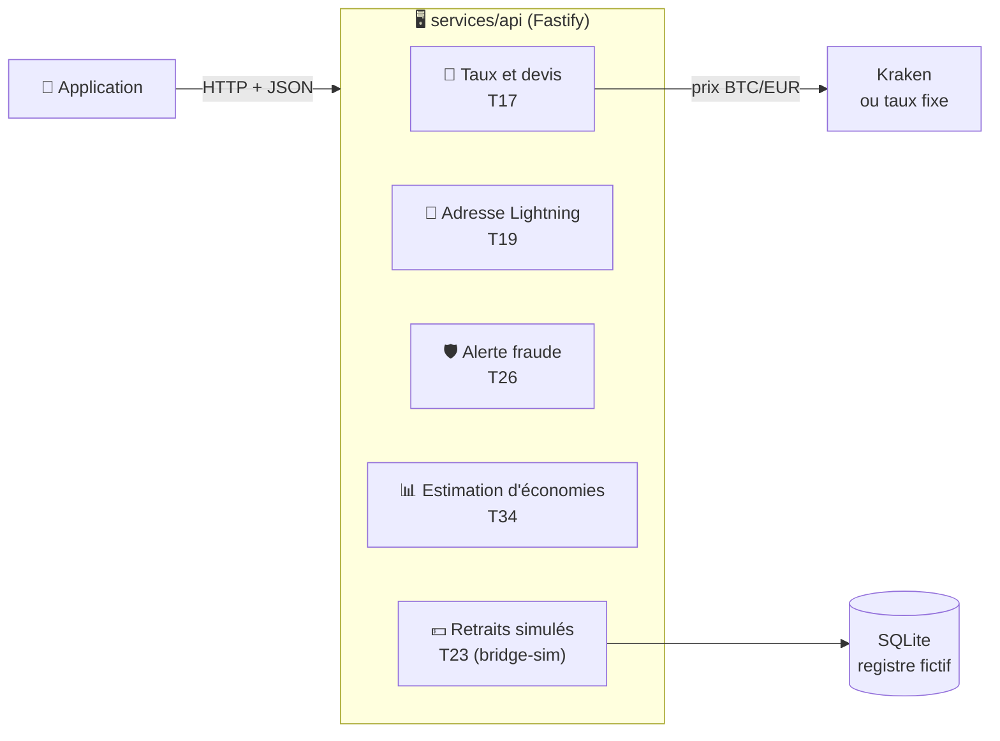

# 🖥️ Services (le serveur)

> Le serveur de Teranga Pay **aide** l'application : il donne le taux BTC/FCFA, fige les prix, relaie l'adresse Lightning, signale les envois inhabituels et simule les retraits. Il ne détient **jamais** les clés ni l'argent des utilisateurs.



| Dossier                            | Ce qu'il fait                                                            | Responsable |
| ---------------------------------- | ------------------------------------------------------------------------ | ----------- |
| [api](api/README.md)               | Le serveur HTTP : toutes les routes, la validation, les limites de débit | Salam       |
| [bridge-sim](bridge-sim/README.md) | La passerelle Wave / Orange Money **simulée**, branchée dans l'API       | PAN         |
| [ai](ai/README.md)                 | Les règles d'alerte et d'estimation, expliquées (le code vit dans l'API) | Salam       |

## Essayer

```sh
npm run api                       # démarre l'API sur http://127.0.0.1:3000
curl http://127.0.0.1:3000/health # {"status":"ok","service":"teranga-api"}
curl http://127.0.0.1:3000/v1/rate
```

Pour les retraits simulés : `npm run bridge:setup`, puis `npm run bridge:demo`, puis `npm run bridge:check` dans un autre terminal.

## Ce que le serveur ne fait jamais

- Il ne reçoit ni la phrase de récupération, ni le code PIN, ni les clés du wallet.
- Il ne crée aucune facture à la place du téléphone et ne garde aucun fonds.
- Il n'écrit ni adresse IP, ni contenu de requête dans ses journaux.

Les choix sont expliqués dans la [décision 0007](../docs/decisions/0007-squelette-api.md) (Fastify) et la [vue d'architecture](../docs/architecture/vue-ensemble.md).

## État d’intégration

Salam et PAN maintiennent les services selon leurs responsabilités. L’API, les règles d’alerte et la passerelle fictive sont présentes ; le [raccordement natif #120](https://github.com/PapaAmad/teranga-pay/issues/120) des ports UI reste ouvert. Les retraits nécessitent une activation explicite et restent limités à la démonstration locale ; voir la [décision 0017](../docs/decisions/0017-passerelle-simulee-et-idempotence.md).
