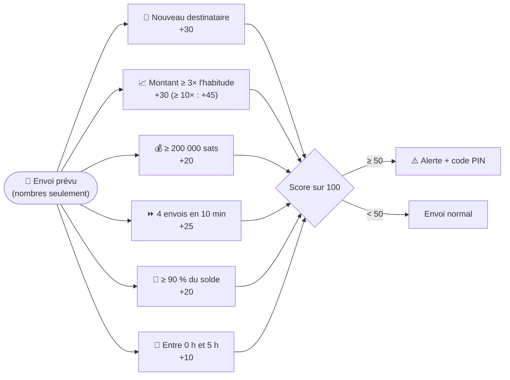
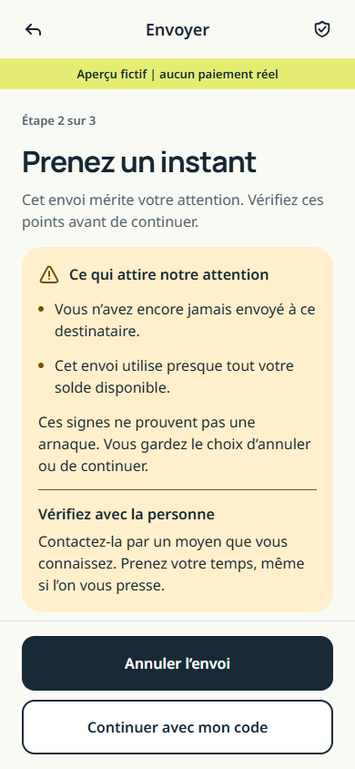

# 🛡️ Alertes et estimation

> Deux aides à la décision, **simples et explicables** : prévenir avant un envoi inhabituel (T26) et estimer l'économie par rapport à un transfert classique (T34). Aucune ne bloque ni n'exécute un paiement.

Pour la démo, il n'y a pas de modèle d'apprentissage automatique : des règles claires, dont chaque point est justifié, suffisent et se comprennent. Le code vit donc dans l'API ([`fraud.ts`](../api/src/fraud.ts), [`savings.ts`](../api/src/savings.ts)). Un service séparé ne se justifierait que si ces calculs demandaient leurs propres ressources.

## Alerte avant un envoi | T26 et T27

Le fournisseur HTTP peut transmettre des nombres sans nom, numéro ni facture. Les ressources UI traduisent les raisons en phrases simples ; leur composition effective reste suivie dans le [raccordement natif #120](https://github.com/PapaAmad/teranga-pay/issues/120).

## Estimation d'économies | T34

> **économie = frais d'un envoi classique − frais réellement payés**

Les hypothèses (par exemple 2,5 à 3,8 % pour France → Sénégal) viennent du document de conception et sont renvoyées avec chaque réponse. Ce sont des ordres de grandeur : voir la [décision 0011](../../docs/decisions/0011-estimation-economies.md).

Détails des routes : [README de l'API](../api/README.md).

Salam porte les règles T26/T34 ; PAN porte leur affichage. Ces fonctions n’ont accès ni aux clés ni à la phrase secrète.
