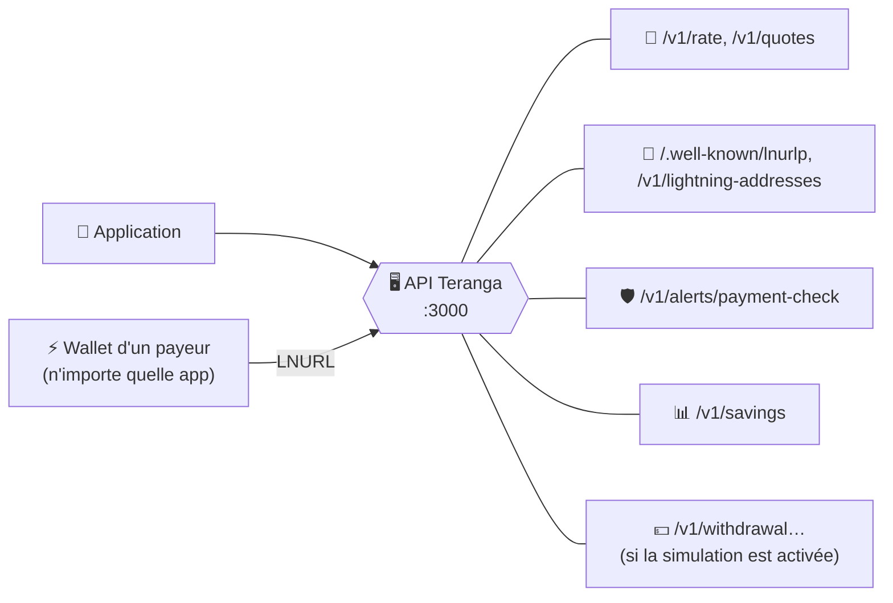
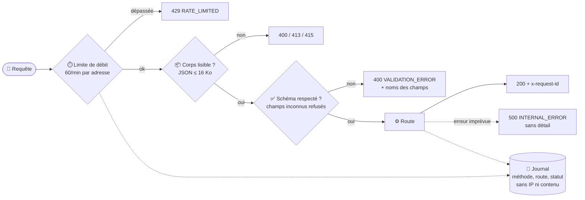
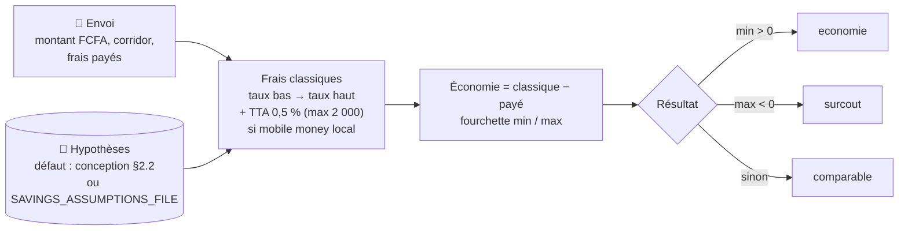
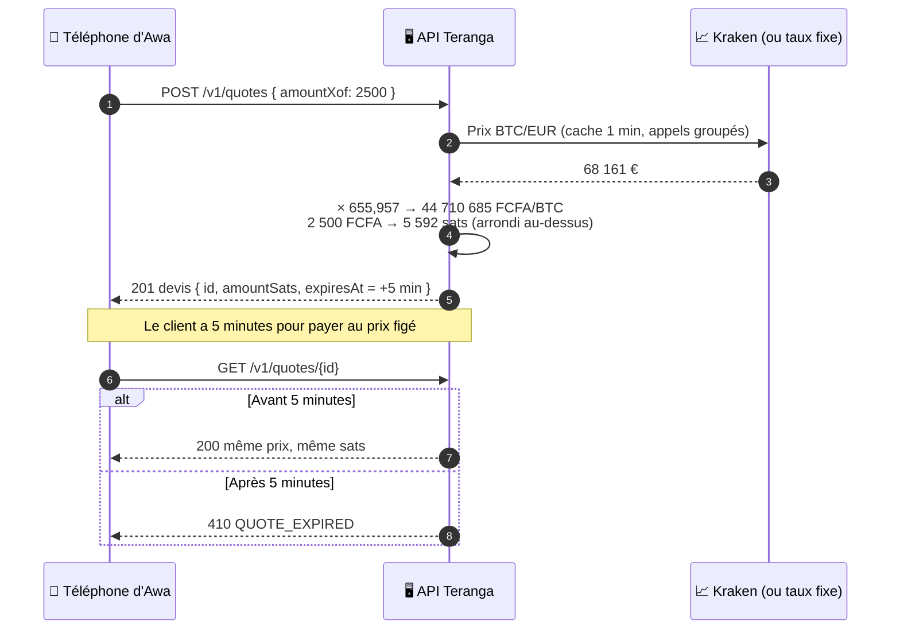
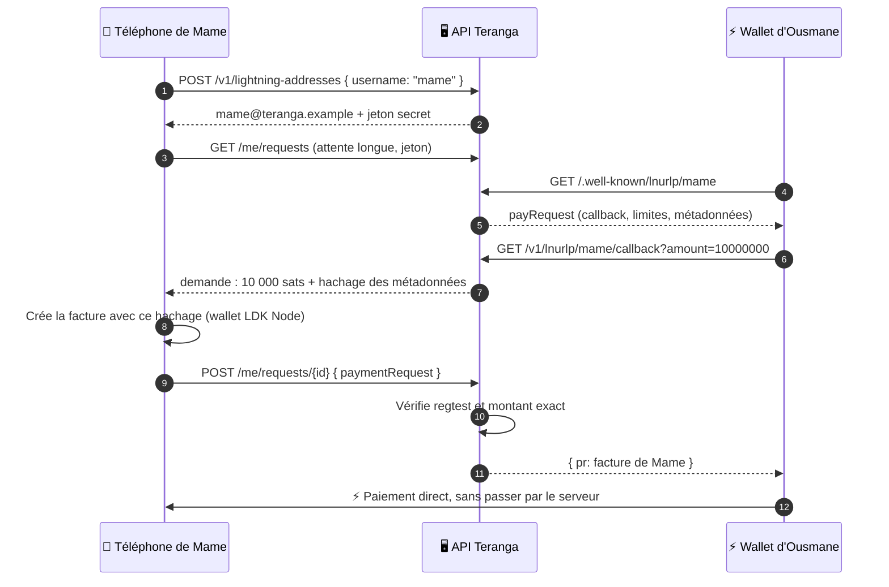
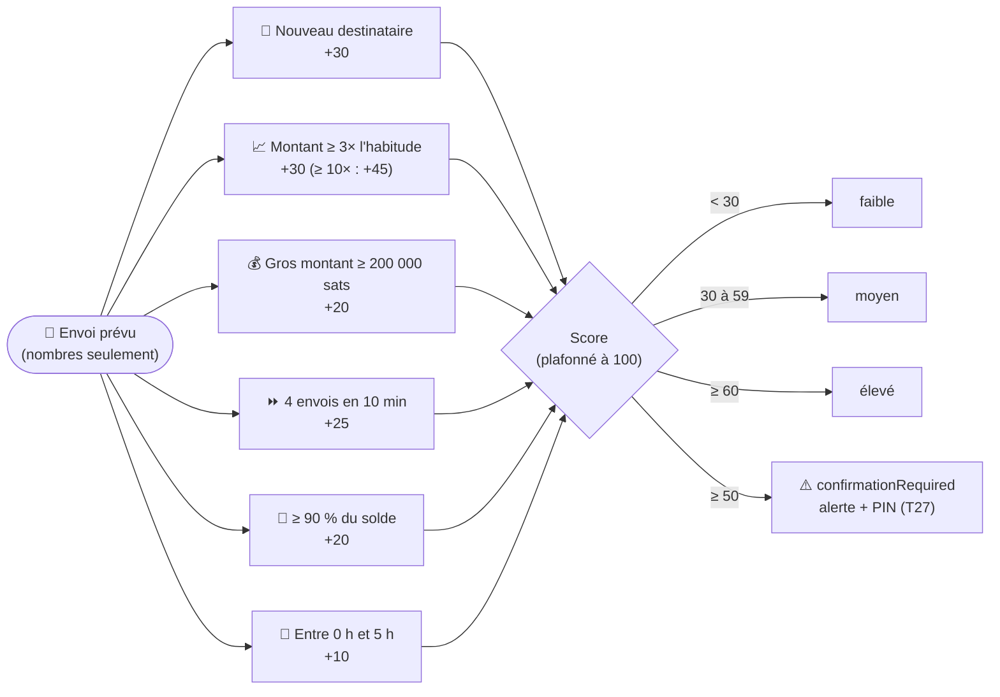

# 🖥️ API Teranga

> Le serveur HTTP de Teranga Pay. Il donne le taux BTC/FCFA, fige les prix pendant 5 minutes, relaie l'adresse Lightning vers le téléphone, évalue les envois inhabituels, estime les économies et simule les retraits. **Il ne touche jamais aux clés ni aux fonds.**

Node.js 24 et TypeScript lancé directement par Node, sans compilation. Le framework est Fastify ([décision 0007](../../docs/decisions/0007-squelette-api.md)). Salam porte l'API ; PAN porte les retraits simulés.

## En un coup d'œil



## Démarrer

Depuis la racine du dépôt :

```sh
npm run api                                   # http://127.0.0.1:3000
npm test --workspace @teranga-pay/api         # tests, sans réseau
npm run typecheck --workspace @teranga-pay/api
```

Retraits simulés : `npm run bridge:setup` crée un jeton secret dans `services/api/.env.bridge-sim` (ignoré par Git), `npm run bridge:demo` démarre l'API avec la simulation, puis `npm run bridge:check` fait un retrait fictif par opérateur.

## Toutes les routes

|     | Méthode | Chemin                                    | Ce qu'elle fait                                                   |
| --- | ------- | ----------------------------------------- | ----------------------------------------------------------------- |
| ❤️  | GET     | `/health`                                 | Le serveur répond-il ?                                            |
| 💱  | GET     | `/v1/rate`                                | Taux BTC/FCFA et sa source                                        |
| 💱  | POST    | `/v1/quotes`                              | Fige un prix en FCFA → sats pendant 5 minutes                     |
| 💱  | GET     | `/v1/quotes/:id`                          | Relit un devis (`410` s'il a expiré)                              |
| 📮  | POST    | `/v1/lightning-addresses`                 | Réserve `nom@teranga.example`, renvoie un jeton (montré une fois) |
| 📮  | GET     | `/.well-known/lnurlp/:nom`                | Un payeur découvre l'adresse (standard LNURL)                     |
| 📮  | GET     | `/v1/lnurlp/:nom/callback?amount=`        | Le payeur demande une facture ; elle vient du téléphone           |
| 📮  | GET     | `/v1/lightning-addresses/me/requests`     | Le téléphone attend les demandes (jeton requis)                   |
| 📮  | POST    | `/v1/lightning-addresses/me/requests/:id` | Le téléphone répond avec sa facture (jeton requis)                |
| 🛡️  | POST    | `/v1/alerts/payment-check`                | Score d'alerte d'un envoi, avec ses raisons                       |
| 📊  | GET     | `/v1/savings/assumptions`                 | Hypothèses de l'estimation et leurs sources                       |
| 📊  | POST    | `/v1/savings/estimate`                    | Économie estimée pour 1 à 100 envois                              |
| 💵  | GET     | `/v1/withdrawal-options`                  | Opérateurs, destinations de démo, frais fictifs                   |
| 💵  | GET     | `/v1/withdrawal-balance`                  | Solde fictif disponible et réservé                                |
| 💵  | POST    | `/v1/withdrawal-quotes`                   | Prépare un prix de retrait (5 minutes)                            |
| 💵  | GET     | `/v1/withdrawal-quotes/:id`               | Relit ce prix                                                     |
| 💵  | POST    | `/v1/withdrawals`                         | Confirme un retrait (`Idempotency-Key` : jamais deux fois)        |
| 💵  | GET     | `/v1/withdrawals`                         | Journal des retraits, page par page                               |
| 💵  | GET     | `/v1/withdrawals/:id`                     | Un retrait précis                                                 |
| 💵  | POST    | `/v1/withdrawals/:id/reconcile`           | Relit le résultat chez l'opérateur simulé                         |
| 💵  | POST    | `/v1/withdrawals/:id/retry`               | Reprend un retrait resté incertain, sans le doubler               |

Les routes 💵 n'existent que si `BRIDGE_SIM_ENABLED=true` et demandent un jeton Bearer.

Le diagramme présente les services disponibles. Leur composition avec les ports des écrans est suivie dans le [raccordement natif #120](https://github.com/PapaAmad/teranga-pay/issues/120). Les retraits restent fictifs et leur activation explicite ; voir la [décision 0017](../../docs/decisions/0017-passerelle-simulee-et-idempotence.md).

## Référence technique des bases consolidées

Squelette serveur introduit en **T13** par Salam ; PAN relit. Node.js 24 et TypeScript exécuté directement par Node (suppression des types), sans étape de compilation. Le framework est Fastify ; la [décision 0007](../../docs/decisions/0007-squelette-api.md) explique ce choix.

## Le trajet d'une requête



## Commandes

Depuis la racine du dépôt :

- `npm run api` démarre le serveur sur `http://127.0.0.1:3000`.
- `npm test --workspace @teranga-pay/api` lance les tests (`node:test`, sans réseau).
- `npm run typecheck --workspace @teranga-pay/api` vérifie les types.

`npm test` à la racine lance aussi ces tests, avant ceux de l'application mobile.

## Routes disponibles

| Méthode | Chemin                                    | Réponse                                                                                                                            |
| ------- | ----------------------------------------- | ---------------------------------------------------------------------------------------------------------------------------------- |
| GET     | `/health`                                 | `200 {"status":"ok","service":"teranga-api"}`                                                                                      |
| GET     | `/v1/rate`                                | `200 {"xofPerBtc","source","fetchedAt"}` : taux BTC/FCFA et sa source (T17)                                                        |
| POST    | `/v1/quotes`                              | `{"amountXof"}` (entier de 1 à 5 000 000) → `201` devis figé : `id`, `amountSats`, `xofPerBtc`, `source`, `createdAt`, `expiresAt` |
| GET     | `/v1/quotes/:id`                          | `200` devis actif, `410 QUOTE_EXPIRED` après expiration, `404 QUOTE_NOT_FOUND`                                                     |
| POST    | `/v1/alerts/payment-check`                | Score d'alerte fraude d'un envoi, sans donnée personnelle (T26)                                                                    |
| GET     | `/.well-known/lnurlp/:username`           | Découverte LNURL-pay de `nom@domaine` (T19)                                                                                        |
| GET     | `/v1/lnurlp/:username/callback?amount=`   | Facture fournie par le téléphone du destinataire (T19)                                                                             |
| POST    | `/v1/lightning-addresses`                 | Réserve un nom ; renvoie l'adresse et un jeton, montré une seule fois (T19)                                                        |
| GET     | `/v1/lightning-addresses/me/requests`     | Attente longue du téléphone : demandes de facture à traiter (jeton requis)                                                         |
| POST    | `/v1/lightning-addresses/me/requests/:id` | Le téléphone répond avec sa facture `{ paymentRequest }` (jeton requis)                                                            |
| GET     | `/v1/savings/assumptions`                 | Hypothèses de l'estimation d'économies, formule et sources                                                                         |
| POST    | `/v1/savings/estimate`                    | Estimation d'économies pour 1 à 100 envois, avec leur total                                                                        |

## Estimation d'économies | T34

La [décision 0011](../../docs/decisions/0011-estimation-economies.md) détaille les choix. Une seule formule, renvoyée avec chaque réponse :

> **économie = frais estimés d'un envoi classique − frais réellement payés**



| Corridor (`id`)      | Frais classiques | TTA | Source                                    |
| -------------------- | ---------------- | --- | ----------------------------------------- |
| `france_senegal`     | 2,5 à 3,8 %      | non | Conception §2.2, coût moyen en 2021       |
| `hors_zone_cfa`      | 10 à 15 %        | non | Conception §2.2, envois hors zone CFA     |
| `wave_local`         | 1 %              | oui | Conception §2.2, envoi local Wave         |
| `orange_money_local` | 0,8 %            | oui | Conception §2.2, envoi local Orange Money |

Exemple : 100 000 FCFA envoyés de France avec 150 FCFA de frais réels donnent une économie estimée de 2 350 à 3 650 FCFA. Le même calcul sur un envoi Wave local de 20 000 FCFA, avec 450 FCFA de frais réels, donne `surcout` (−150 FCFA) : le résultat négatif est renvoyé tel quel.

```bash
curl -s -X POST http://127.0.0.1:3000/v1/savings/estimate -H 'content-type: application/json' \
  -d '{"transfers":[{"amountXof":100000,"corridor":"france_senegal","actualFeesXof":150}]}'
```

Ce sont des **ordres de grandeur indicatifs** : les tarifs des opérateurs changent souvent. Les hypothèses sont à relire avant la démo, puis à remplacer par les mesures du pilote. La requête ne contient ni nom, ni numéro, ni identifiant de paiement.

## Taux et devis | T17



- **Source configurable** (`RATE_SOURCE`) :
  - `fixe` (par défaut) : taux de démonstration reproductible, `RATE_FIXED_XOF_PER_BTC` = 45 000 000 FCFA ;
  - `kraken` : dernier prix BTC/EUR public de Kraken, sans clé, converti par la parité fixe 1 € = 655,957 FCFA.
- **Cache et panne (Kraken)** : une mesure reste en cache une minute. Si Kraken ne répond plus, la dernière mesure sert encore dix minutes, puis l'API répond `503 RATE_UNAVAILABLE`. Les requêtes simultanées partagent une seule demande à Kraken. Un prix converti hors de 1 000 000 à 10 000 000 000 FCFA par BTC (bornes du taux fixe) est traité comme une panne.
- **La source est toujours renvoyée**, pour que l'application l'affiche à l'utilisateur, comme le demande le document de conception.
- **Conversion en sats** : calcul entier, arrondi au sat supérieur, pour que le commerçant ne reçoive jamais moins que le montant affiché.
- **Devis figé** : il garde son taux pendant `QUOTE_TTL_SECONDS` (300 s, soit 5 minutes) même si le marché bouge, puis il est déclaré expiré.
- **Stockage des devis** : en mémoire, au plus 10 000 ; au-delà, le plus ancien est oublié. Les devis expirés restent consultables une heure, ce qui permet de répondre « expiré » plutôt que « inconnu ». Tout est perdu au redémarrage, ce qui est acceptable pour la démo. Aucune route ne touche aux clés ou aux fonds du wallet.

## Adresse Lightning | T19

Le serveur **ne crée jamais de facture et ne touche jamais aux fonds** : il relaie la demande du payeur au téléphone du destinataire, qui fabrique la facture avec son propre wallet. Choix expliqué dans la [décision 0010](../../docs/decisions/0010-adresse-lightning.md).



- **Jeton :** 32 octets aléatoires, montré une seule fois. Le serveur n'en garde que l'empreinte SHA-256 ; il n'apparaît jamais dans les journaux.
- **Délais :** le payeur attend au plus `LNURL_CALLBACK_TIMEOUT_MS` (15 s). Si le téléphone est hors ligne, il reçoit `{"status":"ERROR"}` au format LNURL. Le téléphone reste en écoute 25 s par requête.
- **Contrôles :**
  - la facture doit être une facture regtest qui porte exactement le montant demandé ;
  - un téléphone ne peut répondre qu'aux demandes de sa propre adresse ;
  - 10 demandes au plus en attente par adresse.
- **Limites :**
  - noms réservés au premier arrivé, sans preuve d'identité ;
  - tout est gardé en mémoire et perdu au redémarrage ;
  - le hachage des métadonnées inscrit dans la facture n'est pas vérifié par le serveur : c'est le wallet du payeur qui le vérifie, comme l'impose LUD-06 ;
  - HTTP en démonstration locale ; HTTPS est requis hors démonstration.

## Alerte fraude | T26

`POST /v1/alerts/payment-check` évalue un envoi **avant** la confirmation. Le corps ne contient que des nombres : montant, nouveau destinataire ou non, derniers envois (montant et âge), montants habituels, heure locale et solde. Aucun nom, numéro, adresse ni facture : un champ inconnu est refusé. L'alerte **avertit sans jamais bloquer** ; l'affichage et la confirmation par PIN sont faits par l'application (T27).



Réponse : `{ score, level, confirmationRequired, reasons: [{ code, points }] }`, raisons triées par poids. L'application traduit chaque code (`NOUVEAU_DESTINATAIRE`, `MONTANT_INHABITUEL`, `MONTANT_TRES_INHABITUEL`, `GROS_MONTANT`, `RYTHME_ANORMAL`, `PRESQUE_TOUT_LE_SOLDE`, `HEURE_INHABITUELLE`). Le montant inhabituel n'est évalué qu'à partir de 3 envois connus, pour ne pas alerter un nouvel utilisateur à chaque envoi. Poids et seuils sont des hypothèses de départ, à ajuster après les premiers essais.

## Règles communes à toutes les routes

- **Validation** : chaque route déclare un schéma JSON. Les champs inconnus sont refusés, pas ignorés. Les valeurs d'un corps JSON ne sont jamais converties (`true` ou `"500"` ne valent pas un nombre) ; seuls les paramètres d'URL, reçus en texte, sont convertis vers le type attendu. Corps limité à 16 Ko, JSON uniquement.
- **Erreurs** : réponse `{"error":{"code","requestId","fields?"}}` avec un code stable (`VALIDATION_ERROR`, `NOT_FOUND`, `RATE_LIMITED`, `PAYLOAD_TOO_LARGE`, `UNSUPPORTED_MEDIA_TYPE`, `BAD_REQUEST`, `INTERNAL_ERROR`). `fields` donne le nom des champs refusés, jamais leur valeur. L'application traduit ces codes ; le serveur ne renvoie aucun texte d'interface ni détail interne.
- **Limite de débit** : 60 requêtes par minute et par adresse réseau, routes inconnues comprises, comptées avant la lecture du corps. L'en-tête `X-Forwarded-For` est ignoré pour ne pas permettre de contourner la limite. Le compteur reste en mémoire : il repart à zéro au redémarrage et n'est pas partagé entre plusieurs instances.
- **Journaux** : seuls la méthode, le modèle de route (`/essai/:numero`, jamais la valeur), le code de réponse, la durée et un identifiant de requête aléatoire sont écrits. Ni adresse IP, ni en-têtes, ni paramètres d'URL, ni corps, ni nom de machine. Les tests vérifient ces absences.
- **En-têtes** : `X-Content-Type-Options: nosniff`, `Cache-Control: no-store` et `X-Request-Id` pour relier une erreur signalée à son journal.

## Variables d'environnement

Voir [.env.example](.env.example). `npm run api` lit `services/api/.env` s'il existe (fichier ignoré par Git) ; les variables déjà définies dans l'environnement restent prioritaires. Toute valeur invalide arrête le démarrage avec un message clair.

| Variable                    | Défaut                    | Rôle                                                                              |
| --------------------------- | ------------------------- | --------------------------------------------------------------------------------- |
| `API_HOST`                  | `127.0.0.1`               | Interface d'écoute (`0.0.0.0` dans Docker)                                        |
| `API_PORT`                  | `3000`                    | Port                                                                              |
| `API_LOG_LEVEL`             | `info`                    | `fatal` à `trace`, ou `silent`                                                    |
| `API_RATE_LIMIT_MAX`        | `60`                      | Requêtes autorisées par fenêtre et adresse                                        |
| `API_RATE_LIMIT_WINDOW_MS`  | `60000`                   | Durée de la fenêtre en millisecondes (≥ 1 s)                                      |
| `RATE_SOURCE`               | `fixe`                    | `fixe` ou `kraken`                                                                |
| `RATE_FIXED_XOF_PER_BTC`    | `45000000`                | Taux du mode `fixe`, en FCFA pour 1 BTC                                           |
| `QUOTE_TTL_SECONDS`         | `300`                     | Durée de validité d'un devis (30 à 3 600 s)                                       |
| `LNADDRESS_DOMAIN`          | `teranga.example`         | Domaine des adresses Lightning                                                    |
| `PUBLIC_BASE_URL`           | `http://127.0.0.1:3000`   | URL publique de l'API pour le callback LNURL (émulateur : `http://10.0.2.2:3000`) |
| `LNURL_CALLBACK_TIMEOUT_MS` | `15000`                   | Attente maximale de la facture du téléphone                                       |
| `SAVINGS_ASSUMPTIONS_FILE`  | _(vide)_                  | Fichier JSON qui remplace les hypothèses T34                                      |
| `BRIDGE_SIM_ENABLED`        | `false`                   | Active les seules routes de retrait fictif ; écoute loopback obligatoire.         |
| `BRIDGE_SIM_TOKEN`          | absent                    | Jeton aléatoire de 32 à 128 caractères, conservé dans le fichier ignoré.          |
| `BRIDGE_SIM_DB_PATH`        | `.data/bridge-sim.sqlite` | Registre durable fictif ; préserver ce fichier pour la reprise.                   |
| `BRIDGE_SIM_SCENARIO`       | `success`                 | `success`, `declined`, `timeout_after_success` ou `unavailable`.                  |

## Limites connues

- Pas encore de proxy inverse : le jour où l'API passe derrière un proxy, il faudra configurer `trustProxy` avec l'adresse exacte du proxy, sinon toutes les requêtes partageront la même limite.
- Les routes publiques T13/T17 n'authentifient pas un wallet et leurs devis restent en mémoire. Les routes de retrait T23 ajoutent leur propre contrôle d'accès et leur registre durable ; les identités de démonstration ne sont pas des comptes wallet.
- Pas d'image Docker : elle arrivera avec la commande unique de démonstration (T12 et suivantes).

## T23 | Retraits simulés

PAN porte le [module de passerelle](../bridge-sim/README.md) ; Salam relit. L’API existante monte ses routes lorsque la simulation est explicitement activée. Elles demandent un jeton Bearer de démonstration fourni hors du dépôt, sur une écoute locale. L’identité vient de cette authentification, jamais du corps d’une requête. La configuration et les commandes ci-dessus décrivent le lancement ; le module ne crée pas un second serveur HTTP.

Toutes les réponses métier réussies de ce parcours portent `simulation: true` ; les erreurs gardent le format commun de l’API. Les opérateurs sont `wave` et `orange_money`, avec pour seuls destinataires `wave-demo-001` et `orange-demo-001`. Aucun numéro personnel, PIN, solde natif ou clé n’est demandé. Les frais fixes de **100 FCFA sont fictifs** et apparaissent dans le devis avant la confirmation.

| Méthode | Chemin                          | Rôle                                                                                                  |
| ------- | ------------------------------- | ----------------------------------------------------------------------------------------------------- |
| GET     | `/v1/withdrawal-options`        | Opérateurs, destinations de démonstration et frais fictifs.                                           |
| GET     | `/v1/withdrawal-balance`        | Solde fictif disponible et réservé de l’identité authentifiée.                                        |
| POST    | `/v1/withdrawal-quotes`         | Prépare le prix, les frais et le total à partir du taux T17 ; conserve le devis au plus cinq minutes. |
| GET     | `/v1/withdrawal-quotes/:id`     | Relit le devis durable de cette même identité.                                                        |
| POST    | `/v1/withdrawals`               | Confirme un `quoteId` avec un en-tête `Idempotency-Key` au format UUID opaque.                        |
| GET     | `/v1/withdrawals`               | Lit le journal paginé de l’identité authentifiée, sans nouvelle opération.                            |
| GET     | `/v1/withdrawals/:id`           | Consulte le retrait connu sans créer d’opération.                                                     |
| POST    | `/v1/withdrawals/:id/reconcile` | Relit le journal opérateur simulé de cette opération précise.                                         |
| POST    | `/v1/withdrawals/:id/retry`     | Reprend explicitement cette même opération après lecture de son journal, sans nouvelle réservation.   |

Pour réessayer une confirmation dont la réponse a été perdue, conserver **le même devis et le même UUID de clé**. Une chaîne opaque arbitraire qui n’est pas un UUID est refusée. Le même couple retrouve le retrait après expiration ou redémarrage. La réutilisation de la clé pour un autre devis, ou du devis avec une autre clé, produit un conflit. Le serveur recherche d’abord le retrait déjà engagé : même si le devis a expiré, il répond `409 QUOTE_ALREADY_USED`, pas `410 QUOTE_EXPIRED`. Les erreurs `QUOTE_ALREADY_USED` et `IDEMPOTENCY_CONFLICT` peuvent fournir `error.withdrawalId`, uniquement après vérification de l’identité propriétaire ; le client peut alors consulter ou reprendre cette référence. Les lectures restent limitées à l’identité authentifiée ; connaître une référence ne donne aucun accès aux données d’un autre compte.

La confirmation initiale répond `201` si son résultat est terminal. Un état `en_attente` ou `incertain` répond toujours `202`, y compris au rejeu. Un rejeu terminal répond `200` et conserve `Idempotent-Replay: true`. Ces codes HTTP ne remplacent pas le statut métier du corps. Une lecture, réconciliation ou reprise d’une référence inconnue ou étrangère répond `404 WITHDRAWAL_NOT_FOUND` ; un registre fermé répond `503 STORAGE_CLOSED` sans détail de base.

### Reprise volontaire après une panne

`POST /v1/withdrawals/:id/retry` avec le corps `{}` est authentifié et limité au propriétaire, comme la réconciliation. Il lit d’abord le journal de l’opérateur simulé : un résultat connu est rapproché ; une lecture échouée garde l’incertitude sans soumettre. Si la lecture réussit sans résultat, la reprise soumet **le même identifiant et la même charge utile figée** au simulateur. Son contrat impose l’idempotence durable par identifiant de retrait : plusieurs reprises concurrentes ne produisent qu’un seul effet fictif. Aucun nouveau devis, retrait ou débit de réservation n’est créé, même si le devis réservé a expiré. Un résultat terminal est conservé sans appel opérateur.

La reprise répond `200` si un résultat terminal est retrouvé, sinon `202`. Elle ne libère jamais les fonds sur le seul écoulement du temps. Cette composition est exclusivement simulée ; un futur opérateur réel nécessitera une garantie d’idempotence et une décision d’intégration distinctes.

### Journal de simulation pour T24

`GET /v1/withdrawals?limit=20&before=<id>` renvoie `{"simulation":true,"items":[...],"nextCursor":null}`. La limite vaut 20 par défaut et accepte les entiers de 1 à 100. Omettre `before` pour commencer ; pour continuer, reprendre exactement `nextCursor`. Ce curseur est l’identifiant du dernier retrait rendu ; `null` termine la liste connue par cette lecture. Un curseur inconnu ou appartenant à une autre identité répond `404 NOT_FOUND`, sans révéler ses données. Les paramètres inconnus et les curseurs malformés sont refusés.

Le tri utilise la **date de création immuable** du retrait, puis son identifiant, tous deux décroissants. Les dates égales ne provoquent ni doublon ni omission entre pages. Le statut et `updatedAt` sont relus dans le journal durable : une confirmation tardive actualise le détail sans déplacer le retrait vers une autre page. La pagination ne gèle pas le journal entre plusieurs requêtes ; actualiser depuis la première page pour retrouver les nouvelles créations. Cette date de classement ne prétend pas être la date effective d’un règlement.

La liste ne soumet ni ne réconcilie de retrait et ne modifie aucun solde. Elle reste un historique de **simulation** séparé des paiements du wallet ; T24 ne doit pas additionner ces retraits fictifs comme s’ils étaient des débits natifs.

`en_attente` et `incertain` conservent la réservation fictive. Seule une preuve terminale du simulateur permet de consommer ou de libérer cette réservation, une fois. La réconciliation ne soumet pas un nouveau transfert ; la reprise volontaire peut resoumettre la même opération idempotente après une lecture sans résultat. Le scénario `timeout_after_success` permet de vérifier un succès dont la réponse a été perdue ; `unavailable` garde l’incertitude tant que le simulateur reste indisponible. Les autres scénarios sont `success` et `declined`.

SQLite conserve les comptes, devis, retraits et résultats du simulateur. Préserver le même fichier conserve les garanties de rejeu ; le supprimer ou restaurer une ancienne copie les réinitialise. Aucune purge automatique n’est introduite : la rétention bornée des devis non engagés reste à définir sans effacer les références nécessaires aux reprises. Les devis de retrait utilisent directement la conversion entière T17 puis leur copie durable ; aucun second magasin mémoire n’est créé pour eux. Ce stockage local synchrone sert une démonstration à faible volume. L’[ADR 0017](../../docs/decisions/0017-passerelle-simulee-et-idempotence.md) décrit les choix et leurs limites ; le [suivi T23](../../docs/planning/suivi-t23.md) distingue les tests observés de ceux encore attendus. L’écran de retrait reste T25 et les reçus mobiles T24.
