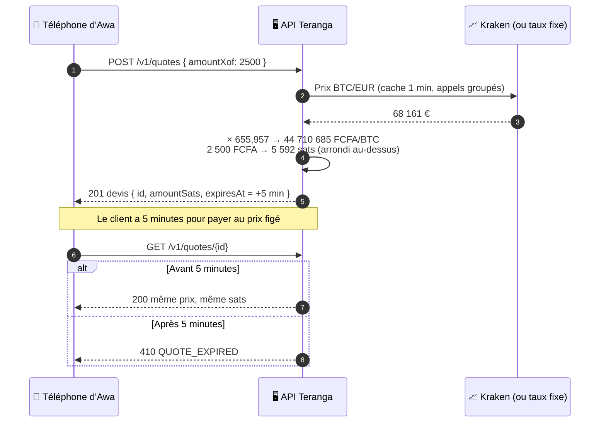

# 🖥️ API Teranga

Squelette serveur introduit en **T13** par Salam ; PAN relit. Node.js 24 et TypeScript exécuté directement par Node (suppression des types), sans étape de compilation. Le framework est Fastify ; la [décision 0007](../../docs/decisions/0007-squelette-api.md) explique ce choix.

## Le trajet d'une requête

## Commandes

Depuis la racine du dépôt :

- `npm run api` démarre le serveur sur `http://127.0.0.1:3000`.
- `npm test --workspace @teranga-pay/api` lance les tests (`node:test`, sans réseau).
- `npm run typecheck --workspace @teranga-pay/api` vérifie les types.

`npm test` à la racine lance aussi ces tests, avant ceux de l'application mobile.

## Route disponible

| Méthode | Chemin           | Réponse                                                                                                                            |
| ------- | ---------------- | ---------------------------------------------------------------------------------------------------------------------------------- |
| GET     | `/health`        | `200 {"status":"ok","service":"teranga-api"}`                                                                                      |
| GET     | `/v1/rate`       | `200 {"xofPerBtc","source","fetchedAt"}` : taux BTC/FCFA et sa source (T17)                                                        |
| POST    | `/v1/quotes`     | `{"amountXof"}` (entier de 1 à 5 000 000) → `201` devis figé : `id`, `amountSats`, `xofPerBtc`, `source`, `createdAt`, `expiresAt` |
| GET     | `/v1/quotes/:id` | `200` devis actif, `410 QUOTE_EXPIRED` après expiration, `404 QUOTE_NOT_FOUND`                                                     |

T19 ajoutera la Lightning Address.

## Taux et devis (T17)

- **Source configurable** (`RATE_SOURCE`) :
  - `fixe` (par défaut) : taux de démonstration reproductible, `RATE_FIXED_XOF_PER_BTC` = 45 000 000 FCFA ;
  - `kraken` : dernier prix BTC/EUR public de Kraken, sans clé, converti par la parité fixe 1 € = 655,957 FCFA.
- **Cache et panne (Kraken)** : une mesure reste en cache une minute. Si Kraken ne répond plus, la dernière mesure sert encore dix minutes, puis l'API répond `503 RATE_UNAVAILABLE`. Les requêtes simultanées partagent une seule demande à Kraken. Un prix converti hors de 1 000 000 à 10 000 000 000 FCFA par BTC (bornes du taux fixe) est traité comme une panne.
- **La source est toujours renvoyée**, pour que l'application l'affiche à l'utilisateur, comme le demande le document de conception.
- **Conversion en sats** : calcul entier, arrondi au sat supérieur, pour que le commerçant ne reçoive jamais moins que le montant affiché.
- **Devis figé** : il garde son taux pendant `QUOTE_TTL_SECONDS` (300 s, soit 5 minutes) même si le marché bouge, puis il est déclaré expiré.
- **Stockage des devis** : en mémoire, au plus 10 000 ; au-delà, le plus ancien est oublié. Les devis expirés restent consultables une heure, ce qui permet de répondre « expiré » plutôt que « inconnu ». Tout est perdu au redémarrage, ce qui est acceptable pour la démo. Aucune route ne touche aux clés ou aux fonds du wallet.

## Règles communes à toutes les routes

- **Validation** : chaque route déclare un schéma JSON. Les champs inconnus sont refusés, pas ignorés. Les valeurs d'un corps JSON ne sont jamais converties (`true` ou `"500"` ne valent pas un nombre) ; seuls les paramètres d'URL, reçus en texte, sont convertis vers le type attendu. Corps limité à 16 Ko, JSON uniquement.
- **Erreurs** : réponse `{"error":{"code","requestId","fields?"}}` avec un code stable (`VALIDATION_ERROR`, `NOT_FOUND`, `RATE_LIMITED`, `PAYLOAD_TOO_LARGE`, `UNSUPPORTED_MEDIA_TYPE`, `BAD_REQUEST`, `INTERNAL_ERROR`). `fields` donne le nom des champs refusés, jamais leur valeur. L'application traduit ces codes ; le serveur ne renvoie aucun texte d'interface ni détail interne.
- **Limite de débit** : 60 requêtes par minute et par adresse réseau, routes inconnues comprises, comptées avant la lecture du corps. L'en-tête `X-Forwarded-For` est ignoré pour ne pas permettre de contourner la limite. Le compteur reste en mémoire : il repart à zéro au redémarrage et n'est pas partagé entre plusieurs instances.
- **Journaux** : seuls la méthode, le modèle de route (`/essai/:numero`, jamais la valeur), le code de réponse, la durée et un identifiant de requête aléatoire sont écrits. Ni adresse IP, ni en-têtes, ni paramètres d'URL, ni corps, ni nom de machine. Les tests vérifient ces absences.
- **En-têtes** : `X-Content-Type-Options: nosniff`, `Cache-Control: no-store` et `X-Request-Id` pour relier une erreur signalée à son journal.

## Variables d'environnement

Voir [.env.example](.env.example). `npm run api` lit `services/api/.env` s'il existe (fichier ignoré par Git) ; les variables déjà définies dans l'environnement restent prioritaires. Toute valeur invalide arrête le démarrage avec un message clair.

| Variable                   | Défaut      | Rôle                                         |
| -------------------------- | ----------- | -------------------------------------------- |
| `API_HOST`                 | `127.0.0.1` | Interface d'écoute (`0.0.0.0` dans Docker)   |
| `API_PORT`                 | `3000`      | Port                                         |
| `API_LOG_LEVEL`            | `info`      | `fatal` à `trace`, ou `silent`               |
| `API_RATE_LIMIT_MAX`       | `60`        | Requêtes autorisées par fenêtre et adresse   |
| `API_RATE_LIMIT_WINDOW_MS` | `60000`     | Durée de la fenêtre en millisecondes (≥ 1 s) |
| `RATE_SOURCE`              | `fixe`      | `fixe` ou `kraken`                           |
| `RATE_FIXED_XOF_PER_BTC`   | `45000000`  | Taux du mode `fixe`, en FCFA pour 1 BTC      |
| `QUOTE_TTL_SECONDS`        | `300`       | Durée de validité d'un devis (30 à 3 600 s)  |

## Limites connues

- Pas encore de proxy inverse : le jour où l'API passe derrière un proxy, il faudra configurer `trustProxy` avec l'adresse exacte du proxy, sinon toutes les requêtes partageront la même limite.
- Pas d'authentification ni de base de données : les devis vivent en mémoire. Le stockage durable viendra avec les routes qui en ont besoin (T19, T26).
- Pas d'image Docker : elle arrivera avec la commande unique de démonstration (T12 et suivantes).
