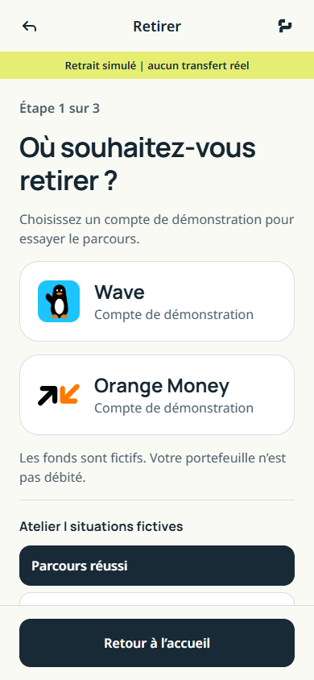
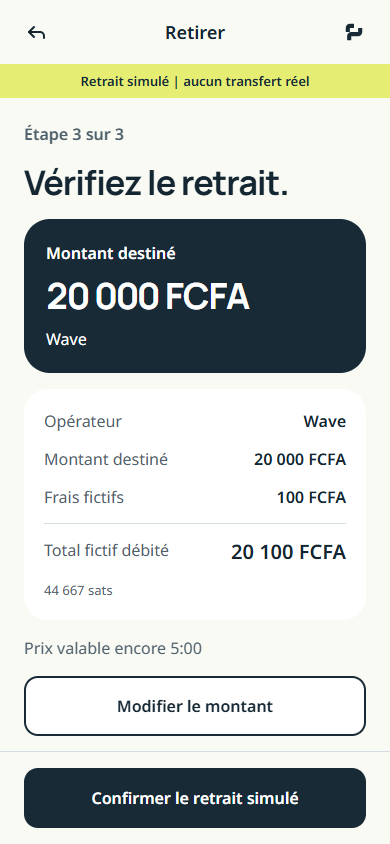
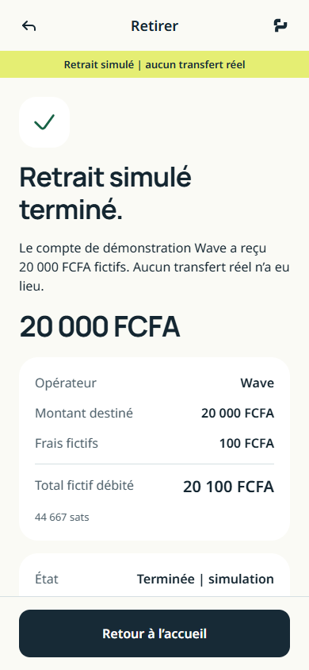
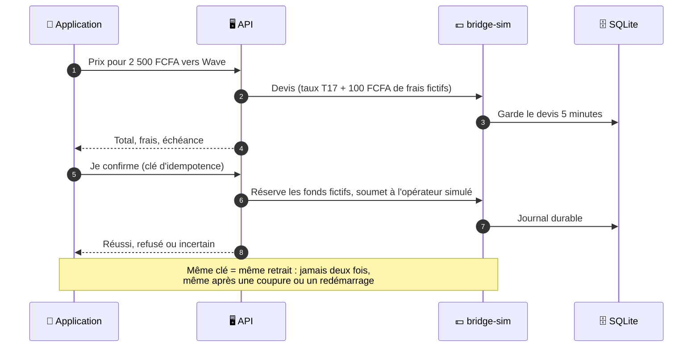
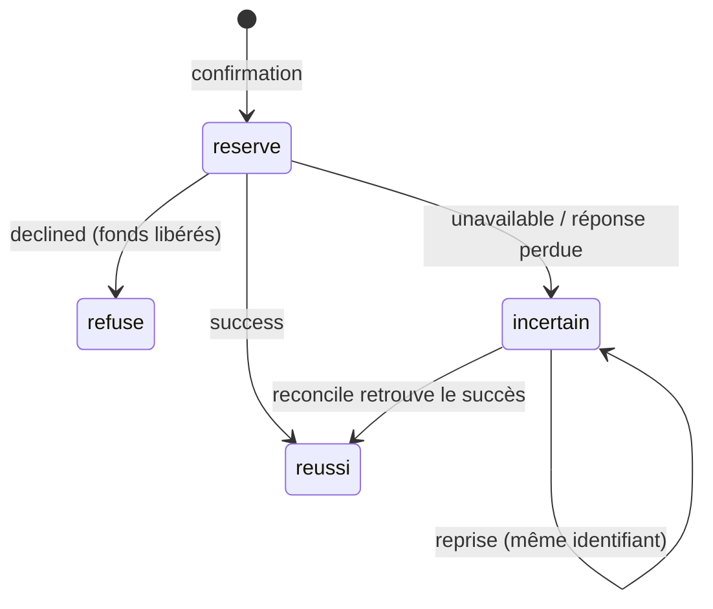

# 💵 Passerelle de retrait simulée | T23

> Fait **semblant** d'être Wave ou Orange Money, pour montrer le retrait en cash pendant la démo. Aucun opérateur réel n'est appelé et aucun vrai argent ne bouge.

PAN porte ce module ; Salam relit. Il est exposé par l’[API](../api/README.md) ; le branchement de l’écran T25 reste suivi dans le [raccordement natif #120](https://github.com/PapaAmad/teranga-pay/issues/120). Les captures et le diagramme présentent le parcours fictif prévu.

  
  
  

## Le parcours d'un retrait

## Les 4 scénarios de démo

Le scénario se choisit avec `BRIDGE_SIM_SCENARIO`. Essayer : `npm run bridge:setup`, `npm run bridge:demo`, puis `npm run bridge:check`.

## Détails

Projet de Salam et PAN. PAN porte ce module et son intégration à l’API Fastify T13/T17 ; Salam relit. Il simule Wave et Orange Money avec des comptes fictifs, des frais visibles, des réservations et un journal durable. L’écran Retirer relève de T25 ; l’historique et les reçus mobiles de T24.

Le [code source](src/README.md) fournit stockage SQLite, règles de devis/retrait et simulateur. Les seules destinations sont `wave-demo-001` et `orange-demo-001`. Les réponses portent `simulation: true`, et les frais fixes de **100 FCFA sont fictifs**. Ce module n’appelle aucun opérateur réel et ne possède aucun accès aux clés, PIN ou fonds du wallet mobile.

Le devis conserve durablement montant FCFA, frais, total, sats, taux, source et échéance limitée à cinq minutes. La confirmation utilise son identifiant et une clé d’idempotence au format UUID opaque. Une même demande est rejouée sans second effet ; modifier le devis sous la même clé ou réutiliser un devis sous une nouvelle clé provoque un conflit qui permet de retrouver la référence propriétaire déjà engagée, même après expiration. Les réservations et identités survivent au redémarrage tant que le même fichier SQLite est conservé.

| Scénario                | Résultat simulé                                                                           |
| ----------------------- | ----------------------------------------------------------------------------------------- |
| `success`               | Le journal opérateur confirme un effet unique.                                            |
| `declined`              | L’échec certain libère une seule fois les fonds fictifs réservés.                         |
| `timeout_after_success` | L’effet est enregistré puis la réponse est perdue ; la réconciliation retrouve le succès. |
| `unavailable`           | Aucun résultat certain ; les fonds fictifs restent réservés.                              |

La réconciliation lit le journal de l’opération existante ; elle ne crée pas un nouveau retrait. Une opération incertaine conserve sa réservation, et une réponse tardive ne modifie pas un résultat terminal. L’initialisation des comptes ne recharge pas leur solde à chaque lancement.

La reprise explicite `retry(owner, id)` commence par cette lecture. Une réponse connue est rapprochée ; une lecture échouée n’autorise aucune soumission. Si le journal est lu sans résultat, la reprise soumet le même identifiant et la même charge utile au simulateur, dont `submit` doit être durablement idempotent par retrait. Il n’y a ni nouveau devis ni nouvelle réservation. L’API expose cette action volontaire et authentifiée dans `POST /v1/withdrawals/:id/retry` ; l’expiration seule ne libère aucun fonds fictif incertain.

Les routes d’accès sont montées dans [l’API](../api/README.md), désactivées par défaut et protégées par un jeton Bearer lorsqu’elles sont activées. Les jetons et fichiers SQLite restent ignorés par Git. Le module utilise `node:sqlite` et ses opérations synchrones : une démo locale à faible volume, dont le stockage doit être réévalué pour un déploiement plus large.

Pour le journal T24, `history(owner, { limit, before })` et `GET /v1/withdrawals` renvoient une page bornée avec `simulation: true`, `items` et `nextCursor`. Le curseur est limité au propriétaire et le tri repose sur la création immuable puis l’identifiant décroissants. Les statuts restent actualisés sans modifier l’ordre, et cette lecture ne déclenche aucune soumission ou réconciliation. La pagination ne fige pas les créations suivantes : un rafraîchissement reprend à la première page. Ces retraits restent distincts de l’historique et des totaux du wallet natif.

Commandes utiles depuis la racine du checkout : `npm test --workspace @teranga-pay/bridge-sim` et `npm run typecheck --workspace @teranga-pay/bridge-sim`. Les [choix et limites](../../docs/decisions/0017-passerelle-simulee-et-idempotence.md) et le [suivi des preuves](../../docs/planning/suivi-t23.md) complètent ce guide.

Les 66 tests du module comprennent une concurrence réelle de quatre workers SQLite, vingt reprises simultanées du même retrait avec un seul effet fictif, les lectures opérateur malformées, les pages de même date, les limites, l’isolation des curseurs et la reprise durable du journal. Le parcours HTTP local des deux opérateurs et la reprise après redémarrage sont vérifiés. Pour essayer : `npm run bridge:setup`, `npm run bridge:demo`, puis `npm run bridge:check` dans un autre terminal. Les résultats restent explicitement fictifs et l’écran mobile relève de T25.
