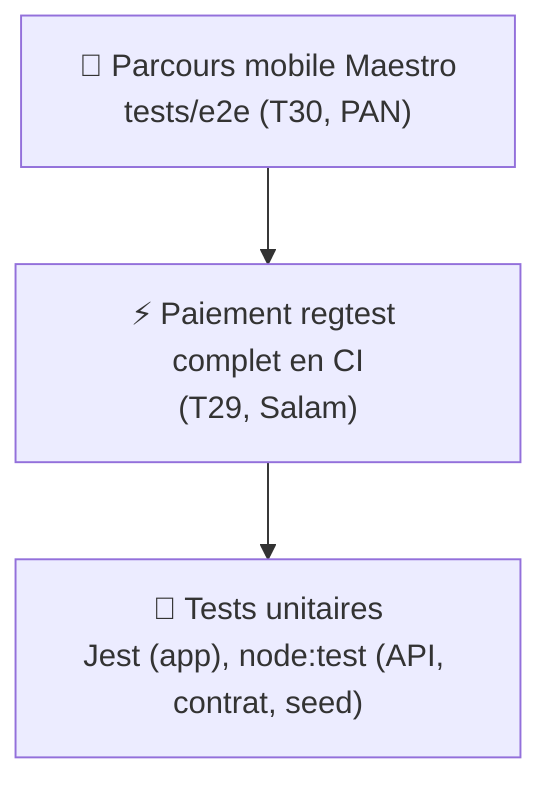

# 🧪 Tests transversaux

Ce dossier réserve les scénarios qui traversent plusieurs composants. Les tests unitaires restent à côté du code qu'ils vérifient.

| Niveau       | Ce qu'il prouve                                        | Où                                    |
| ------------ | ------------------------------------------------------ | ------------------------------------- |
| Unitaire     | Une fonction ou un écran se comporte comme prévu       | À côté du code, lancés par `npm test` |
| Intégration  | Un vrai paiement Lightning passe sur le réseau regtest | T29, à venir                          |
| Bout en bout | Une personne peut créer un wallet, recevoir et retirer | [e2e](e2e/README.md), T30, à venir    |

Aucune preuve de paiement ou de parcours complet n'est apportée par ces dossiers réservés. Les vérifications se lancent depuis la racine avec les commandes du [guide de démarrage](../docs/guides/demarrage.md).
