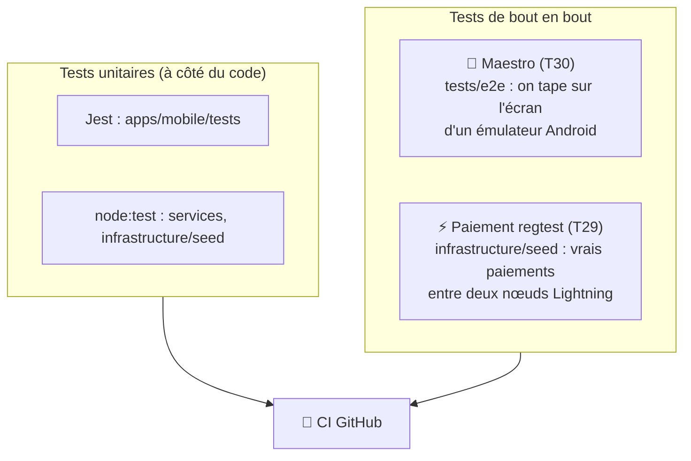

# ✅ Tests de bout en bout

> Les tests qui traversent plusieurs parties du projet. Les tests unitaires, eux, restent à côté du code qu'ils vérifient (par exemple `apps/mobile/tests`).

| Quoi                                  | Où                                                      | Commande                                                                  |
| ------------------------------------- | ------------------------------------------------------- | ------------------------------------------------------------------------- |
| Parcours de l'application sur Android | [e2e](e2e/README.md)                                    | `npm run e2e:check`, puis `npm run e2e:android -- --device emulator-5554` |
| Vrais paiements Lightning de test     | [infrastructure/seed](../infrastructure/seed/README.md) | `npm run regtest:integration`                                             |
| Tests unitaires                       | chaque dossier                                          | `npm test -- --ci` et `npm run test:tooling`                              |

**À savoir** : les parcours Maestro utilisent l'atelier fictif (sans vrai wallet). Ils prouvent que les écrans réagissent bien, pas qu'un paiement passe. Le test regtest prouve les paiements, pas les écrans. Les deux se complètent. Résultats observés : [suivi T30](../docs/planning/suivi-t30.md).
