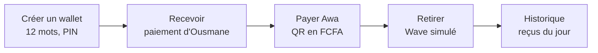

# 🧭 Parcours mobile | emplacement réservé

PAN ajoutera en **T30** les scénarios Maestro du parcours nominal ; Salam relit. Le réseau et les données de démo viennent de T12 et T29.

Aucun scénario Maestro ni test de paiement n'est encore disponible. Quand l'application sera intégrée, documenter ici les appareils ciblés, les commandes, l'initialisation fictive et les artefacts de diagnostic, sans données sensibles.
