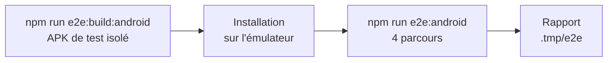

# ✅ Parcours Maestro Android | T30

> Maestro pilote un émulateur Android comme un vrai utilisateur : il tape sur les boutons, saisit du texte et vérifie ce qui s'affiche.

| Parcours                                                              | Ce qu'il vérifie                                           |
| --------------------------------------------------------------------- | ---------------------------------------------------------- |
| [`01-onboarding-fictif`](flows/01-onboarding-fictif.yaml)             | Bienvenue, code à 6 chiffres, 12 mots et leur vérification |
| [`02-parcours-nominal-fictif`](flows/02-parcours-nominal-fictif.yaml) | Recevoir, Envoyer, Encaisser, Retirer et Historique        |
| [`03-envoi-resultat-tardif`](flows/03-envoi-resultat-tardif.yaml)     | Un envoi dont la réponse arrive en retard                  |
| [`04-retrait-resultat-tardif`](flows/04-retrait-resultat-tardif.yaml) | Un retrait simulé dont la réponse arrive en retard         |

## Détails

PAN maintient les parcours dans [flows](flows/README.md) ; Salam relit. Les
quatre fichiers contrôlent l’onboarding fictif, les écrans Recevoir, Envoyer,
Encaisser, Retirer et Historique, ainsi que les résultats tardifs d’un envoi et
d’un retrait simulé. Ils ciblent l’APK debug isolé **`pay.teranga.demo.e2e`**.

Depuis la racine, `npm run e2e:install` installe le CLI épinglé puis
`npm run e2e:check` valide les fichiers sans piloter d’appareil. Le banc complet
requiert JDK 21, le SDK Android, un émulateur x86_64, l’APK produit par
`npm run e2e:build:android` puis installé, et Metro sur le port 8081. Lancer
ensuite `npm run e2e:android -- --device emulator-5554` avec l’identifiant de la
cible choisie. Voir les commandes complètes du
[guide Maestro](../../docs/guides/tests-maestro.md).

Chaque parcours remet à zéro uniquement ce paquet de test et utilise des
données inventées. Les rapports et captures vont dans `.tmp/e2e`, ignoré par
Git. Le [suivi T30](../../docs/planning/suivi-t30.md) distingue les validations
effectivement exécutées des étapes encore en préparation.

Le workflow sépare compilation et émulateur sur deux machines virtuelles. Il
transmet l’APK fictif avec son SHA source dans un artefact privé conservé un jour,
et garde les diagnostics sans APK pendant sept jours. Le contrôle de l’APK
précède son installation ; la seule compilation ne prouve aucun parcours.

Ces ateliers ne créent pas de wallet natif et ne prouvent ni un paiement
Lightning regtest, ni un transfert Wave/Orange Money. La composition avec le
wallet de Salam et la preuve financière restent distinctes des assertions de
l’interface. Les fournisseurs d’atelier sont indépendants ; leur reçu
d’historique préexiste et ne confirme pas les opérations des autres écrans.
